> **AI-assisted project.** This codebase was created with [Claude](https://claude.com/claude-code)
> (Anthropic), directed and reviewed by a human author.
> The panels render inside a real Web RCS session and the device store mirrors live, both checked
> through this proxy against **LivePremier Simulator 6.2.73**. **In field testing:** every path this
> app sends has been checked against a physical **Aquilon C** and, since 0.6.0, a physical
> **Pulse 4K**. On the Pulse the Midra port's writes were proven over AWJ, and **the Console panel
> made this app's first writes to a real device**, typed in by the operator. An **Aquilon RS4** on
> firmware 6.1.60 has since been read from, and has taken one preview opacity from the Layer tab.
> The timeline has still only ever fired at a simulator. The Status note below says which is which.

# LivePremier Plus

A small local app that adds panels to an Analog Way **LivePremier** Web RCS session. They're
drawn in Web RCS's own design language, so they look as if they came in the box rather than
bolted on afterwards:

- **Edit:** the Screens / Aux. page with one row instead of two, and that row is a programmer
  buffer that's on neither bus. You build a look with the same sources, the same 67 layer
  parameters and the same memory bank, and nothing reaches the switcher until you save it.
  Then it goes straight into a real memory slot, with no preset buffer written and no take
  fired.
- **VPU Map:** the device's mixing-resource allocation, drawn as a budget. It shows which units
  are fitted, who's holding them, what's spare, and what a staged preconfig would change. On
  firmware that reports no mixer map (6.1.60 doesn't) it shows each screen's layer sizes and the
  room left on the box instead.
- **Console:** Mynah's command line, which is a lighting-desk grammar for a video switcher:
  `Recall Screen 1 Memory 5`, `R Sc 1 Th 4 Me 5 Pre`, `Take Screen 1`. It takes raw AWJ, raw
  Web RCS store writes and OSC addresses too, tells you what a line will do before you press
  Enter, and pops out into a window of its own. On a Midra 4K or Alta 4K it routes audio as
  well: `Set Audio Patch Input 3 To Screen 1`.
- **Audio Matrix:** a LivePremier's audio channel matrix as a crosspoint grid, with inputs and
  Dante down the side and outputs, Dante and multiviewers across. It opens as blocks (click one
  to lay a source across a destination 1→1 … 8→8, or to clear it), and a header opens into its
  eight channels for single crosspoints and mutes. Nothing lights until the switcher echoes it,
  there's a Lock for when the show's live, and it pops out. Only proven on the simulator.
- **Timeline:** a theatre-style cue stack. It's a numbered list that steps on with one GO, with
  fade, delay and follow times per cue, and it drives the switcher's preset recalls and TAKE. A
  cue can also carry a **timecode** and fire when MIDI Time Code, LTC from an audio input, or
  timecode pushed from another machine goes past it.
- **Memories:** all three banks (master, screen and layer) in one list, with search, renaming,
  and which buffer is holding each memory right now. A recall names its target buffer every
  time and never defaults to program. It pops out onto a second monitor.
- **Layer:** every one of a layer's 67 properties, generated from the device's own parameter
  catalogue rather than typed out by hand, so a firmware that adds one grows a field for it.
  **Name a layer** here and the name turns up in the vendor's own layer lists, which is handy,
  because the switcher itself has nowhere to keep one.
- **Layer Groups:** several layers, on one screen or on many, driven as one. Layer 2 on screen 1
  with layer 1 on screens 2 and 3 is *the side screens*, and a ganged group follows a source
  change made to any of its members, wherever that change came from.
- **Layer Lock:** lock a layer and a take leaves it where it is, or take one layer (or one group)
  on its own. The switcher can't do either, because a take swaps the whole preset buffer. So a
  locked layer's preview copy is kept equal to program, and every TAKE or CUT sent from this
  page, the vendor's own button included, is held for the moment it takes to line it up. Takes
  from the front panel, a T-bar or OSC aren't held, and the panel says so.
- **Preview lock during takes** (off until you switch it on): press TAKE, recall the next memory
  a moment later, and the switcher loads it into the buffer that's fading up, so it rides the
  take onto program, which nobody wanted. This shuts the vendor's own PRW padlock on a screen's
  card for as long as that screen is transitioning, so Web RCS refuses the recall with its own
  warning, and opens it again when the take lands. It never opens a padlock you shut yourself.
  This app's own recalls (Timeline cues, the Memories panel, the Console) wait instead: a recall
  into a preview that's mid-take goes the moment the take lands, and cues fire in the order GO
  was pressed. Companion, OSC and the front panel aren't held back.
- **Pixel Map:** pick an image from the switcher's own library and it's laid over a screen's
  preview on the Screens / Aux. page: the LED wall's outline, the gaps between its panels, the
  set piece cut out of the middle of the raster. In Mask mode black in the map hides what's under
  it, so while you're building a look you can see what the wall will actually show of it. It costs
  no layer, writes nothing to the switcher, and every click goes straight through it to the layers
  underneath.
- **Surfaces** (off until you switch it on): mark out the LED elements a screen actually lands on,
  as rectangles on its canvas, and bind layers to them. A bound layer stays inside its surface
  however it's moved: the vendor's own drag, nudge, fields and toolbar, the Layer tab, the
  Console, a cue. Full screen fills the surface rather than the canvas, and the align buttons
  align to it. The outlines are drawn on the screen cards so you can see the edge coming.
- **UMD Generator** *(preview, off by default)*: an aux laid out as a multiviewer has the
  pictures and none of the furniture. This draws the furniture: a hairline round each box and a
  dark tab with the source's name, as one transparent PNG worked out from where each
  layer actually is and what it's showing. It goes on an aux's top layer through a still, or to the
  Background Slicer for a screen's background, and there are 1, 3, 5 and 7-box layouts to start an
  aux from.
- **Aux follow** (off until you switch it on): give an aux's layer a screen layer to follow and it
  takes whatever source that layer has, however it got there: the vendor's drag, a memory, a
  take, the front panel, Companion. In *Program* the aux's program cuts to match when the screen's
  take lands; in *Program and preview* it follows role for role, so an aux taken with the screen
  transitions with it. The switcher has no such link, so it's kept by the page: with no
  LivePremier Plus page open, nothing follows.
- **AoI from a custom format** (off until you switch it on): an LED wall defined as a custom
  format, say 3000×1000, can't go down SDI as one, because SDI only carries standard formats. So
  the SDI output runs a standard format big enough to hold it, and its AoI is the wall: pick the
  custom format under the output's AoI on Preconfig ▸ Canvas, top left, top centre or centred,
  and it's set the way the vendor's own AoI fields set it. The output's footprint on the canvas
  becomes the wall's size, so the canvas is laid out in the wall's own pixels.
- **Send to:** a `…` on every source card that routes it without dragging: preview or program,
  then a screen and layer or a whole group. It respects the vendor's own PGM padlock and asks
  before it steps past one.
- **Matrix Routing:** patch the frame's own SDI and HDMI sockets to ports on a Blackmagic
  Videohub, a Lightware or a Turtle AV router, and route through it from the panel, a cue, the
  Console or OSC. You describe the cable, and it turns the direction round for you.
- **HyperDecks:** Blackmagic HyperDecks, and Mitti through its HyperDeck control, played, cued
  and recorded from a panel, a cue or OSC. Link a deck to the input it feeds and it can follow
  the show the way Mitti follows an ATEM: play when it goes on air, load the next clip when it
  comes off, and take when its clip ends, a set number of seconds early so the mix lands on the
  last frame.
- **Dante** *(preview, off by default)*: the Dante audio network's routing as a crosspoint grid
  next to the switcher it feeds. Devices are found over mDNS, and you get every receive channel's
  subscription and its status, a click to subscribe or clear, snapshots recalled from a cue or
  OSC, and **Dante Controller presets**, written for Dante Controller to load, or read back and
  shown as a difference before anything's applied. The switcher's own Dante card is marked, with
  its Audio Matrix patching beside its channels. It hasn't been run against a real Dante device
  yet.
- **EDID builder:** the Otter EDID editor on the switcher's own EDID page. **From Formats**, a
  tab beside Default EDIDS and EDID Bank, builds one EDID per custom format in Setup ▸ Formats
  (every porch kept, and the CTA VIC carried when the raster matches one) and saves it into the
  bank in one click, or keeps the bank topped up with them by itself. **Create EDID…** and an
  **Edit** tool on every bank slot open the full editor in its own window, Mosaic mode for tiled
  multi-plug EDIDs included, and save straight into a slot.
- **Companion:** a Bitfocus Companion linked to this app. Its pages of buttons are drawn in the
  app's own look, live and pressable, and you can pop them out onto a second monitor. There's a
  **Companion trigger** on every cue and every memory recall, so the show presses the buttons as
  it runs, and Companion's own editor is served on the same address as Web RCS, with no second
  port and no CORS. A panel lists the show's actual connections, follows them live, and offers to
  add the AWJ and LivePremier Plus connections pointed at whichever switcher you're on, telling
  you what it'll create before it does.
- **Pitch Compensation:** a screen spanning LED walls of different pixel pitches needs H and V
  ratios per output. The device has the fields for them and no help whatsoever filling them in.
  Give this the pitches and it reads everything else off the switcher, then writes the ratios on
  a second press.
- **OSC input:** QLab, TouchOSC, a lighting desk or Companion drive the switcher over UDP, with
  no browser open. It's off until you turn it on, and every address is in
  [docs/OSC.md](docs/OSC.md).
- **MIDI Mapping:** a control surface driving the switcher from the page itself: faders to
  opacity, encoders to size and position, buttons to select.
- **Speed Editor** *(preview)*: a DaVinci Resolve Speed Editor as a switcher panel, plugged into
  the machine this app runs on. CAM 1–9 put a source on the selected layer, CUT and DIS cut and
  take, and the wheel moves opacity, position, size or the T-bar. Proven on a real panel over
  USB, 2026-09-25.
- **Pixelhue panel** *(preview)*: a Pixelhue U5, U5 Pro or U5 mini drives the switcher from a
  model of it rather than from a key map, and **Pixelhue Mapping** draws the console so you can
  give every key, fader and encoder a different job. It hasn't been run against a real console
  yet.
- **Barco EC panel** *(preview, off by default)*: a Barco EC-30, EC-40 or EC-50 plugged into the
  machine this app runs on drives the switcher with no browser open. Screens on the destination
  keys, layers on the layer keys, inputs, stills or memories on the labelled rows, ALL TRANS, CUT
  and the T-bar. It hasn't been run against a real panel yet. [docs/BARCO-EC.md](docs/BARCO-EC.md)
- **Thumbnail relay** *(preview, off by default)*: the switcher's source thumbnails re-encoded
  as JPEG and shared between pages. That's a twentieth or less of the bytes the vendor's pages
  would otherwise pull, and every Web RCS tab gets it without a change to the vendor's code. It
  hasn't run against a real frame yet.
- **Multiviewer thumbnails** *(preview, off by default)*: the switcher's multiviewer, captured or
  streamed into the browser, cut up into its sources and put into every thumbnail instead of the
  once-a-second PNGs, so you get live pictures at up to 25 frames a second. The store gives each
  tile's position, so there's nothing to calibrate by hand. On a Midra 4K or Alta 4K the
  switcher's own H.264 streamer can be the feed. It hasn't met a real multiviewer yet.
- **Background Slicer** *(preview, off by default)*: one picture laid over one or more screens
  and cut into a background per output, pixel for pixel. Each screen's canvas is drawn with its
  outputs, groups and slices, and you place the picture by dragging or by numbers. Before
  anything's written you get a plan of every free library slot, still and background set it'll
  take. Then it uploads the images, sets the stills, raises still capacities only where nothing
  in use gets displaced, and fills the set, with an Undo. Its live-input mode feeds each
  output's background from an input instead, loads each input with the switcher's own EDID for
  that output, and exports the map the media server needs: a Resolume Arena Advanced Output
  preset, disguise, Pixera, Hippotizer, Millumin and TouchDesigner files, and a pixel-map pack
  for everything else. On a Midra 4K or Alta 4K it cuts one picture per screen instead (the
  canvas, through a Background Image shown 1:1, which an Auto Crop set has the switcher crop for
  each output), or fills a Custom set with an input per output. Only proven on simulators. It opens a PDF or a PowerPoint deck too, and makes a background set per
  page, or every page a still at whatever size you type.
- **Your setup in one file:** the cue stack, layer groups, names and locks, your variables,
  pixel maps, surfaces, UMDs and Companion triggers, the routers and the patch to them,
  HyperDecks, Dante snapshots and settings, written as one plain JSON file and read back the same
  way, so a rig comes back whole alongside its `.awc`, not just the half the `.awc` holds.
- **Remote access:** reach the app from somewhere else over Tailscale or ZeroTier, with HTTPS on
  the tailnet name if you want MIDI and LTC to work from the far end too. The card lists every
  door that's open, because an address that works from home also drives the switcher from home.
- **Arithmetic in the vendor's own numeric fields:** type `1080-80` into a layer width and get
  1000, the way you can in every other tool on the desk.
- **Variables:** `$S1.width`, `$IN3.rate` and `$S1.PGM.L2.x` for what the switcher reports,
  generated from whatever rig it is, and `@gap`, `@half` and so on of your own, wherever a
  number goes: `Set Screen 1 Layer 2 Size ($S1.width / 2) $S1.height` at the Console, `$S1.width/2`
  in a width field, `"@gap * 3"` in an OSC argument. A role mid-take is refused,
  never guessed. They only read; see [docs/VARIABLES.md](docs/VARIABLES.md).
- **Mosaic inputs:** the EDID builder's Mosaic mode, carried through to the frame. Group inputs
  2X1 or 2X2 and load each plug with its tile EDID, and a Mac joins several outputs into one
  frame-synced display.

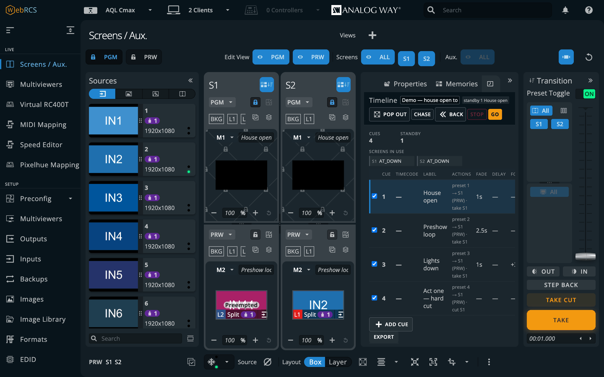

<sub>The Timeline tab on the vendor's own Screens / Aux. page, against Analog Way's
LivePremier Simulator 6.2.73. Every screenshot here is the app itself, taken with
`npm run demo`.</sub>

Every one of these is a plugin you can switch off, in Preconfig ▸ LivePremier Plus → Plugins,
and a switched-off feature leaves no menu entry, route or background service behind. You can
add your own, too: a folder in `~/.livepremier-plus/plugins/` (or `/config/plugins/` in Docker)
with a `plugin.json`, a server half and a page half. They start switched off and only run once
you switch them on. [docs/PLUGINS.md](docs/PLUGINS.md) is the guide, and
[`examples/plugins/hello-switcher`](examples/plugins/hello-switcher) is the template.

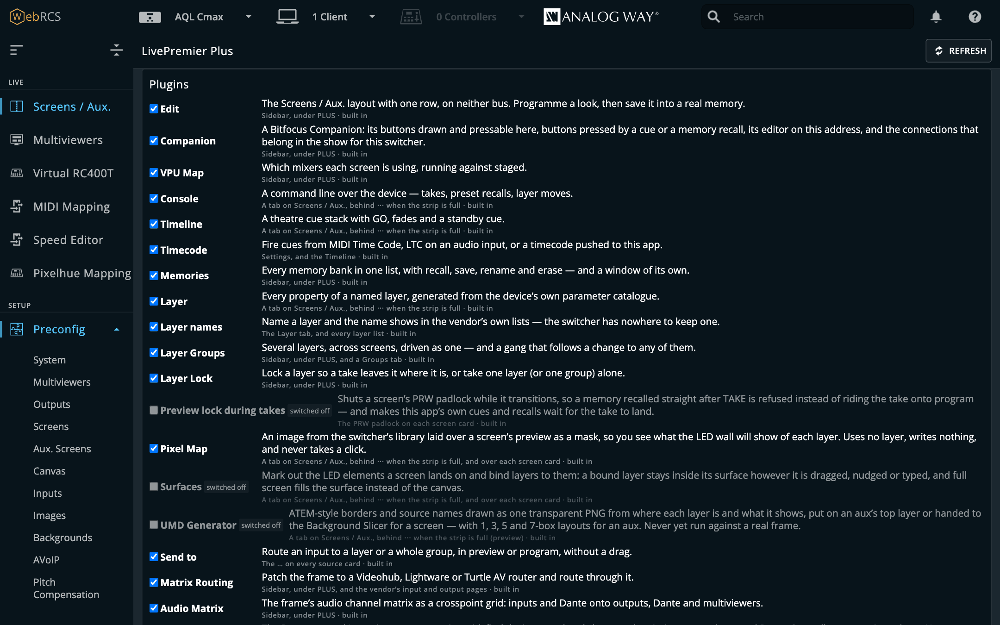

Point it at a switcher, open the address it prints, and you get the vendor's own Web RCS with
the extra panels already in it. The panels ride the vendor app's own WebSocket, so there's no
second Web RCS connection to the device, no replacement UI and nothing to install in the
browser. (OSC input, the Pixelhue panel, the Console's `AWJ get` and the Edit page's direct save
and memory export each open a brief AWJ connection of their own when they act, and the switcher
has a budget of five AWJ clients.)

It runs as a desktop tray app for macOS, Windows and Linux, as a Docker image, or from the
command line with Node 20. It works on a **LivePremier**, and on a **Midra 4K or Alta 4K** for
most of it: everything bar the VPU Map, Matrix Routing, Audio Matrix, Mosaic inputs, Pixel Map
and Surfaces, and the pages that hang under Virtual RC400T (MIDI Mapping, Speed Editor, Pixelhue
Mapping), which that platform's sidebar doesn't have. [Platforms](#platforms) has the detail.

> **Status: field testing, v0.17.8.** The panels render inside a real Web RCS session and the
> device store mirrors live. Both are verified through this proxy against LivePremier Simulator
> 6.2.73, along with cue-stack persistence and the whole setup flow. The VPU map has been **read
> from a live Aquilon C** and is tested against that capture, including Optimized mode,
> interleaved output links, and a staged preconfig that differs from the running one. It has
> also been read from a live **Aquilon RS4 on firmware 6.1.60**, which reports no mixer map at
> all, not even over its own protocol; there the panel shows each screen's layers and the room
> left on the box instead. Both were read only, never written to.
>
> **The Edit page was driven on a simulator on 2026-09-22**, and what it claims was measured
> rather than taken on trust. All three of S1's preset buffers were read over AWJ before and
> after a full editing session (seed from program, a source dropped on a layer, a layer dragged
> and resized) and came back **byte-identical**. A look was then saved into memory 900 by the
> direct route, and the device reported the slot valid with the operator's label, with those
> three buffers still identical. The memory was read back into an emptied programmer, 132
> properties, with the dragged position exactly where it had been left, and a second look went
> into 901 by the preview route, with preview put back property for property afterwards. Both
> test slots were deleted.
>
> ⚠️ **The direct route has an open question on real hardware.** The path the device extracts
> the memory file from is on the *switcher's* filesystem. On a simulator that's the same machine,
> which is why it works here. On an Aquilon it's the box's own disk, and Web RCS 6.2.73 has no
> memory import and no upload route for one. That's why the preview route exists as well (it's
> also the only route on Midra 4K and Alta 4K, whose banks have no import at all), and why the
> directory is a setting rather than a constant.
>
> **Companion was driven against a running Companion 5.0.5 and a LivePremier simulator on
> 2026-09-22.** The mounted Buttons page loaded same-origin with its grid drawn and one socket
> relayed. The panel listed the show's three actual connections with live status, and its feed
> followed a connection being disabled and re-enabled. An AWJ connection was added, configured
> and reported `good`.
> The cross-origin WebSocket check was confirmed live: `101` for the page this app served and for
> a client sending no Origin, `403` for a forged origin and for the `null` a sandboxed iframe
> sends. **The LivePremier Plus connection can't be added yet**, because there's no LivePremier
> Plus Companion module yet, and the panel says so in those words. It was merged into 0.11.0
> after the Edit page. The merged proxy, settings and panels were re-checked through the proxy,
> but not against a live Companion a second time.
>
> **Layer groups and the send-to menu were driven on a simulator on 2026-09-21**, against a
> preconfig staged for the purpose: two screens on **opposite preset letters** (S1 at `AT_UP`
> with program B, S2 at `AT_DOWN` with program A), which is the only arrangement where getting
> the role conversion wrong shows up. A change to S1's layer 2 in letter B was followed onto S2's
> layer 1 in letter **A**, leaving S2's preview alone. A group send in preview wrote both members'
> preview buffers and neither program. A program send was held behind the confirmation step while
> the vendor's PGM padlock was shut and went straight through once it was opened, both read from
> the vendor's own buttons. No physical LivePremier has seen any of it.
>
> **Verified against real hardware (Aquilon C `NLC_C`, firmware 6.2.73, 2026-09-09).** Every
> path this app sends was checked against the box: the command table resolved with no `E12`, the
> VPU collections answered, and the pitch paths resolved. That confirmed
> `pitchedWidth`/`pitchedHeight` really do live under `canvas/status`, and that the output
> collection key is numeric (`1`), not `OUTPUT_1`, which the device refuses. The device store was
> pulled whole (124 MB) and the VPU model re-checked against it rather than against a capture.
> Nothing disagreed with what the simulator had taught me.
>
> **The VPU map's header is part-verified from that same pull (2026-09-15).** The header over the
> grid's columns names each link's region and output plug from `outputList` (`usedInScreenAux`,
> `usedInRegion`, `capability`, the mapping and the plug type), and every one of those fields is
> in the store the box gave me, with each screen's outputs adding up to its own figures
> (`test/fixtures/aquilon-c-dual-outputs.json`). **Not yet verified on a box: the order a
> screen's links run in over several outputs.** Every screen on that pull had one, so a screen
> whose outputs don't add up gets no header. The next time an Aquilon is within reach,
> aquilon-vpu-map's `scripts/probe-hardware.mjs` step 6 and its capture guide say what to check.
>
> **Driven in a browser against the box (2026-09-10).** The sidebar entries and the two
> Preconfig flyout pages have now been opened and navigated against a live Aquilon C in an
> ordinary browser session, not just against the simulator. That's what turned up the blank page
> fixed in 0.4.1: closing a panel handed back a `display: none` the panel had written itself, and
> Web RCS carried on routing and rendering into an element no wider than nothing.
>
> **The Memories and Layer panels (new in 0.5.0) were driven against the same box** the day they
> were written: 85 screen memories listed under their real names, and program/preview resolved
> and checked against the device's own `presetUp`/`presetDown`/`transition`. Their writes
> (recall, save, erase, rename, and a layer property with its clamp) were exercised with the
> socket **stubbed**, so the paths and values are proven and the switcher received none of them.
>
> **Midra 4K and Alta 4K (2026-09-12).** The Timeline, Console and Layer tabs, the Memories panel
> and Pitch Compensation now work on Analog Way's other platform too, every model of it. The
> object model was read off a **live Pulse 4K** (firmware 3.3.10, read-only, mid-show), and the
> port was then driven against the **Midra 4K simulator as a Pulse 4K and the Alta 4K simulator
> as a Zenith 200**. Cues fired through the panel's own GO (recall → fade → take, with the device
> echoing each step back), and memories were saved, renamed and recalled through the Memories
> panel, the aux bank included. QuickVu, Eikos, QuickMatrix and Zenith 100 stores were captured
> and checked too, and all six share one object model. [Platforms](#platforms) has what is and
> isn't offered there.
>
> **Proven on the live Pulse 4K (2026-09-12/13).** With the show's screens frozen, a test harness
> ran the port's whole write vocabulary against the box: `takeTime`, store, label, recall into
> the buffer the `UP`/`DOWN` rule names, a recall of an empty slot (silence, as documented), two
> TAKEs with preview holding program, restore and delete, a layer opacity on preview, a
> multiviewer layout and a pitch ratio. **39 checks, none failed**, and the baseline re-read
> identical apart from the device's own bookkeeping. The next morning the operator typed the
> Console's lines at the box itself: the four offline refusals, then a backup, a recall to
> preview, a `takeTime` over the OSC spelling, and the restore. Those were **the first writes this
> app's own panels have made to a physical device**, and all went as expected. (The
> `Set … Opacity` typed in the same run was refused by that build's Console, which handed the compiler
> no device facts. That's the bug 0.7.0 fixes; the opacity write itself is the harness's W7.) Two
> things only hardware could show: with *preset toggle* off, a take passes `COPY_FROM_x` after
> its effect, so the settle is takeTime plus ~250 ms, and `isLoading` is a real 30 ms window
> where the simulator's is zero. `docs/NOTES.md` has the rest.
>
> **0.17.8 (2026-10-19).** Fixes, mostly for a Midra 4K or Alta 4K. Seven in-panel buttons and
> the Edit, Layer Groups and Groups icons drew blank there (or, for some, on every switcher),
> because they asked for sprite ids those web clients don't have; a test now holds every icon to
> the sprites of each switcher it's offered on. The console's **MVR** key opens the live
> multiviewer on a Midra too, and **SOURCE BACKUP** says a Midra input has no backup instead of
> looking for a menu that isn't there. **Pixelhue Mapping** now sits at the foot of PLUS on a
> Midra or Alta, and the Plugins card says why MIDI Mapping and the Speed Editor aren't offered
> there. **Preview lock** now shuts PRW when the take comes from the vendor's own TAKE button as
> well as from this app. All of it was checked on simulators (LivePremier 6.2.73, Midra 4K
> 3.2.29), not on a frame.
>
> **0.17.7 (2026-10-16).** Adds the **UMD Generator**, off until you switch it on. An aux laid out
> as a multiviewer has the pictures and none of the furniture; this draws the furniture (a hairline
> round each box and a dark tab with the source's name) as one transparent PNG worked out from where
> each layer is and what it shows. It goes on an aux's top layer through a library
> slot and a still, updates by uploading again, and asks first when that's on air. For a screen it
> hands the PNG to the Background Slicer, which cuts backgrounds per output. Templates of 1, 3, 5
> and 7 boxes start an aux, because its layers come in pairs with its capability and the top one
> is the UMD's. Proven on LivePremier Simulator 6.2.73 only, every write checked over AWJ; not run
> on a real frame, so whether a frame keys the still's transparency is the first thing to look at.
>
> **0.17.6 (2026-10-16).** Adds **Surfaces**, off until you switch it on. Mark out the LED
> elements a screen's canvas really lands on (a wall in pieces, a header strip, a pair of IMAG
> screens) as rectangles on that canvas and bind layers to them, and a bound layer is kept inside
> its surface: full screen fills the surface rather than the canvas, the vendor's align buttons
> align to it, and a drag stops at its edge, on Screens / Aux. and the Edit page alike. Writes
> leaving the page are put right before they go, so the switcher never sees a bound layer outside
> its surface; a change from anywhere else is pulled back on preview and only flagged on program.
> It's proven on LivePremier Simulator 6.2.73 only. On 6.1.60, the RS4's firmware, it's proven by
> comparing the vendor's bundle: the same align buttons and the same drag code, but that simulator
> has no screen in service, so nothing was dragged there. Not run on a real frame yet.
>
> **0.17.5 (2026-10-16).** Adds **Pixel Map**. Pick a picture from the switcher's own image library
> for a screen and it's laid over that screen's preview on Screens / Aux. as a mask, so you can see
> which bits of a layer will end up on LED and which on the scenery. It uses no layer, writes
> nothing to the switcher and takes no clicks, so the layers under it still select, drag and zoom
> as normal. It's proven on LivePremier Simulator 6.2.73 only. On 6.1.60, the RS4's firmware, it's
> proven by comparing the vendor's bundle: the image library and its routes answer the same and the
> card is drawn by the same code, but no 6.1.60 card has had a map on it. Not run on a real frame
> yet.
>
> **0.17.4 (2026-10-16).** One change to the **VPU map** on a box with no mixer map. Every screen in
> service on the RS4 reports the same spare room, so the Screens table's Room for column repeated
> one figure down every row and invited adding it up. The room is now said once, under the table,
> as the box's, with the mask figures; screens that ever report different figures keep a column of
> their own. Drawn from a fresh read-only pull of the RS4's store: 19 DUAL · 9 4K · 4 5K, said once.
>
> **0.17.3 (2026-10-16).** Fixes from an Aquilon RS4 on firmware 6.1.60, and one found retaking
> the screenshots. The **Screens / Aux. strip** puts the plugin tabs behind a ⋯ instead of running
> them off both sides of its panel. The **VPU map** no longer calls a live box a simulator, and on
> 6.1.60, which reports no mixer map at all, it shows each screen's layer sizes and the room left
> in the staged configuration instead of an empty panel. The **Layer tab** and the Edit page offer
> only the sources the switcher has, and only the kinds the layer can take. **Arithmetic** works in
> 6.1.x number fields. And **two saves of one file at once** no longer lose one, which renaming
> layers quickly could do. The strip was measured on the RS4, and the source list and the VPU
> sizes were drawn from read-only pulls of its store; arithmetic and the VPU wording were run on
> Analog Way's 6.1.60 simulator, whose page is the RS4's own, and nothing was typed into the box.
>
> **0.17.2 (2026-10-13).** Three fixes, all found by the new live test suite against the rack's
> simulator. **Mosaic inputs** offered an input that already belonged to a mosaic as the start of
> another one (with IN_17 + IN_18 grouped, it offered IN_18 + IN_19); it doesn't any more. The
> **Thumbnail relay** counted a frame answered 304, with no body, as sent in full, so its card
> overstated the traffic to the pages and understated what it saved; it now counts only what it
> sends. And a plugin that's off because a plugin it needs is off (Timecode, with Timeline
> switched off) says so on its routes, instead of claiming its own switch is off. Proven on
> LivePremier Simulator 6.2.73 only.
>
> **0.17.1 (2026-10-11).** The **Background Slicer**'s LivePremier apply now waits for the
> switcher's own echo. It had been taking its own outgoing write as the answer, so a write the
> switcher refused read back as landed. Apply, Undo and the capacity change now wait for the
> inbound frame, as the Midra apply already did. Proven on LivePremier Simulator 6.2.73 only.
>
> **0.17.0 (2026-10-06).** **Variables**: `$` names generated from the device store and `@`
> names of your own, with bracketed arithmetic, wherever a number goes (the Console, OSC input
> and the vendor's own numeric fields; not cues yet). **Preview lock** (off by default) shuts the
> PRW padlock while a screen transitions, so cues, Memories and the Console wait for a take to land.
> **Dante** and the **Background Slicer** arrive as previews, off by default. Dante has only
> talked to a simulator. The Slicer (one picture cut into pixel-exact backgrounds, on LivePremier
> and on Midra 4K / Alta 4K) has run on simulators only, its rotated outputs, output groups and
> non-1.000 pitch ratios are unproven, and its Resolume preset has never been opened in Arena.
> The Edit page speaks Midra 4K / Alta 4K, and HyperDeck commands end with a bare line feed, so
> Mitti accepts them.
>
> **0.16.0 (2026-09-25).** The **Speed Editor** now works on a real panel. It moved off WebHID,
> which can't read the panel's handshake on macOS, into the **device host**
> ([devices/](devices/README.md)), a separate program that the app starts and restarts and that
> holds USB panels, one module per device. CUT, the CAM keys, the wheel, the battery level and a
> replug are proven over USB on macOS; the key lamps and Bluetooth haven't been tried yet. The
> desktop app carries the host, and a checkout installs it with `npm run setup:devices`. The
> same test found CUT and TAKE firing only once on a switcher that leaves `xCut` true, which is
> fixed in the shared engine, so MIDI Mapping's triggers get the fix too. **Audio Matrix**
> *(LivePremier)* draws the frame's audio channel matrix as a crosspoint grid: sources by blocks
> or channels, per-channel mutes, signal-present dots, and it pops out. **Remote access** serves
> the app over Tailscale (HTTPS through `tailscale serve`, or the tailnet address) or ZeroTier.
> **Multiviewer thumbnails** *(preview, off by default)* cut a captured or streamed multiviewer
> into its sources and put live pictures in every thumbnail. The HyperDecks' `end` and `preview`
> OSC addresses are published now, and a trigger's release sends nothing. Audio Matrix, Remote
> access and Multiviewer thumbnails are proven on the simulator (Remote access against real
> Tailscale and ZeroTier), not yet against real hardware.
>
> **0.15.0 (2026-09-23).** Six new plugins, each proven on the simulator only. **Layer Lock**
> keeps a layer through a take, or takes one layer on its own. The switcher can do neither, so
> both are built from a layer that's identical in program and preview; takes from the front
> panel, T-bar, OSC or direct AWJ aren't held. **HyperDecks** plays, cues and records Blackmagic
> HyperDecks (or Mitti's emulation) with Mitti-style rules that follow the show: play on
> program, rewind in preview, take off air when a clip ends. An **EDID builder** on the Setup ▸
> EDID page builds one EDID per custom format with Otter, saves it into the bank, and opens the
> whole Otter editor on any slot. **Mosaic inputs** group inputs 2X1/2X2 and load each plug with
> its tiled EDID, so a Mac joins them into one display. **Pixelhue Mapping** draws the U5 as a
> Virtual RC400T with every key, fader and encoder remappable. **Speed Editor** *(preview)*
> drives the switcher from a DaVinci Resolve Speed Editor over WebHID, not yet tried with a
> physical panel. None of these had met real hardware at 0.15.0; the Speed Editor met a real
> panel in 0.16.0, above.
>
> **0.14.0 (2026-09-23).** **Thumbnail relay** *(preview, off by default)*: the switcher's source
> thumbnails re-encoded as JPEG and shared between pages, at a twentieth or less of the bytes.
> The sources being edited on Screens / Aux. refresh up to 10 times a second while the rest are
> held; see [Thumbnail relay](#thumbnail-relay--preview). **Placeholder routers** in Matrix
> Routing: a Videohub, Lightware or Turtle AV model of the right size with nothing on the other
> end, so a show's routing can be built before the rack turns up, then taken live with **Push
> plan**. **Companion** draws its button pages natively instead of embedding Companion's own,
> and a cue or a memory recall can press a button. The **Edit page** gives each destination the
> full column, as the vendor's PRW-only view does. The **Pixelhue panel** *(preview)* gains layer
> binding and stepping, store and delete, the T-bar, TIME and SWAP, SIGNAL SOURCE, LOCK PANEL,
> faders and encoders, cue transport, MVR and SOURCE BACKUP, and fade-to-black and freeze on
> LivePremier, all proved against PixelFlow's virtual U5 and the simulator and still never a
> console. Its WebSocket handshake is fixed too: a typo in the RFC's magic string meant no real
> UCenter would ever have accepted it. The tray app now stops its server with SIGTERM, so it
> saves its state and nothing it started is left running.
>
> **0.13.0 (2026-09-23).** **Every feature is a plugin.** Each panel, page and background
> service (the Console, the Timeline, Matrix Routing, Companion and the rest, eighteen in all)
> is its own plugin, and each can be switched off in **Preconfig ▸ LivePremier Plus → Plugins**.
> Off means gone, with no menu entry, route or background connection left behind. **Plugins of
> your own** go in the data directory's `plugins/` folder and stay off until you switch them on;
> [docs/PLUGINS.md](docs/PLUGINS.md) is the guide, with an example to copy. Fixed on the way: a
> panel no longer loses the caret, the selection or half-typed text to the once-a-second
> repaint, and an open dropdown no longer closes under the pointer. The Companion link no longer
> drops every 35 s, and its embedded editor no longer reloads every second. Pointing the app at
> another switcher no longer stops OSC input, the routers, Companion or the Pixelhue panel until
> a restart, and restoring a setup file now reaches the running app, not just its files.
> ⚠️ The Companion, Pixelhue, OSC input and Edit-page settings now live inside their plugins. An
> upgrade moves them for you; going back to 0.12.0 loses them.
>
> **0.12.0 (2026-09-22).** **Router routing on the vendor's own pages.** There's a **Router**
> tab on Inputs ▸ an input and Outputs ▸ an output, and a **Router** box in Preconfig ▸ Inputs /
> Outputs. Each shows which router port the cable is on (patchable in place) and the router's
> ports as a grid of tiles and as a list. An input picks one source and routes on the click; an
> output picks any number of destinations and sends them on **Route**. Nothing lights until the
> router reports it. Proven against the simulator and a Videohub emulator, not yet against a
> real router.
>
> **0.11.0 (2026-09-22).** **Companion**, served inside this app. A Bitfocus Companion's admin
> pages, web buttons and emulator open on the same address as Web RCS (Companion's own sub-path
> support with this proxy in front, so there's no second port and no CORS), and a panel lists
> the show's actual connections, follows them live, and offers to add the AWJ and LivePremier
> Plus connections pointed at the switcher you're on, saying what it'll create before it does.
> Companion's cross-origin WebSocket check is re-made here rather than bypassed. The LivePremier
> Plus connection can't be added until a Companion module for this app exists, and the panel
> says so. Linking a Companion also puts its admin UI behind this proxy, which is why the
> binding-wide warning now names it.
>
> **0.10.0 (2026-09-22).** The **Edit page**: the Screens / Aux. layout with one row instead of
> two, and that row is a *programmer*, a buffer that's on neither preview nor program. Same
> sources, same sixty-seven layer parameters and same memory bank, with a stage you can drag and
> resize a layer on, and nothing reaches the switcher until you save a memory. Saving offers two
> routes and says what each costs: **direct**, which writes the bank itself through a facility
> Web RCS doesn't expose (no preset buffer, no take), and **via preview**, which borrows the
> preview buffer, fires the switcher's own save and puts preview back property for property.
> `docs/NOTES.md` has the device work behind it, including why the third preset buffer C looks
> like the answer and isn't.
>
> **0.9.0 (2026-09-21).** Two things an operator keeps doing by hand. **Layer Groups** name a set
> of layers across screens and drive them as one (a ganged group follows a source change made to
> any member, whatever made it), and a **`…` on every source card** routes an input to a screen
> and layer, or to a whole group, in preview or program, without a drag. You write a *role*,
> never a preset letter, because which letter is program changes on every take. **Matrix
> Routing** patches the frame's own SDI and HDMI sockets to ports on a Blackmagic Videohub, a
> Lightware or a Turtle AV router: you describe the cable, the direction turns round by itself,
> and the crosspoints are reachable from the panel, a cue, the Console and OSC. The Videohub
> driver was driven end to end against a working implementation of that protocol. The Lightware
> and Turtle AV drivers are written from their vendors' documents and haven't met the hardware;
> `docs/MATRIX.md` says how to prove each on your own kit.
>
> **0.8.1 (2026-09-18).** The desktop launcher tells you why a start failed. Pressing Start with
> the port already held (another copy of the app, or the proxy started by hand) used to look like
> nothing happening. Now it says so on the click and keeps Open available, names a port the OS
> refuses or an interface address that's gone, and quotes the last output lines of a proxy that
> dies right after starting. The shell is av-launcher 21bc307; nothing in the proxy or the panels
> changed.
>
> **0.8.0 (2026-09-17).** The VPU map reads the grid top to bottom, the way an output link runs.
> The native band sits above the eight layer links, and a screen whose next layer landed on
> another VPU keeps its columns there: the two cards stack and the link draws straight down out
> of one and into the next. A header over the columns names each link's region and output plug
> from `outputList`, with the real Aquilon C outputs of 2026-09-09 as a fixture. The desktop
> launcher now stops the proxy it supervises on every exit path (⌘Q and Quit from the Dock left
> the Node process holding the port); the shell is av-launcher 2c83ad7.
>
> **0.7.0 (2026-09-13).** Three things, all proven on the simulators and not yet on hardware.
> **Audio routing on Midra 4K / Alta 4K**, at the Console: `Set Audio Patch Input 3 To Screen 1`
> writes the preset's audio layer, `Follow Layer 2 On Screen 1` or
> `Follow Screen 2 On Line Output 1` sets what a point follows, and `Mute Output 1 Channel 3 Thru 4` mutes where the
> device keeps it. That's mynah 1.5.0, vendored; the vendor's own header dropdown changed to
> "Input 3" when the line was typed at the Pulse simulator. **A loopback door for a LAN-bound
> server**: bind to an interface and it still answers on `127.0.0.1`, a browser on the same
> machine arriving by the LAN address is sent there, and the secure-context note names the page
> that's actually open. **And the Console now hands mynah the device facts it asks for.** Every
> `Set` typed at it since the Console existed had been refused with "needs a live connection",
> right next to a live connection. The panel is now tested by typing at it, over both platforms'
> store captures.
>
> **Still untested on hardware:** on LivePremier the panels have written only to the simulator
> and, with the socket stubbed, proven their paths against an Aquilon, apart from one preview
> opacity the Layer tab wrote to an **Aquilon RS4** on 6.1.60 on 2026-10-16 and put back, both
> read over AWJ (0.17.3 above has what else that box taught me). On Midra, the Timeline's GO, the
> Layer tab's edits and the Memories panel's own buttons have written to the simulators only.
> The Console, on the Pulse 4K, and the Layer tab, on the RS4, are the only panels to have written
> to a real box.

[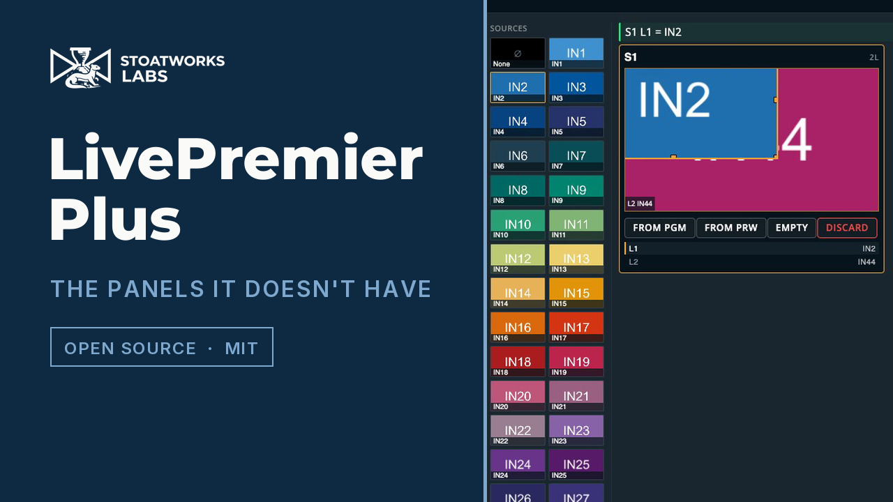](https://www.youtube.com/watch?v=gYI1xJLEYXE)

**[Watch the tour (77s)](https://www.youtube.com/watch?v=gYI1xJLEYXE)**: the app itself,
filmed on Analog Way's LivePremier simulator. It shows the Edit page building a look off air
and saving it into a real memory slot, Companion served inside the app, layer groups and the
`…` on a source card, routing through a Videohub emulator, the VPU map, the Console and the
Timeline. It was filmed on 0.12.0; 0.13.0 changed how the app is built, not what it shows. The
first video, with the VPU map off a real Aquilon C capture and `1080-80` turning into 1000 in a
layer width, [is still up](https://www.youtube.com/watch?v=mGjGiNO_tSo).

---

## Running it

It needs **Node 20 or newer**, and there are no dependencies to install.

```bash
npm start
```

Then open `http://127.0.0.1:8535/` and give it the switcher's address. It remembers that, so
after the first run it goes straight to the Web RCS.

You can also name the device up front, which skips the setup page:

```bash
npm start -- --device 192.168.2.142
```

| flag | meaning |
| --- | --- |
| `--device <host[:port]>` | the switcher. Port defaults to 80 (a simulator is usually `:3000`). |
| `--port <n>` | local port to listen on (default 8535) |
| `--host <addr>` | local address to bind (default `127.0.0.1`). Bind a LAN address or `0.0.0.0` to reach it from other machines; this machine should still open it at `127.0.0.1` — see [secure contexts](#why-this-needs-no-offscreen-document) — and a local browser that arrives by the LAN address is sent there. |
| `--data <dir>` | where it keeps everything: settings, the last switcher, cue stacks, every plugin's per-switcher documents, and your own plugins in `plugins/` (default `~/.livepremier-plus`) |
| `--appliance` | this host exists to run the app: [Remote access](#remote-access-over-tailscale-or-zerotier) may join and leave Tailscale and ZeroTier networks for it. Also `LPP_APPLIANCE=1`. |
| `--no-devices` | don't start the device host for USB panels (the Speed Editor), even when it's installed. Also `LPP_DEVICES=0`. |

`--device`, `--port`, `--host` and `--data` can also come from `LPP_DEVICE`, `LPP_PORT`,
`LPP_HOST` and `LPP_DATA`, which is how the Docker image sets them.

There's a desktop app too: a tray launcher with an interface and port picker, the same shape as
the rest of the fleet. See [launcher/](launcher/).

### In Docker

Every push to `main` publishes an image to `ghcr.io/stoatworks-labs/livepremier-plus`, as
`:latest` and as the commit's SHA. There's no per-version tag, so **`:latest` can be ahead of
the last release**; to pin a release, use the SHA its tag points at. The repo's
`docker-compose.yml` runs it with the cue stacks and the remembered switcher kept in `./config`:

```bash
docker compose up -d
```

or on its own:

```bash
docker run -d -p 127.0.0.1:8535:8535 -v "$PWD/config:/config" \
  ghcr.io/stoatworks-labs/livepremier-plus:latest
```

Inside the container it has to listen on `0.0.0.0` to be reachable at all, so the port you
publish decides where it's reachable *from*. **`docker-compose.yml` publishes `8535:8535`, which
is every interface on the host.** That's the binding-wide case below, so change it to
`127.0.0.1:8535:8535` unless the whole network is meant to reach it. Set `LPP_DEVICE` to skip
the setup page.

### Remote access over Tailscale or ZeroTier

**Preconfig ▸ LivePremier Plus → Remote access** serves the app to a
[Tailscale](https://tailscale.com) tailnet or a [ZeroTier](https://www.zerotier.com)
network without binding it to the venue LAN. Both are off until you switch them on.

| | what you get | what it needs |
| --- | --- | --- |
| **Tailscale — HTTPS on the tailnet name** | `https://<machine>.<tailnet>.ts.net/`, through `tailscale serve`, with a real certificate. The app stays on loopback. An https page is a secure context, so MIDI and audio input for LTC work from the remote browser too. | HTTPS certificates switched on for the tailnet (admin console ▸ DNS), once. The first load after that waits ~15 s while the certificate is issued. Port 443, 8443 or 10000 — the card refuses a port something else is already served on. |
| **Tailscale — plain http on the tailnet address** | `http://100.x.y.z:<port>/`, a listener on this host's tailnet addresses only. | Any tailnet. Not a secure context: no MIDI or audio input from there. |
| **ZeroTier** | `http://<zerotier address>:<port>/` on every network this host is authorised on, opened as the controller authorises it and closed when it leaves. | `zerotier-cli` able to read the service's auth token — root, or a copy at `~/.zeroTierOneAuthToken` for the account the app runs as. Same secure-context limit. |

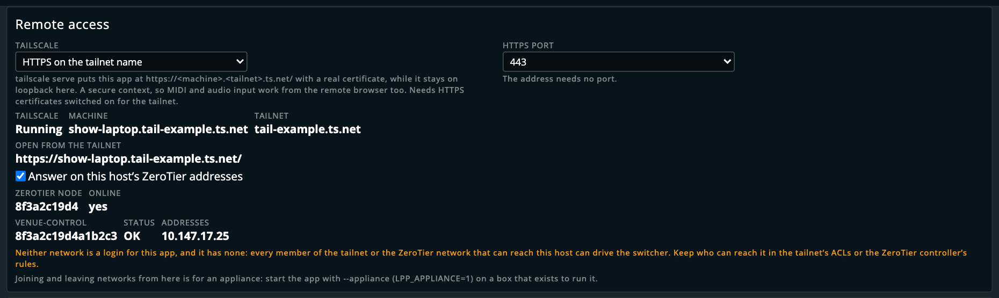

The machine and network names in that picture are made up. It was taken with stand-ins answering
for `tailscale` and `zerotier-cli`, because the real ones would have put my own tailnet in the
README.

Switching Tailscale serving off, or stopping the app, removes the `tailscale serve` entry, and
only ever one that still points at this app.

The controls for **joining and leaving networks** (a Tailscale auth key, Disconnect, Rename, a
ZeroTier network id, Leave) only appear when the app was started with `--appliance` (or
`LPP_APPLIANCE=1`), and the server refuses them otherwise. They're for a box that exists to run
LivePremier Plus, where nobody at the venue has a shell. On a laptop, the networks belong to
whoever owns the laptop. `tailscale up` needs root unless the host joined once with
`--operator=<the app's account>`; without that, the buttons get Tailscale's own "access denied".

⚠️ **Neither network is a login, and this app doesn't have one.** Every member who can reach the
host can drive the switcher. Who can reach it is a job for the tailnet's ACLs or the ZeroTier
controller's rules.

**In Docker** the image has neither CLI. Run the app on the host's network and put Tailscale in
front of it yourself (`tailscale serve --bg http://127.0.0.1:8535` on the host, or the Tailscale
sidecar's `TS_SERVE_CONFIG`), or run it from the Linux package on the appliance instead.

<!-- Nothing between the markers is hand-written: gen-downloads.py owns it,
     heading and all, and rewrites it wholesale at each release. -->
<!-- downloads:start -->

## Download

**[v0.17.8](https://github.com/stoatworks-labs/livepremier-plus/releases/tag/v0.17.8)** — prebuilt for macOS, Windows and Linux. Pick your platform:

<details>
<summary><b>macOS</b> — Universal (Apple Silicon + Intel)</summary>

| Build | Download | Size |
| --- | --- | --- |
| Universal (Apple Silicon + Intel) · .dmg disk image | [`livepremier-plus-0.17.8-macos-universal.dmg`](https://github.com/stoatworks-labs/livepremier-plus/releases/download/v0.17.8/livepremier-plus-0.17.8-macos-universal.dmg) | 83 MB |
| Universal (Apple Silicon + Intel) · .pkg installer | [`livepremier-plus-0.17.8-macos-universal.pkg`](https://github.com/stoatworks-labs/livepremier-plus/releases/download/v0.17.8/livepremier-plus-0.17.8-macos-universal.pkg) | 83 MB |

</details>

<details>
<summary><b>Windows</b> — x64</summary>

| Build | Download | Size |
| --- | --- | --- |
| x64 · .exe installer | [`LivePremier.Plus_0.17.8_x64-setup.exe`](https://github.com/stoatworks-labs/livepremier-plus/releases/download/v0.17.8/LivePremier.Plus_0.17.8_x64-setup.exe) | 26 MB |

</details>

<details>
<summary><b>Linux</b> — x64</summary>

| Build | Download | Size |
| --- | --- | --- |
| x64 · .deb package (Debian/Ubuntu) | [`LivePremier.Plus_0.17.8_amd64.deb`](https://github.com/stoatworks-labs/livepremier-plus/releases/download/v0.17.8/LivePremier.Plus_0.17.8_amd64.deb) | 51 MB |
| x64 · .rpm package (Fedora/RHEL) | [`LivePremier.Plus-0.17.8-1.x86_64.rpm`](https://github.com/stoatworks-labs/livepremier-plus/releases/download/v0.17.8/LivePremier.Plus-0.17.8-1.x86_64.rpm) | 51 MB |

</details>

All builds, checksums and release notes: [github.com/stoatworks-labs/livepremier-plus/releases](https://github.com/stoatworks-labs/livepremier-plus/releases).

macOS builds are signed and notarised and open normally. The Windows builds are unsigned, so SmartScreen warns once.

<!-- downloads:end -->

> **On binding wide.** The default is loopback for a reason. This proxy is an unauthenticated
> route to a switcher's entire control surface and, once a Companion is linked, to that
> Companion's admin UI too. `--host 0.0.0.0` hands both to everyone on the network, so only do
> it when you mean to.

## Edit

PLUS ▸ Edit is the Screens / Aux. layout with one row per destination instead of two, and that
row is a **programmer**: a buffer on neither preview nor program, marked EDIT in amber. Fill it
**from PGM**, **from PRW** or **empty**, drag and resize layers on the stage, put sources on
them, and work all sixty-seven layer parameters in the panel on the right. The switcher sees
none of it.

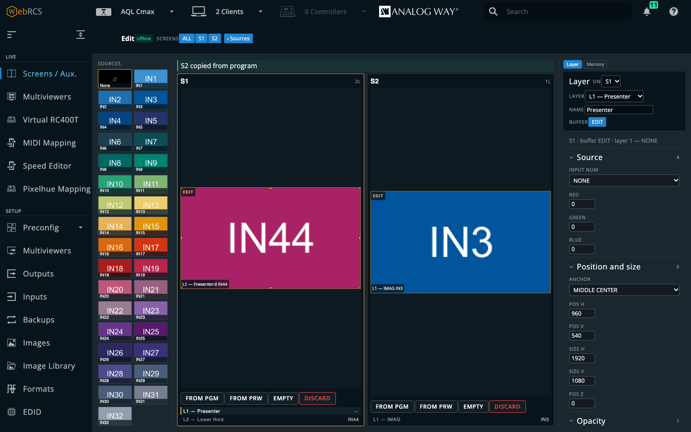

The **Memory** tab is the one control on the page that writes. **Direct** puts the look into a
memory slot with no preset buffer written and no take fired; **via preview** borrows the preview
buffer, fires the switcher's own save and puts preview back property for property. The user
guide says what each one costs, and the Status note above says what's still open about the
direct route on real hardware.

## Console

Mynah's command language, inside Web RCS. Verb first, then objects, innermost scope last. Every
keyword abbreviates to any unambiguous prefix, and nothing is sent until you press Enter.

```
Recall Screen 1 Memory 5
R Sc 1 Th 4 Me 5 Pre          the same command
Store Master 12
Take Screen 1
```

The line parses as you type and shows what it'll do (`Recall 3 → Screen 1 Preview`) before
anything reaches the device. Tab completes, and ↑ brings back history.

**Variables** go wherever a number goes (`Set Screen 1 Layer 2 Size ($S1.width / 2) $S1.height`,
`Recall Screen 1 Thru @screens Memory @opener`), and the feedback names what each one reads
before you press Enter. Arithmetic goes in brackets, because outside them `+` and `-` are still
the range operators. See [docs/VARIABLES.md](docs/VARIABLES.md).

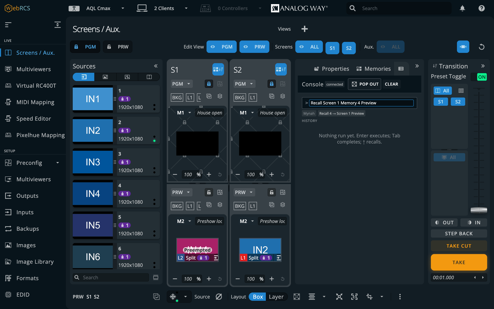

**This panel has no grammar of its own.** Every token, rule and device path comes from
`src/vendor/mynah-lang.mjs`, which is [mynah](https://github.com/stoatworks-labs/mynah)'s own
`npm run build:lang` output, the same file its Companion module vendors. If a command means the
wrong thing, the fix goes in mynah.

There's a reason for that beyond tidiness. Mynah's compiler and this repo's `CMD` builder were
written independently, and they produce **byte-identical** store paths for the commands both
know. Two independent derivations agreeing is about the best evidence you'll get that either is
right, and it only stays true while nobody re-types the grammar here. A test pins it.

### Four languages, one line

The same command line also takes raw AWJ, raw Web RCS store JSON, and OSC. These are all the
same write:

```
Take Screen 1
AWJ DeviceObject/$screenAuxGroup/@items/S1/control/@props/xTake = true
{"path":["device","screenAuxGroupList","items","S1","control","pp","xTake"],"value":true}
/lp/screen/1/take
```

Mynah is the language for driving a show. The other three are for when the show isn't going so
well: a path out of a packet capture, a frame out of a browser's network panel, an address a
lighting desk is already sending. You've already got each of those in front of you, and
translating one by hand is a good way to put a typo on a live frame.

Each line is read as whichever language it looks like, and the verdict shows beside the
feedback before you press Enter. That matters, because a line read as the wrong language
complains about a character rather than a command, which looks just like your own typo. A
leading `MYNAH`, `AWJ`, `JSON` or `OSC` says which outright, and the **Console language** card
in Preconfig ▸ LivePremier Plus can turn detection off altogether.

### Reading a value back

`AWJ get DeviceObject/system/$device/@items/1/@props/dev` answers. Nothing else here does,
because the vendor's socket carries a stream of changes rather than a request and its answer,
so a `get` goes out on a **real TCP 10606 socket** opened by this process and the reply lands in
the console log.

Everything else rides the vendor's own connection, whichever language it was typed in. A path
is held once and rendered for either transport, so an AWJ message turns into a store write and
lands at the same node. **AWJ via**, on the same card, changes that for when you want the message
on the wire exactly as typed. The device allows five AWJ clients, and this uses one of them for the
length of each exchange.

## OSC input

It's off by default. Turn it on in **Preconfig ▸ LivePremier Plus → OSC input** and this process
listens on a UDP port, so QLab, TouchOSC, Companion or a lighting desk can drive the switcher
directly.

```
/lp/screen/1/take
/lp/screen/1/memory/5/recall/preview
/lp/master/memory/12/store
/lp/screen/1/preset/a/layer/2/opacity/opacity/norm 0.5
```

**[The full dictionary is in docs/OSC.md](docs/OSC.md)**: every address, its argument and its
range. It's the same address space the MIDI mapping binds to. A fader is bound to a screen, a
preset, a layer and a parameter, and that four-part address means the same thing whether it
arrives as a control change or as a packet. The document is generated from the resolver's own
tables, so it can't describe an address that doesn't work.

Four things worth knowing before you wire a surface to it:

- **The address is the target; the argument is only the value.** A button with a fixed address
  and no argument still means something specific, which is what lets you draw a TouchOSC layout
  once with no logic behind it.
- **A trigger fires on a non-zero argument and on none at all.** Surfaces send `1` on press and
  `0` on release, and firing on both would take the screen twice.
- **A recall never defaults to program.** `/lp/screen/1/memory/5/recall` goes to preview. To
  reach air you have to say so, here as everywhere else.
- **`/norm` takes 0–1 and scales; without it the value is in the device's own units.** Opacity
  is 0–256, not 0–100. You can't tell from `0.5` alone which one was meant, so the address says
  it instead.

It binds to loopback unless you choose otherwise, and the other option tells you in as many
words that the network will be able to fire takes. Messages go to the switcher over AWJ, so it
works with no browser open, which is the point. Bear in mind that port can be switched off in
the Web RCS security settings.

> **Over UDP, live layer parameters have to name a buffer:** `/a`, `/b` or `/c`.
> `preview` and `program` mean whichever buffer is pending or live right now, and working that
> out needs the device's take state, which this listener doesn't have. It refuses those
> addresses and says why, rather than guessing. The Console *can* resolve them, because the page
> has the device store.

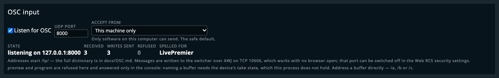

## Matrix routing

Patch the switcher's own SDI and HDMI connectors to ports on a **Blackmagic Videohub**, a
**Lightware** or a **Turtle AV** router, then route through it from the panel, a cue, the
Console or OSC.

Tell it about the **cable** and the rest follows:

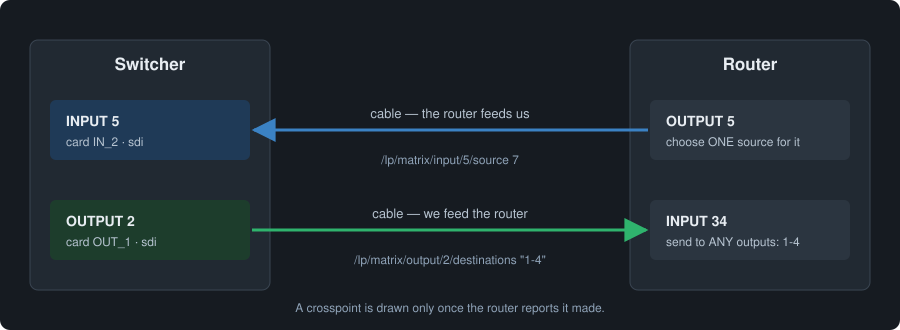

That inversion is the whole model, and the two operations that come out of it aren't
symmetrical, on purpose. An input is fed by one router output, so choosing its source is one
crosspoint and decides everything it sees. An output arrives at one router input, which can be
sent to any number of destinations at once.

The panel names sockets in the device's own words (`Input 13 · card IN_2 · connector IN_25 · sdi`),
because which connector "card 2, port 1" is depends on a legend this app can't see.

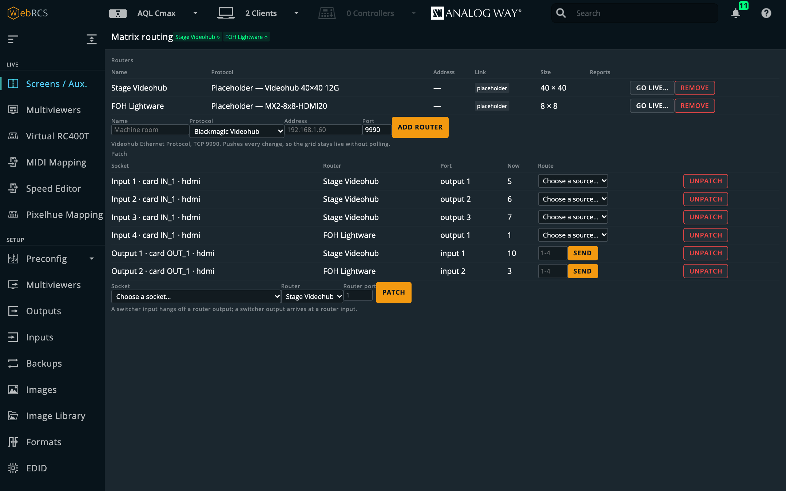

The same routing is on the vendor's own pages: a **Router** tab on Inputs ▸ an input and
Outputs ▸ an output, and a Router box in Preconfig ▸ Inputs / Outputs.

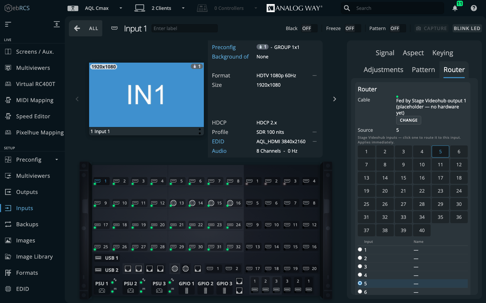

A **placeholder** router (a Videohub, Lightware or Turtle AV model of the right size with nothing
on the other end) takes the patch and the routing before the rack arrives. **Go live…** gives it
an address, and **Push plan** sends only what's different.

**Nothing is optimistic.** A driver never writes its own state, so a click doesn't move the grid
until the router says it moved. A Videohub answers a refused route with ACK and the *unchanged*
routing, so a UI that showed what it had asked for would be lying to you at the worst possible
moment.

> ⚠️ **This hasn't driven a real router yet.** The Videohub driver is a port of BlackMatrix's,
> exercised against a working implementation of the protocol. The Lightware and Turtle AV drivers
> are written from their vendors' protocol documents and have never spoken to hardware. The
> patch model and the connector reader *are* checked against a real LivePremier's own store.
> **[docs/MATRIX.md](docs/MATRIX.md)** has the lot, including a short procedure for proving each
> driver on your own kit.

## HyperDecks

PLUS ▸ HyperDecks. Blackmagic HyperDecks, and anything that answers their Ethernet protocol
(Mitti included), played, cued and recorded from the panel, from a cue
(`VT 1 clip 3; VT 1 play`) or over OSC (`/hyperdeck/<deck>/play`). Each card shows the transport,
clip, elapsed and remaining time, format and disk, and whether its input is on air or in preview.

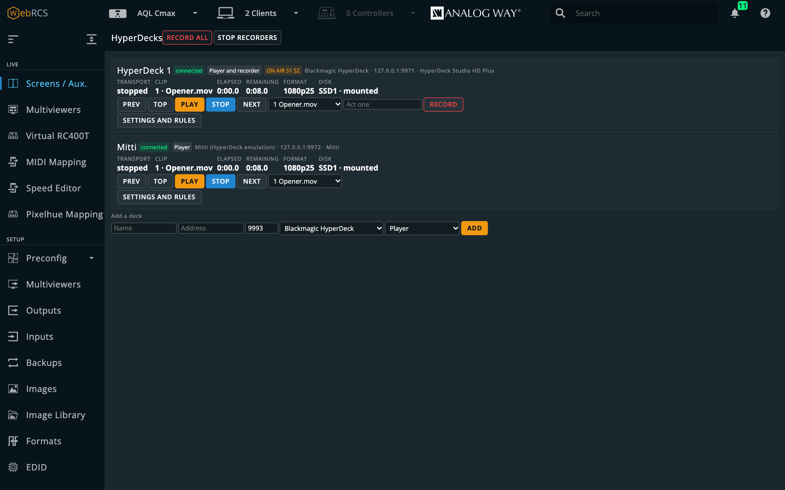

Tell a deck which switcher input it plays into and it can **follow the show** the way Mitti
follows an ATEM: play when that input goes to program, rewind when it's cued, pause, rewind or
load the next clip when it comes off, and take when its clip ends, a set number of seconds early
so the mix lands on the last frame. The rules run in one open page at a time and only act on what
changes after they start, so opening a page never plays a deck that's already on air.

> ⚠️ **Written from Blackmagic's published protocol and proved against an emulation of it, but
> not yet against a real HyperDeck.**
> `node tools/hyperdeck-sim.mjs` is that emulation; **[docs/HYPERDECK.md](docs/HYPERDECK.md)**
> has the protocol notes and a short procedure for proving it on your own deck.
>
> **Mitti needs 0.17.0 or later.** A real Mitti 2.8.18 answers `103 unsupported` to any command
> that ends in a carriage return, which is how 0.16.0 ended them. 0.17.0 ends them with a bare
> line feed, which a HyperDeck takes as well, and the simulator's `--mitti` mode now refuses CR
> the same way.

## Dante — preview

PLUS ▸ Dante. The Dante network's routing, read off the devices themselves: receivers down the
side and transmitters across the top, as device blocks that open into channels. A cell is one
subscription, coloured by what the receiver reports (connected, establishing, unresolved,
failed), and a click subscribes or clears it. A block lays one device across another, channel
for channel. The grid **opens locked**, because it reaches every device on the audio network,
not just the switcher, and the sound department will want a word if you start clicking about in
theirs. It's off by default; turn it on in Preconfig ▸ LivePremier Plus.


Dante Controller doesn't have a remote-control interface, so this is two things rather than one
pretend one:

- **Its own Dante routing control**, speaking the control protocol the open-source
  [netaudio](https://github.com/chris-ritsen/network-audio-controller) project reverse-engineered:
  discovery, channels, subscriptions and their status, and adding and removing subscriptions.
  Every write is planned against what the devices last said, sent, and **read back**, so what
  the panel shows is what the devices say afterwards, never what was asked for.
- **Dante Controller's own preset files.** Export a preset of what this app reads and load it in
  Dante Controller with File ▸ Load Preset, or import a preset Dante Controller saved and see
  which subscriptions applying it would change (clearing the channels it leaves empty, as Dante
  Controller does) before anything's sent.

Routing **snapshots** save and recall the whole network's subscriptions, from the panel, a cue
(`snapshot Show A`) or OSC (`/lp/dante/snapshot/Show-A/recall`). The switcher's own Dante card is
found by the name its store reports and marked in the grid, with what its Audio Matrix does with
each Dante channel beside it.

Discovery asks the network from a port of the app's own and never touches UDP 5353, so the
system's mDNS responder, and the Dante Controller and Dante Virtual Soundcard that depend on it,
are left alone. You can also list devices by address.

> ⚠️ **Preview: not yet run against a real Dante device.** The protocol codec is held, byte for
> byte, to packets Dante Controller itself sent, and the rest was proved against
> `node tools/dante-sim.mjs`, a simulated network built from the same tables, which tells you
> nothing about a real one. **[docs/DANTE.md](docs/DANTE.md)** has the design, a source for every
> protocol table, and the first-device test to run before a show.

## Pitch Compensation

It's under Preconfig, next to the two fields it fills in.

A screen spanning LED walls of different pixel pitches needs each output group told how much
canvas its raster is worth, or a layer changes physical size the instant it crosses the join.
The device has the fields for it (Preconfig > Canvas > Pitch, **H Ratio** and **V Ratio**) and no
help at all working out what to put in them.

The device knows every number but one. It has the rasters, it knows which outputs are on the
screen, and it'll tell you what ratios are set. What it has no idea about is how far apart the
LEDs are, so the panel reads the rest and asks you for the pitches: one per output, `2.6`, or
`2.6 x 3.0` if the pixels really aren't square.

**The engine is [aquilon-pitch](https://github.com/stoatworks-labs/aquilon-pitch)'s,
vendored** into `src/vendor/pitch-engine.js`. It carries four things that are easy to get
backwards while still looking right, and each was worked out there by driving a simulator rather
than by reading the manual:

- the ratio **multiplies** a group's raster to give its canvas footprint, so a **coarser** wall
  takes a ratio **above** 1.000
- the field is an integer in thousandths, range 0.100 to 10.000
- the device **discards** an out-of-range write rather than clamping it, so a ratio that won't
  fit is refused here instead of sent
- the footprint **floors**, so 1080 × 1.234 is 1332 and not 1333

Applying takes two presses. It's a preconfig change, it moves every output on the screen at
once, and it's the only control in the panel that touches the device, so it ought to be hard to
hit by accident. When the device already holds the computed ratios, the button says so and does
nothing.

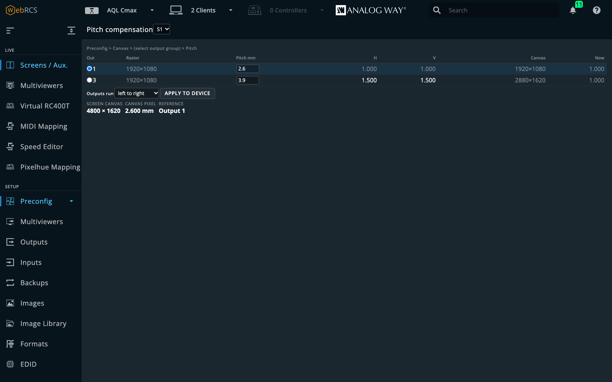

## MIDI Mapping

It's under Virtual RC400T. Pick an input, an output for feedback and a controller profile, then
press Start. Faders, encoders and buttons then drive the selected layer.

**The engine is [awj-surface](https://github.com/stoatworks-labs/awj-surface)'s,
vendored whole** into `src/vendor/surface/` along with its stock profiles (X-Touch/Mackie, APC40,
MIDIcon 2 and Pro, plus a generic learn profile). Decoding, soft pickup, encoder acceleration,
MCU feedback and the parameter catalogue are all upstream's. This repo adds a front end and
nothing else.

Soft pickup is the bit worth knowing about. A non-motorised fader won't move a live value until
it's swept through that value, so grabbing a fader mid-show can't make a layer's opacity jump.
The panel shows the hold-off rather than just looking broken.

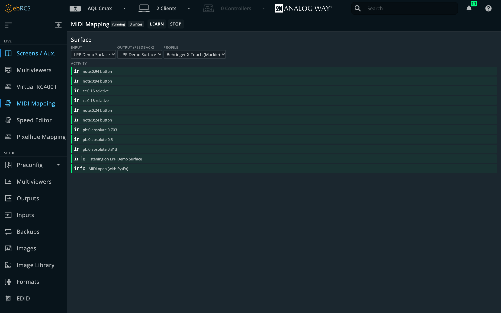

### Why this needs no offscreen document

`navigator.requestMIDIAccess()` is a **secure-context** API. When this project was a Chrome
extension, the page was a Web RCS on a plain-HTTP LAN address, which isn't a secure context, and
a content script inherits the page's context, so neither side could use it. The fix back then
was an offscreen document on the `chrome-extension://` origin, relaying MIDI through a service
worker.

None of that's needed here. The proxy serves the vendor UI from `http://127.0.0.1:<port>`, and
loopback **is** a potentially-trustworthy origin, so the page is a secure context and Web MIDI is
just there. It fixes the SysEx problem too: an invisible offscreen document can't show a
permission prompt, so Mackie scribble strips had to be granted from a separate page. A normal
page just asks.

The flip side: **a plain-http page on any address but loopback has no Web MIDI and no audio
input.** That's the switcher's own address, and just as much this app's own when the launcher
binds it to a LAN interface and opens `http://192.168.2.69:8535/`. Until 0.7.0 the note on the
Settings page only knew about the first case, and helpfully told an operator who was already
inside LivePremier Plus to open LivePremier Plus. Now a LAN-bound server always answers on
`127.0.0.1` as well, and a browser on the same machine that arrives by the LAN address is
redirected there. (The server can tell: a connection whose source address is the very address
it connected to was made on this host, and nothing else qualifies, not even a VM behind a NAT
bridge.) The note names the page that's actually open, the loopback door with its port, and the
fact that another machine needs HTTPS. The app doesn't serve that itself, but
[Remote access](#remote-access-over-tailscale-or-zerotier) can put it on a tailnet name with a real
certificate, and a browser there gets MIDI and audio input too. Only top-level navigations are
redirected; the vendor app's fetches and its socket stay where they are.

## Speed Editor — preview

It's under Virtual RC400T, next to MIDI Mapping: a DaVinci Resolve Speed Editor as a switcher
panel, plugged into the machine LivePremier Plus runs on, over USB or paired over Bluetooth. The
page tells you when it's found the panel; then press **Start**.

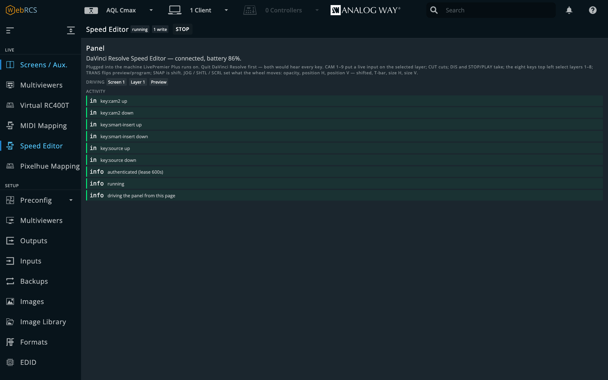

The panel in that picture is the tests' stand-in, playing the real handshake through the real
device host, as I didn't have the hardware plugged in at the time.

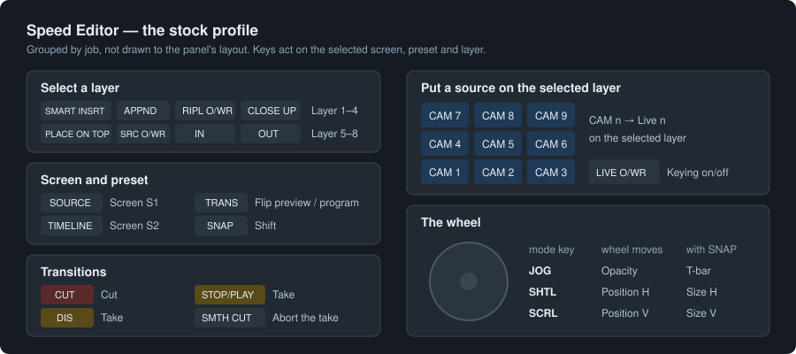

It's MIDI Mapping's sibling and has no engine of its own. The panel's handshake and reports are
[awj-surface](https://github.com/stoatworks-labs/awj-surface)'s `core/hid/`, vendored under
`src/vendor/surface/hid/`, and the mapping, soft pickup and feedback are the same engine the
MIDI panel runs, in the page.

**The device host holds the panel, not the page.** The first build used WebHID, and with a real
panel, Chrome on macOS couldn't read the handshake's challenge. It reads every feature report at
the length of the largest (33 bytes), and the panel refuses a 10-byte report read that way. So
USB panels are held by the **device host** ([devices/](devices/README.md)), a separate program
that the app starts, restarts if it stops, and stops along with itself. Its Speed Editor module
opens the panel through [node-hid](https://github.com/node-hid/node-hid), answers the challenge,
renews it at half its lease, finds the panel again whenever it's plugged back in, and streams its
reports to the page. The panel is only opened while a page has the Speed Editor started, and let
go when none has. One page drives it at a time, and **Take over** moves it to another. Any
browser works, from any address. The host's state is on the settings page (**Device host**).

The desktop app carries the device host. In a checkout, `npm run setup:devices` installs it
once, and the app starts it on every run after that (`--no-devices` if you'd rather it didn't).
node-hid is the host's dependency, not the app's. The Docker image has no USB and no host;
without one, the Speed Editor page says why and the rest of the app carries on as normal. **Quit
DaVinci Resolve** first, or both will hear every key and squabble over the lamps.

> ⚠️ **Preview.** Proven on a real panel over USB on macOS against the simulator (2026-09-25),
> through the device host in a staged desktop bundle: the handshake, CUT (repeatedly), CAM 1–3
> into preview, the wheel on opacity, the battery level, and a replug. Not tried yet: whether
> the key lamps light, Bluetooth, and Windows or Linux. The tests run a fake panel that plays the
> real handshake and, like the hardware, refuses a read at the wrong length.

## Thumbnail relay — preview

The switcher's source thumbnails are PNGs its firmware writes with next to no compression (about
148 KB each at 256×144 on an Aquilon C, 590 KB at 512×288 on a Pulse 4K), and the Web RCS asks
for every input's about once a second. Ten inputs on a Pulse comes to some 47 Mbit/s of
thumbnails, which is a lot of network to spend on postage stamps.

Switch the relay on in Preconfig ▸ LivePremier Plus → Plugins and this app answers those
requests itself. It fetches each PNG from the switcher, re-encodes it as a JPEG in a worker
thread (10–40 KB, depending on how busy the picture is), and hands the same frame to every page
that asks within 300 ms. The vendor's own source cards draw the JPEG as it is. Anything it can't
improve on (a 404, a placeholder that would get bigger) goes through as the switcher sent it, and
when it's switched off nothing is touched.

The Web RCS asks for every input's thumbnail in turn, whether anybody's looking at it or not.
The relay picks out the ones being **edited** (drawn in a screen or aux canvas on Screens / Aux.,
or in this app's Edit page and previews, and on screen) from the rest. While there are any, the
page refreshes those itself (**Hot refresh**, 2 Hz by default), and the relay answers the vendor
for every other source from the frame it already has until that frame is **Idle hold** old
(4 s). Against the simulator with 32 inputs and three on S1/S2, the three went from a new frame
every 1.28 s to four a second, the other 29 to one every 5 s, and the switcher's link carried
less than before. With nobody editing (just a page of source cards), every source is treated the
same.

The switcher still sends each PNG it's asked for in full; the hold just means it gets asked less
often. The traffic from here to the browsers shrinks the most, which matters for a page on
another machine, like a tablet on the show Wi-Fi. Its card on the settings page shows the bytes
in and out, which sources are hot, and how often each source's picture actually changed.


That's against the simulator, whose thumbnails are a few KB of flat colour, so there's next to
nothing to save and the card says so. A real frame's are tens of times the size, which is where
the saving is.

> ⚠️ **Preview: not yet run against a real frame.** Proved against the LivePremier Simulator,
> with a stand-in serving hardware-shaped thumbnails. `node tools/snapshot-probe.mjs --device <ip>`,
> run from a checkout of this repo (the desktop app and the image don't carry `tools/`), measures
> how often a real switcher rewrites a thumbnail, which is the number that decides what happens
> next.

## Multiviewer thumbnails — preview

Off until you switch it on in Preconfig ▸ LivePremier Plus → Plugins. The switcher already draws
every source, live, on its multiviewer, and the device store says to the pixel where each one
sits. An Aquilon C's multiviewer 1 was a 5×4 grid of 384×270 widgets
carrying `IN_1`…`IN_20`. Get that multiviewer into a browser and this plugin cuts each source out
and puts it into the page's thumbnails (the vendor's source cards, the screen and aux canvases,
and this app's own) at up to 25 frames a second instead of one.

You choose where the picture comes from **in each browser**, on the plugin's card in Preconfig ▸
LivePremier Plus:

- **Capture device:** a capture card on that machine carrying the multiviewer output, which means
  anything the browser sees as a webcam. Needs `localhost` or https.
- **Stream (WHEP):** WebRTC from [MediaMTX](https://github.com/bluenviron/mediamtx), re-serving
  an encoder that carries the multiviewer. Works from any machine, including a tablet on the show
  Wi-Fi.
- **Test pattern:** a multiviewer drawn in the page from the store's own layout, for a simulator,
  which doesn't have a multiviewer output.

**On a Midra 4K or Alta 4K the switcher can be its own feed.** Its H.264 streamer takes the
multiviewer (`OUTPUT_MTVW`) as a picture (a real Pulse 4K offers it) and pushes RTMP. Point it at
a MediaMTX (`rtmp://<host>:1935/<path>`) and the page plays the same path back over WHEP
(`http://<host>:8889/<path>/whep`, worked out for you). The card's **Stream the multiviewer
here** writes one destination slot (10 by default), sets the picture and starts it, but only
when you press it, after a confirmation, and never while the streamer's carrying something else.
It's the unit's only streamer, and the stream is 720p30 and a second or so behind: slower than a
capture card, far quicker than the PNGs.

The card draws the capture with every cut outlined, so you can check by eye the three things
not yet seen on a real output: whether the picture is 16:9 inside its widget, where it sits
(centre, top, bottom) with the label band beside it, and whether a tally border needs trimming.
Only inputs (and, on a LivePremier, stills) have thumbnails to replace, and a source that isn't
on the multiviewer keeps the switcher's picture. Three seconds without a new frame and every
thumbnail goes back to the switcher.


That's the test pattern on the simulator, with multiviewer 1 given twenty inputs for the
occasion. **Replacing** reads nought because the settings page has no thumbnails of its own; on
Screens / Aux. it's every input in the Sources column.

> ⚠️ **Preview: not yet tried against a real multiviewer or a real streamer.** Proven against
> the LivePremier Simulator with the test pattern (the vendor's own source cards drawing the cut
> pictures, and a source leaving the layout and a dead capture both handing back), and the Midra
> geometry and streamer plan checked against a real Pulse 4K's store. Starting the streamer has
> never been seen to work, because the simulators never start a stream.

## Background Slicer — preview

**PLUS ▸ Background Slicer**, once it's switched on in Preconfig ▸ LivePremier Plus → Plugins
(it starts off, because it uploads into the image library and writes stills, still capacities
and background sets). A background set gives each output of a screen its own still or
input, shown 1:1 in the output's raster, so a picture that spans a wall has to be cut into the
exact piece each output shows. This does the cutting. Choose a picture and the screens, and each
screen's canvas is drawn with its outputs on it and the picture over them, for you to drag or
type into place (Fit, Fill, Stretch, 1:1, Centre, or one picture spanning several screens). The
UMD Generator can hand a screen's UMD over as the picture, with the screens already chosen.
Before anything's written, the plan says which background set, free library slot and free still
each output takes, the still capacity it needs, what it replaces, and whether its cut is a
straight copy of pixels or resampled. **Generate** cuts the PNGs in the page. **Write** uploads
them through the switcher's own image route, sets the stills, raises a capacity through the
preconfig only when the switcher's own check says nothing in use gets displaced, fills the set
and, if you ask, loads it into preview. Each step is confirmed by the switcher's echo, and
**Undo** takes back exactly what was written.

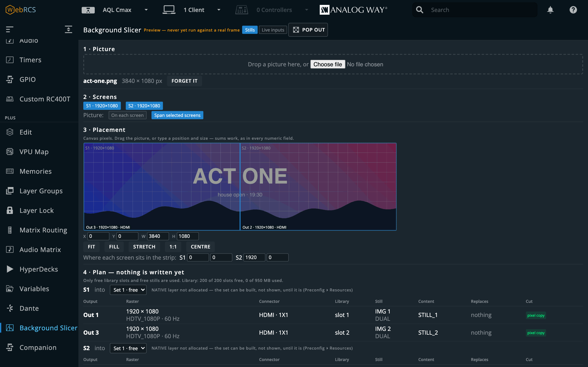

The **live-input mode** gives each output an input instead. The set takes `LIVE_n`, each input's
plug is loaded with the switcher's own EDID for that output's format, and the map that the media
server behind those inputs needs is exported: an Arena Advanced Output preset (written by
output-map, held to files Arena itself wrote), disguise's Feed Mapping table, Pixera feed rects,
a Hippotizer Video Mapper CSV, Millumin SVGs, a TouchDesigner table, and a CSV/JSON/SVG/PNG
pixel-map pack with a recipe for QLab, Mitti, MadMapper and Watchout.
[docs/BACKGROUNDS.md](docs/BACKGROUNDS.md) has the design, what's proven, and which of those
formats each server actually imports.

> ⚠️ **Preview: not yet run against a real frame.** Every write was proved on the LivePremier
> Simulator, whose outputs are a static picture, so you can't see a background written there.
> The cut is tested on every pixel. What the switcher does with a rotated, grouped, sliced or
> pitched output hasn't been seen yet, and the panel marks every output that depends on it.

**On a Midra 4K or Alta 4K** the platform has its own model, and the panel follows it. A screen
takes **one** picture, its canvas, through one of its four Background Images shown 1:1, and an
**Auto Crop** background set lets the switcher crop it for each output; the plan shows the
switcher's own rectangle for every output and whether it's 1:1. The switcher picks the library
slot (its first empty one), so the plan refuses when any Background or Foreground Image already
points at that slot, because the upload would turn up there too. The live mode fills a
**Custom** set with an input per output. Proved on the Midra 4K simulator 3.2.29, write and
Undo, with each write confirmed by the switcher's own echo; see
[docs/BACKGROUNDS.md](docs/BACKGROUNDS.md#midra-4k-and-alta-4k).

**Slides.** Drop a PDF or a PowerPoint deck on it instead of a picture and you get a strip of
pages to pick from. Pick **A background set per page** and each page goes on the screens like a
picture and into a set of its own, page 1 in the first free set, page 2 in the next. Pick
**Stills at a size** and every page is drawn at whatever width and height you type, Fit, Fill or
Stretch, and goes into the library (and a free still each, if you like) or a zip. A page isn't a
picture with pixels to scale, so each one is drawn at exactly the size it's going to be, and text
on a 4K output is as sharp as a 4K output can make it. A PDF is opened in the browser. A deck is
turned into one by PowerPoint on the machine LivePremier Plus runs on, or by LibreOffice where
that's installed. PowerPoint leaves hidden slides out of its PDF, so the stills are named after
the slides they actually are. Keynote wouldn't be driven unattended when I tried it, so for a
Keynote deck, export a PDF and drop that.
[docs/BACKGROUNDS.md](docs/BACKGROUNDS.md#documents-a-pdf-or-a-powerpoint-deck) has the detail.

> ⚠️ **Slides are newer still:** run on the LivePremier Simulator only, both kinds written and
> undone (2026-10-20). Not on a Midra simulator, not with LibreOffice, not from the packaged app
> (which has to be allowed to control PowerPoint the first time), and not on a frame.

## Pixelhue panel — preview

A Pixelhue U5, U5 Pro or U5 mini event controller, driving the switcher. The plugin is on, but
the panel itself starts off: tick **Drive a Pixelhue console** on its card in Preconfig ▸
LivePremier Plus and give it the console's address.

It doesn't map keys. The console is handed a **model** of this switcher (its screens, its
inputs, its memories) and labels, lights and pages its own keys from that. What comes back is
what the operator meant (`select screen S2`, `put LIVE_2 on the selected layer`, `take`),
carrying the identity this app published. So there's nothing to remap when a firmware moves a
key.

> ⚠️ **Preview: this hasn't been run against a console yet.** It was built from the consoles'
> firmware and proved against the vendor's own control service running headless with no panel
> attached. `docs/PIXELHUE.md` has the wire detail, how to rig one, and the list of what's still
> unverified. Since 0.14.0 it's been driven key by key from PixelFlow's own virtual U5 against
> the simulator; fade-to-black and freeze are sent on LivePremier, not yet on a Midra 4K.

You can change what each key, fader and encoder does on **Pixelhue Mapping**, under Virtual
RC400T (in the **PLUS** section on a Midra 4K or Alta 4K, which has no Virtual RC400T). It draws
the console in the Virtual RC400T's look, with the buses showing what the console shows. Click a
control to change it (take, cut, fade to black, layer stepping, the cue stack, a memory to
preview, a Companion button), or press it on the console and it lights up here. A changed
control gets a blue dot, and **Reset** puts everything back.

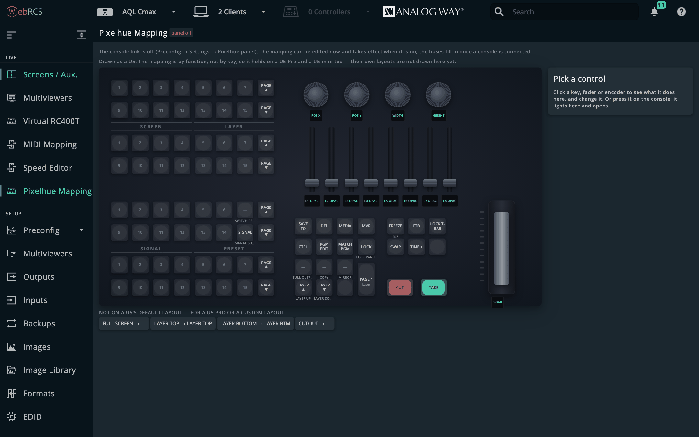

A **U5 mini** answers on the LAN, so it's driven from wherever this app already runs. A **U5 or
U5 Pro** only serves its control port on loopback, so this app has to run on the console itself.
Luckily that's a Windows mini-PC with a touch screen, and it runs the proxied Web RCS perfectly
well. A mini also has less on it: no faders, no encoders, and no TIME, MVR, SIGNAL SOURCE or
lower-left cluster, so take time, layer stepping and the cue keys have nowhere to live, and
Pixelhue Mapping draws it as a U5 until its own layout is added.

There's a test suite for the day a console turns up, which drives one key by key against a
simulator and checks each press three ways; [Testing](#against-a-pixelhue-console) has it.

## The demo environment

```bash
npm run demo
```

This brings the whole thing up against a **LivePremier Simulator**, with a real Aquilon C's
resource map folded in and an example cue stack already loaded, so every panel has something to
show without a switcher in the room. It prints a short list of things worth trying and the URL
to open.

It needs a simulator running. The panels mount into Web RCS's own sidebar, are drawn with its
own utility classes and ride its own socket, so a demo that stubbed all of that out would be a
demo of some other product. The simulator is Analog Way's and runs locally, and it's the proper
way to get the vendor's own UI with no device, and with no vendor asset copied into this repo.

What a simulator may not give you is a **VPU**. The one this repo's fixtures were cut from has no
`vpuMixerList` at all, so against it the panel correctly reports there's nothing to draw; the
rack's C MAX and the Cmax session of the simulator app do have one. Either way
`tools/demo/seed.js` replaces it with the recorded capture, so the demo always shows the same
box: 32 of 64 mixers fitted, 26 allocated, S1 in Optimized mode, and a staged preconfig that
differs from the running one in 26 mixers. Everything outside
`preconfig/resources` stays the simulator's own live state, so cues fired from the timeline
really do go out on the wire.

It **refuses to run against anything that isn't loopback.** The demo splices a store subtree and
seeds a cue stack, and "I thought it was the simulator" is not a sentence anyone wants to say at
a production meeting. To drive a real switcher, use `npm start -- --device <address>`.

It looks for a simulator on `127.0.0.1:3000`, `127.0.0.1:3001` and `localhost:3000`. If yours is
somewhere else:

```bash
LPP_DEMO_DEVICE=127.0.0.1:3002 npm run demo
```

It serves on 8535, the app's own port, so quit the app first or give it another with
`LPP_DEMO_PORT=8545`.

The demo's cue stack lives in a temporary directory and is deleted on exit, and
`~/.livepremier-plus` is never touched.

## Arithmetic in numeric fields

Type an expression into any of Web RCS's own numeric fields and it's worked out when you
commit, on Enter or when you leave the field:

| typed | becomes |
| --- | --- |
| `1080-80` | `1000` |
| `1920/2` | `960` |
| `(1920-40)/2` | `940` |
| `1920*2` | `3840` |

`+ - * / ( )` and decimals, with the usual precedence. The result is clamped to the field's own
declared range and rounded to its `step`, so a width of `9000+1000` lands on 8192 rather than
being refused.

Nothing else about the field changes. The vendor still validates it, still decides what to send,
and still drags the other axis along if the aspect lock is on. All this does is swap in the
number you meant, an instant before Web RCS reads it.

**Where it applies, and why that's narrow on purpose.** Only fields the vendor itself marks as
numeric, which it does by putting `min`, `max` and `step` on them; its geometry fields report
`step="1"` with real ranges. That's a steadier signal than any class name in a CSS-modules build,
and it leaves out everything that mustn't be touched. Labels have no `step`, and neither does the
transition-time field, whose `00:01.000` would be mangled by anything treating `:` as
arithmetic.

**On firmware 6.1.x the same fields are number inputs, and it works there too.** An Aquilon RS4
on 6.1.60 draws its geometry fields as `input[type="number"]`, and a number input *discards*
anything it can't parse: after typing `1080-80` the browser reports an empty value, so the
expression can't be read back. So a number field with `min`, `max` and `step` becomes a text field
while you're typing in it and goes back to a number field when you leave. That's what Web RCS 6.2
does to the same vendor component for its own arithmetic, and the component does its arrow-key and
wheel stepping in its own code, so nothing is lost while it's text. Two rules keep it safe: Enter
in such a field only goes through if the field holds a number or an expression that works out
(otherwise your text stays put and the field flashes amber with the reason), and leaving it with
anything else empties it first, so Web RCS puts its own value back, exactly as it does when you
leave a stray `-` in a number field. The canvas zoom box has no range and is left alone, and so
are this app's own number fields. Proven on a 6.2 simulator's number field of the same kind, and
then on Analog Way's **6.1.60 simulator**, whose web client is the very file an RS4 on 6.1.60 serves
(same bundle hash): in the Save Master Memory slot box, `2*3` committed 6, the up arrow stepped it
while it was text, `6-` was held and put back when I left, and `400+200` clamped to 500. **It hasn't
been typed into on a 6.1.x box itself.** If the arrow keys stop stepping a geometry field there,
switch **Field arithmetic** off and tell me.

There's **no `eval`** anywhere in this path. `src/core/expr.js` is a hand-written
recursive-descent parser over a closed token set. Anything it doesn't fully understand is refused
rather than guessed at, and the field is left as typed for the vendor to reject the way it
always has.

**Variables work here too**, while the Variables plugin is on: `$S1.width/2`, `@gap*3`,
`$OUT1.cw - 40`. One that can't be read right now (a program layer mid-take, a canvas the
switcher hasn't reported) isn't applied, and the field flashes amber with the reason in its
tooltip. With the plugin off, a field with a variable in it is left as typed, the same as before.
The names are in [docs/VARIABLES.md](docs/VARIABLES.md).

## What it looks like

Every panel is built from the vendor stylesheet's own utility classes (the slate-grey scale, the
spacing scale, the typography), and the sidebar entries are cloned from the vendor's own at
runtime, so they pick up whatever per-build class hashes the firmware happens to use. So the
panels are drawn by Web RCS's own CSS, and there's no skin to fall out of date.

Console, Timeline, Layer, Groups and Pixel Map, plus Surfaces and UMD when they're switched on,
are **tabs in the vendor's own strip** on Screens / Aux., beside Properties and Memories, because
that's where an operator already looks for per-screen tools. On LivePremier that panel is a fixed
360px whatever the window, and the vendor's two tabs and its own collapse button leave room for
one more, so mine sit behind a **⋯** at the end of the strip:

```
Properties | Memories | ⋯ ─┬─ Console
                          ├─ Timeline
                          ├─ Layer
                          ├─ Groups
                          ├─ Pixel Map
                          ├─ Surfaces
                          └─ UMD
```

While one of them is open the ⋯ is lit and wears that tab's icon. A strip with more room (or
fewer of these plugins switched on) shows them as tabs, with icons or names as the width allows.

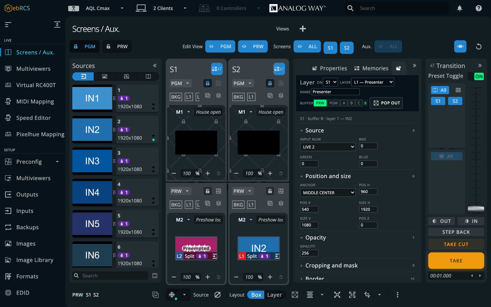

Layer is a properties editor. It's called Layer rather than Properties because the vendor's own
Properties tab is in the same strip, and two tabs with one name would be worse than a
name that's only mostly accurate. That's also the actual difference between them: the vendor's
tab follows the layer you've *clicked*, which is React state inside their bundle and can't be
read from here, so mine makes you name a destination, a buffer and a layer outright. On a second
monitor that turns out to be better anyway, because the window stays pointed where you left it.

MIDI Mapping, Speed Editor and Pixelhue Mapping sit **under Virtual RC400T** in the vendor's own
LIVE section. They're all about control surfaces, and putting them in a section of my own would
file them by who wrote them rather than by what they do. A Midra 4K or Alta 4K has no Virtual
RC400T, so MIDI Mapping and the Speed Editor aren't offered there, and Pixelhue Mapping goes at
the foot of PLUS instead. Pitch Compensation and this app's own settings sit in the
**Preconfig** flyout, next to the device settings they belong with. The whole-device views get a
section of their own:

```
LIVE
  Screens / Aux.
  Multiviewers
  Virtual RC400T
  MIDI Mapping       <- ours
  Speed Editor       <- ours
  Pixelhue Mapping   <- ours
SETUP
  Preconfig
    …
    Pitch Compensation   <- ours
    LivePremier Plus     <- ours: settings and the plugin switches
  Inputs / Outputs   <- the vendor's, with a Router tab of ours
  …
PLUS                 <- ours
  Edit
  VPU Map
  Memories
  Layer Groups
  Layer Lock
  Matrix Routing
  Audio Matrix
  HyperDecks
  Variables
  Dante
  Background Slicer
  Companion
```

A switched-off plugin takes its entry with it, so your sidebar may well be shorter than this.

The memory banks are in the sidebar rather than on the strip for two reasons. They aren't
per-screen (master memories cover every screen at once, and the screen bank is one flat list of
1000 slots any screen can recall from), and the strip is about 360px wide, which is already
full. Layer Groups is there for the same reason, only more so: a group exists *because* it
crosses screens.

## Layer groups, and sending a source to one

Nobody on a show thinks "layer 2 on screen 1, layer 1 on screen 2, layer 1 on screen 3". They
think **the side screens**. The switcher has no word for that. A LivePremier addresses a layer as
(destination, preset buffer, layer) and nothing above that ties two of them together, so this
adds one.

A group is a name and a list of layers, kept per device beside the cue stack.

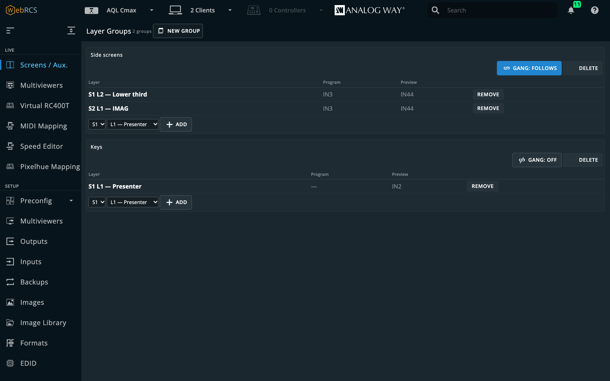

It does two things:

- **It's a target.** Send an input to the group and every member gets it.
- **It follows.** A group marked *gang* (the default) watches its members, and a source change to
  any one of them is written to the rest. It doesn't matter how that change arrived: this app's
  menu, the vendor's own drag-and-drop, a memory recall, another client on the network.

The `…` on each source card is how you aim at one. It sits beside the vendor's own `⋮` (which
opens that input's settings) and is cloned from it, so it gets the same button styling whatever
the firmware hashes it to this week. Its dots run across rather than down, so you can tell the
two apart at a glance. The menu is preview or program, then a target: a recently used one, a
group, or a screen and one of its fitted layers.

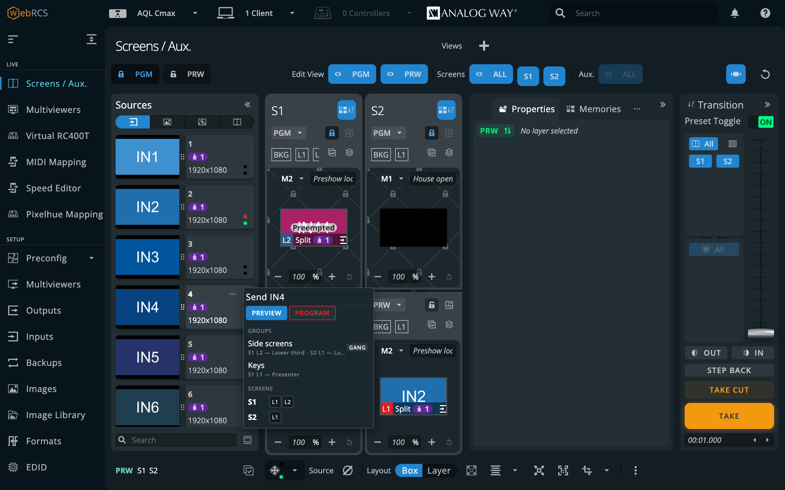

**It writes the role, not the letter.** A layer's source lives under a preset buffer (A, B or
C), and which letter is program changes on every take, so two screens are routinely on opposite
ones. Sending to "program" works that out per screen. A gang that copied letter to letter would
put a preview edit on air on half the screens, which is the one thing this feature absolutely
has to get right. It's verified on LivePremier Simulator 6.2.73 with S1 at `AT_UP` and S2 at
`AT_DOWN`, the only arrangement where a wrong answer shows up.

**It respects the PGM padlock.** The lock on a screen card is React state inside the vendor
bundle. It isn't in the device store, and a write over the socket doesn't have to obey it. The
menu honours it anyway: a locked target buffer gets a confirmation step naming every layer it's
about to change, and an open one is sent straight through. A screen whose card isn't on screen
has no lock to read, so it's treated as locked and you get asked.

Mid-take, nothing's written at all. "Program" and "preview" don't reliably name a buffer while a
transition's in flight, and the refusal is the same one the Layer panel already makes.

### Popping a panel out

Console, Timeline, Memories, Layer, Companion, Audio Matrix, Dante, the EDID editor and the
Background Slicer each have a **Pop out** button that opens them in a window of their own, for a
second monitor. A popped-out panel makes **no connection of its own**. It drives the session
already running in the Web RCS tab, so the switcher still sees one client per tab. Close that tab and the popout tells you in a banner rather than just going quiet.

Popping out is the reason Memories and Layer exist as panels of mine at all. The vendor's
equivalents are React panes whose event listeners are bound to the app's root container, so a
copy moved into a second window repaints and then stops responding, and there's no way to move
them. These read the device mirror instead.

## Layer Lock

PLUS ▸ Layer Lock. A LivePremier take swaps the whole preset buffer, and there's no per-layer
take. What this uses instead is the fact that a layer that's identical in program and preview
has nothing to transition. **Lock** keeps a layer's preview copy equal to program, and every TAKE
or CUT sent from this page, the vendor's own button included, is held for the few milliseconds
it takes to line a drifted lock back up. **Take only** takes one layer, or one group, on its own:
every other layer is set equal to program, the take goes, and their preview looks are put back
afterwards.

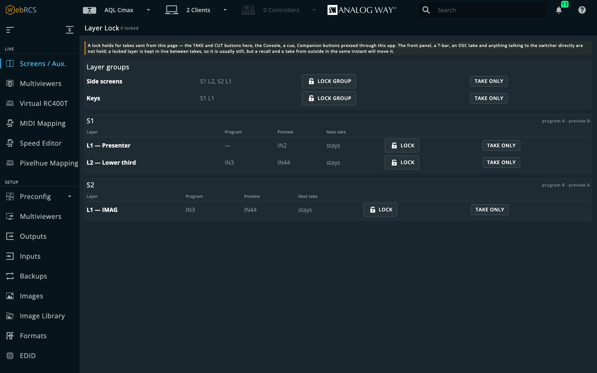

> ⚠️ **Only takes sent from this page are held**, and it's only been proved on the simulator.
> The front panel, a T-bar, an OSC take or another operator's browser go straight to the
> switcher, and the panel says so at the top every time.

## Pixel Map

Screens / Aux. ▸ ⋯ ▸ Pixel Map. Pick an image from the switcher's image library for a screen and
it's drawn over that screen's PRW canvas, on its card, in one of three ways:

- **Mask**: black in the map hides what's under it and white leaves it alone, so what's left is
  what the LED will show of each layer. Over an empty preview that's black, which is correct and
  not much help.
- **Over**: the map as it is, at the opacity. Panel numbers and outlines.
- **Lines**: only the light parts of the map show. What you want from a white grid of panel
  edges over dark content.


**1:1** puts one map pixel on one canvas pixel from the top left, which is where a pixel map is
true. **Stretch** fits the whole map to the canvas, whatever its size. A map that isn't the size of
its screen's canvas says so. **On** at the top picks PRW, PGM or both, and **Show** hides the lot.

The switcher never knows. No layer is spent and nothing is written: the map lives in the browser
tab, and which image goes on which screen is kept per switcher in the app and in the setup file.
It sits between the layers and their selection handles and takes no pointer at all, so a click, a
drag, a dropped source or a zoom lands on the layers as if it weren't there. The picture is the
library's original file, the one the Image Library page's Download button fetches, so a map drawn
with one-pixel panel edges stays sharp when you zoom the card.

> Proven on LivePremier Simulator 6.2.73 on 2026-10-16: a 1920×1080 map uploaded to the library
> and drawn over S1 and S2 in PRW, PGM and both; Mask showed an input only inside the wall; a click
> through S2's map selected S2's layer, with the handles drawn over the map; the map followed the
> card's zoom exactly, came back after leaving the page, and went when its library slot was
> deleted; a 960×540 map drew at half size 1:1 and full size stretched. On **6.1.60**, the RS4's
> firmware, the library and both image routes answer the same, and the Web RCS modules that draw
> the card are the same source as 6.2.73's, but that simulator had no screen in service, so no
> card was drawn there. LivePremier only. Not yet run on a real frame.

## Surfaces

Screens / Aux. ▸ ⋯ ▸ Surfaces. Off until you switch it on in Preconfig ▸ LivePremier Plus →
Plugins, because it rewrites the vendor's own geometry writes on their way out, and that's the
sort of thing you should choose rather than discover.

A screen's canvas is one raster, but it usually lands on several things: a wall in three pieces,
a header strip, a pair of IMAG screens. Each of those is a **surface**: a name and a rectangle in
canvas pixels, typed in, or made one per output with **From outputs** (each output's place on the
canvas, which is the right first guess when one processor drives one element and the wrong one
when it doesn't). Then bind layers to them, by layer slot: the binding holds in program, preview
and the Edit page alike.

A bound layer is kept inside its surface:

- **Dragged or nudged**, it stops at the edge. Drag an edge past the surface and the other edge
  stays where it was; drag a corner with the ratio kept and it stops with its shape.
- **Full screen** fills the surface, not the canvas. So does anything else that asks for the
  whole canvas, such as a memory that was saved full screen.
- **The align buttons** align to the surface. Align centre centres it on the surface, which is
  the one that needed help, since keeping a centred layer inside would only have pushed it to the
  nearest edge.
- **Too big for its surface**, it's made to fit, keeping its shape unless the change was to its
  shape.


The outlines are drawn on every PGM and PRW card, over a Pixel Map and under the selection
handles, and take no clicks. A surface with a bound layer outside it on that buffer goes red and
names the layer.

How it holds, briefly: writes leaving this page are rewritten before they go, so the switcher never
sees a bound layer outside its surface, program included. Changes from anywhere else (Companion,
OSC, the front panel, another browser, a memory recall) are pulled back in on **preview** only.
Program is never corrected by itself; it's flagged, in red on the card and in words on the tab. A
layer that something keeps moving back out is let go after three goes, and the tab says which, so
two things never fight over it. A layer held by Layer Lock is left to the lock, which keeps it equal
to program, or the two would argue for ever. Changing a surface moves nothing; layers it no longer
fits are flagged until they're next moved.

> Proven on LivePremier Simulator 6.2.73 on 2026-10-16: the vendor's full-screen button filled the
> bound layer's surface; its align-to-middle centred it on the surface (960 asked, 480 sent); a
> drag past the edge stopped there on the switcher and on the vendor's own card; a write from
> outside the page (AWJ) on preview was pulled back within 40 ms, and one on program was left alone;
> the Edit page's drag stopped at the edge as it moved, and nothing reached the switcher. 6.1.60's
> bundle has the same toolbar and the same drag code. LivePremier only. Not yet run on a real frame.

## UMD Generator — preview

Screens / Aux. ▸ ⋯ ▸ UMD. Off until you switch it on in Preconfig ▸ LivePremier Plus → Plugins,
because it uploads into the image library and writes a still and an aux's layers.

Pick a screen or aux and the tab reads every layer that's showing something: where it is, and
what it's showing. From that it draws the furniture a multiviewer wears over its windows: a thin
line round each box, shared where two boxes touch, and a dark tab along the bottom with the
source's name. It's one PNG at the canvas's size, transparent everywhere else.


- **Names** come from the switcher: an input's label, a still's label, or the short `IN5` when
  nobody gave it one. Type your own per layer, or take the layer's name from Layer names. A layer
  with no source isn't drawn, unless you've named it, which is how you label a box before its
  camera turns up.
- **The look:** labels inside the bottom or top of the box, under it, or none; border on or off,
  its width and colour; text size, capitals, and how dark the tab is. Long names shrink, then get
  cut short with an ellipsis rather than escaping their box.
- **On an aux** it goes on the top layer. An aux can't take a picture on its background (the
  vendor's own page won't offer one; [AGENTS.md](AGENTS.md) has the longer story), so the top
  layer carries a still of the PNG over the whole canvas and the layers under it are the boxes.
  **Put on** uploads it into a free library slot, loads a free still and points the layer at it,
  in preview (or program, if you've chosen PGM, after it asks). After that it's **Update UMD**,
  which only re-uploads: the still and the layer follow on their own. The tab says when the UMD
  on the switcher no longer matches the layers, and **Undo** takes back the last thing it wrote.
- **On a screen** it goes on the background, which costs no mixer but is cut per output, and the
  Background Slicer already does that properly. **To Background Slicer** hands it over; finish
  there. Under the layers a label inside its box is hidden by the box, so a screen's labels sit
  under each box by default, and the tab names any label a layer would cover.
- **Templates** lay an aux out first. Its layers come with its capability, two at a time (an
  advanced aux gets 2 at 4K, 4 at 5K, 6 at "6" and 8 at 8K), and with the top one spent on the
  UMD that leaves 1, 3, 5 or 7 boxes: *Full* or *Inset*; *Two over one*, *One over two* or *One
  and two*; *Two over three* or *One over four*; *Three and four* (three quarters, the fourth split in
  four again) or *Three over four*. Every box keeps the canvas's shape, so a 16:9 camera isn't squashed into it, and a
  gap can stand them apart. **Lay out** writes the box layers' positions in the buffer you're on
  and empties the ones the template doesn't use; sources are left alone.
- **Download PNG** needs nothing from the switcher's library, so a Midra gets that much (drawn
  against the Midra 4K simulator's store, not yet tried on a Midra) for loading by hand.

> Proven on LivePremier Simulator 6.2.73 on 2026-10-16, each write checked over AWJ: an 8-layer
> aux laid out as *Three and four* to the pixel; the UMD put on its L8 (library slot, still,
> full canvas, no rescale) and the library's copy downloaded back with its transparency; a rename
> marked it out of date; after a take, an update to program asked first and changed only that
> tab's pixels; a screen's UMD arrived in the Background Slicer as its picture. LivePremier only
> for writing. Not yet run on a real frame, so whether a frame keys the still's transparency over
> the layers under it is the first thing to look at.

## Gallery

The panels from the list above that don't have a section of their own, and the windows that pop
out. They're all the app itself on the LivePremier Simulator 6.2.73, taken with
`npm run demo`; click one for the full size. The [user guide](docs/USER-GUIDE.md) explains each
one.

<table>
<tr>
<td width="50%"><a href="docs/screenshots/memories.png">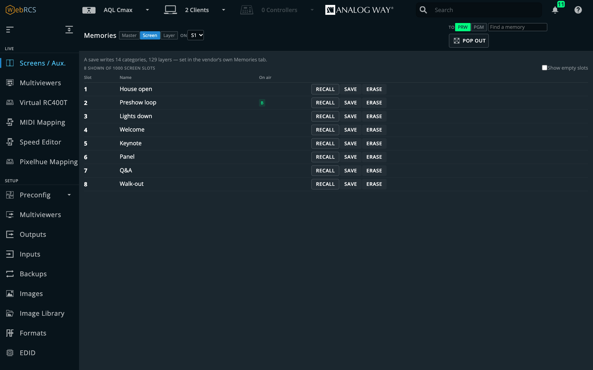</a><br><sub><b>Memories</b>: every bank in one list, renamed in place, with the buffer that holds each.</sub></td>
<td width="50%"><a href="docs/screenshots/companion.png">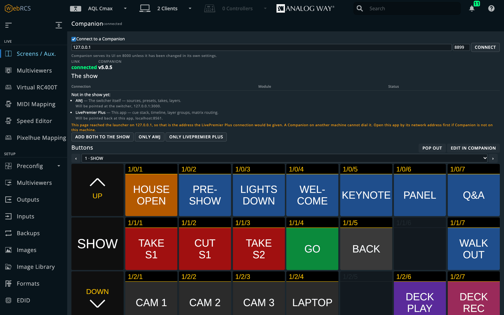</a><br><sub><b>Companion</b>: linked to Companion 5.0.5, with the connections it offers to add and a page of buttons drawn as Companion renders them.</sub></td>
</tr>
<tr>
<td><a href="docs/screenshots/audio-matrix.png">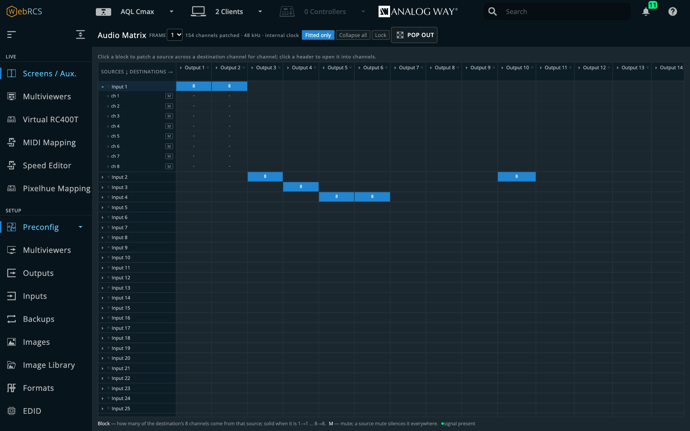</a><br><sub><b>Audio Matrix</b>: blocks of eight, with Input 1 opened into single channels.</sub></td>
<td><a href="docs/screenshots/timeline-popout.png">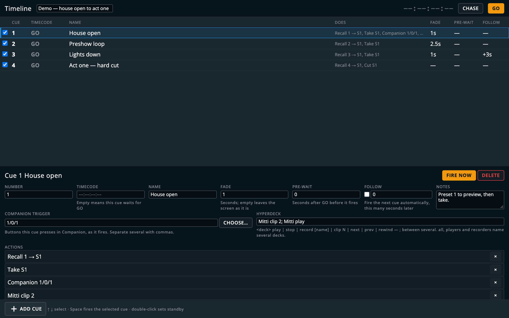</a><br><sub><b>Timeline, popped out</b>: a cue with its Companion trigger and HyperDeck commands.</sub></td>
</tr>
<tr>
<td><a href="docs/screenshots/edid-formats.png">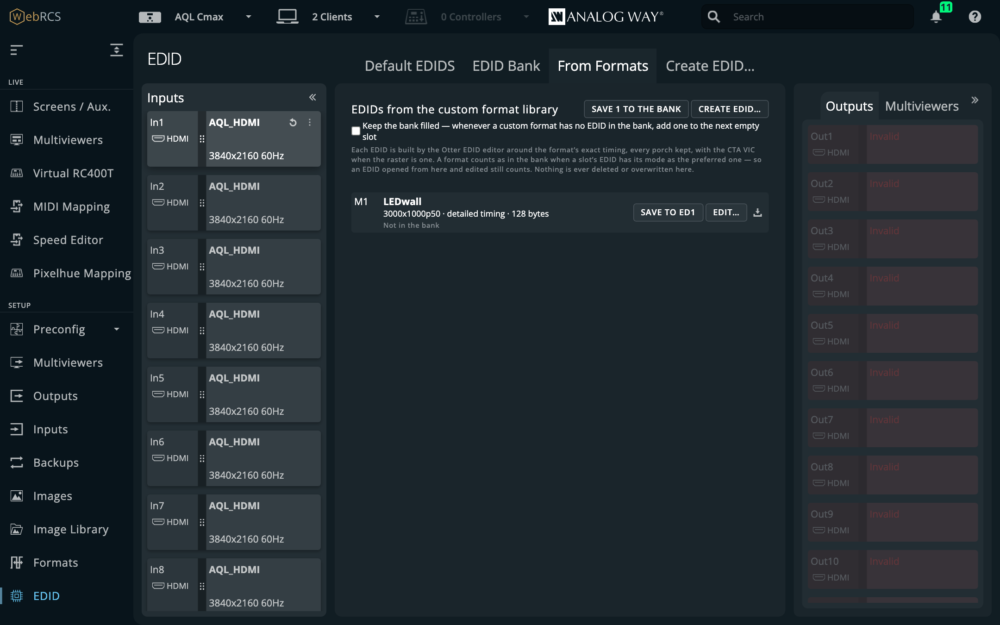</a><br><sub><b>EDID ▸ From Formats</b>: an EDID built for custom format M1, one click from the bank.</sub></td>
<td><a href="docs/screenshots/edid-editor.png">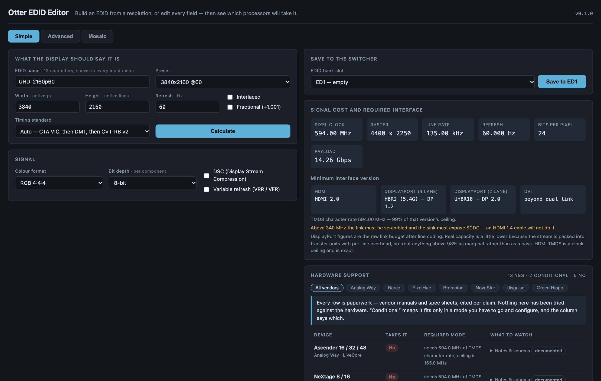</a><br><sub><b>Create EDID…</b>: the Otter editor in its own window, saving straight into a slot.</sub></td>
</tr>
<tr>
<td><a href="docs/screenshots/edid-mosaic.png">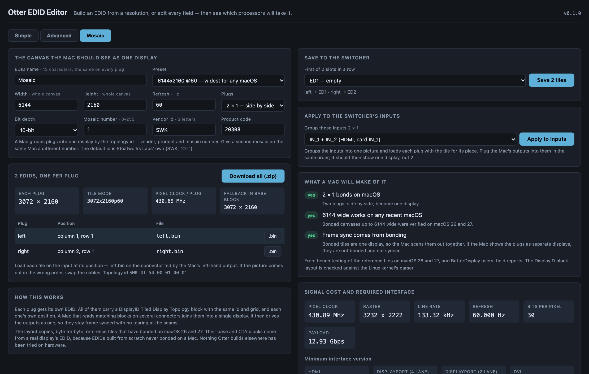</a><br><sub><b>Mosaic</b>: one tiled EDID per plug, saved and applied to a 2 × 1 input group.</sub></td>
<td><a href="docs/screenshots/preconfig-layer-names.png">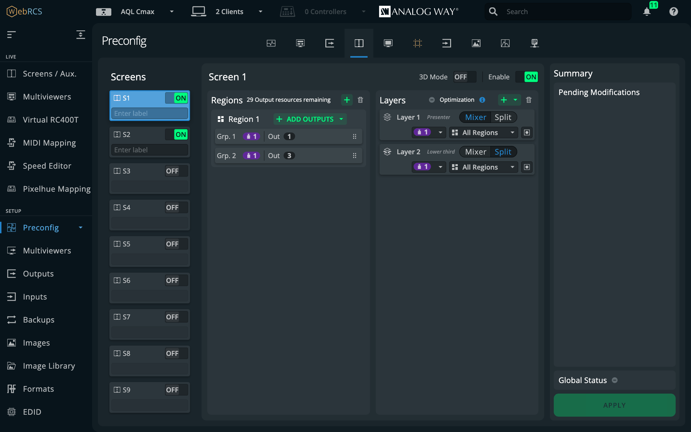</a><br><sub><b>Layer names in the vendor's own pages</b>, here Preconfig ▸ Screens.</sub></td>
</tr>
<tr>
<td><a href="docs/screenshots/variables.png">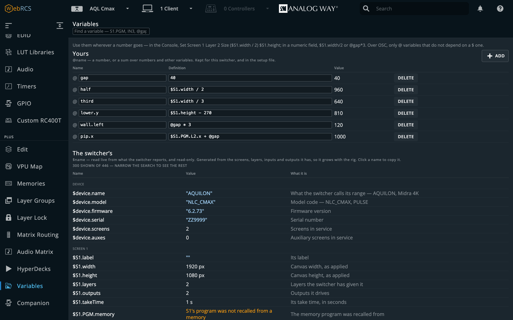</a><br><sub><b>Variables</b>: your own <code>@</code> names over the switcher's <code>$</code> ones, each with what it comes to now. The names are in <a href="docs/VARIABLES.md">VARIABLES.md</a>.</sub></td>
<td><a href="docs/screenshots/preview-lock.png">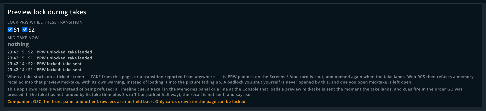</a><br><sub><b>Preview lock during takes</b>: the card after a take on S1 and S2, each PRW padlock shut as the take went out and opened when it landed.</sub></td>
</tr>
</table>

## How it works


Everything the browser asks for goes through this process to the switcher and back. On the way
past, the document picks up two script tags:

```
GET /                    the device's own index.html, plus:
  <script>…hook…</script>          inline, in <head>
  <script type="module" src="/__lpp/src/main.js">
GET /styles/app.<hash>.css         proxied, untouched
GET /api/stores/device             proxied, streamed — it is over 100 MB
ws://localhost:8535                relayed byte-for-byte to the device
```

Three things about that arrangement matter:

**The hook can't lose its race, because there isn't one.** It has to wrap `WebSocket` before the
vendor bundle makes one, or it misses the connection and every frame up to it. As a Chrome
extension this meant a `document_start` content script, which usually won but was never promised
to. Here every vendor script tag is `defer` and the hook is an inline classic script, so the HTML
parser runs it first by definition.

**No URL is rewritten.** Every asset the Web RCS refers to is root-absolute, so a
path-preserving proxy doesn't need to rewrite anything. Please don't add any: the vendor's hashes
change with every firmware, and a rewriter would be one more thing to keep in step with a bundle
nobody here controls.

**One connection reaches the device.** The upgrade is relayed at the byte level, so the device's
client count stays accurate and this process never has to understand WebSocket framing.

The device itself is one big JSON object. The Web RCS front end loads it from
`GET /api/stores/device` and then applies a stream of `{path, value}` writes off the socket, and
writing a property *is* the command. The panels do the same thing over the same connection. See
[docs/TRANSPORT.md](docs/TRANSPORT.md).

### Why a proxy and not a browser extension

This started out as an extension, and the extension worked. The proxy replaced it because it's
strictly better on four counts, at the cost of one more process to run:

- It works in **any browser**, not just a Chrome with a sideloaded extension, which matters on a
  locked-down show laptop.
- The hook's ordering becomes a guarantee rather than a race.
- Cue stacks persist to a file, and are keyed by device. The extension brokered `chrome.storage`
  through a content script, and that code never ran once.
- There's no MV3 packaging step to get wrong, and no unpacked-extension install for an operator
  to redo after a browser update.

The important bit is what **didn't** change: the panels, the store mirror and the cue engine are
the same code, and they still ride the vendor's own socket.

### Layout

```
server/
  index.js       CLI entry: flags, data dir, shutdown
  proxy.js       the reverse proxy, the injection, the socket relay, settings
  plugin-host.js loads each plugin's server half, routes to it, and stops it
  storage.js     the files on disk: settings, the remembered switcher
  documents.js   a plugin's per-switcher JSON document, as a route
  config-file.js the one-file setup's format
  osc.js         the UDP listener the OSC input plugin runs
  awj.js         one-shot AWJ exchanges with the switcher
  ws-client.js   a small WebSocket client, for Companion's link and the Pixelhue console's
  device-host.js runs devices/ (USB panels) in a process of its own
  local-client.js  sends a browser on this machine to the loopback door
  setup.html     shown until a switcher is chosen
src/
  core/          no DOM, no transport - importable anywhere
    paths.js       store paths, the AWJ spelling of them, and the command set
    platform.js    which family a switcher is, and what each capability needs
    dialect.js     one interface, LivePremier's and Midra's spellings behind it
    device-store.js  the local mirror of the device object model
    vpu.js         the VPU allocation map, adapted from the device store
    cuestack.js    the cue engine: GO, follow chains, delays, fade times
    session.js     snapshot + stream, folded into a store
    stills.js      the image library, stills and uploads (Background Slicer, UMD)
    wire.js        send a write and wait for the switcher's own echo
    plugins.js     every feature as a plugin: what it is, and whether it is on
    contributions.js  how plugins extend each other: contribution points, services
  transports/
    page-socket.js the vendor page's own WebSocket
  ui/            the shell, the tab strip, the settings page, shared panels
    plugin-host.js loads each plugin's page half into the sidebar and tabs
    canvas-overlay.js  where Pixel Map and Surfaces draw on a screen card
  hook/          the WebSocket hook, inlined into the document by the proxy
  vendor/        the seven vendored engines (below), never edited by hand
plugins/         every feature, one folder each - a server half, a page half,
  console/       or both: console, timeline, matrix-routing, companion, edit,
  …              memories, layer, layer-groups, umd, surfaces and the rest
devices/         the device host: USB and HID panels, its own package
examples/plugins/hello-switcher/   the template for a plugin of your own
tools/           the demo, the panel bench, the sync scripts, stand-in devices
test/            the offline suite; sim/ and console/ for the live ones
launcher/        the desktop app - the fleet's standard Tauri tray shell
```

`core/` has nothing browser-shaped in it, on purpose: it imports and runs under plain Node, which
is what the test suite does. (`stills.js` uploads with `fetch`, which Node has too.) The browser
panels are one front end over it. A standalone client talking AWJ over TCP 10606 is meant to be
another, and only needs a second `transports/` module.

## Seven things are vendored, not reimplemented

| in `src/vendor/` | from | what it is |
| --- | --- | --- |
| `vpu-model.js` | aquilon-vpu-map | the VPU mixer model |
| `mynah-lang.mjs` | mynah | the command language |
| `surface/` | awj-surface | the control-surface engine and profiles |
| `pixelhue/` | pixelhue-bridge | the U-series console's frame codec |
| `pitch-engine.js` | aquilon-pitch | the pitch-compensation arithmetic |
| `otter-edid-embed.js` | otter-edid-editor | the EDID editor and encoder, React included |
| `output-map/` | output-map | the Resolume Arena Advanced Output writer, bundled from its TypeScript |

Each one is copied rather than re-derived, for one reason: two implementations of one grammar,
one device model or one decode table will disagree sooner or later, and both will look right.
`npm run sync:*` re-copies each and rewrites its provenance, and `test/vendor.test.js` (Otter's
in `test/edid.test.js`) fails on drift and skips when there's no upstream checkout to compare
against. Edits go upstream.

## The VPU model is shared, not reimplemented

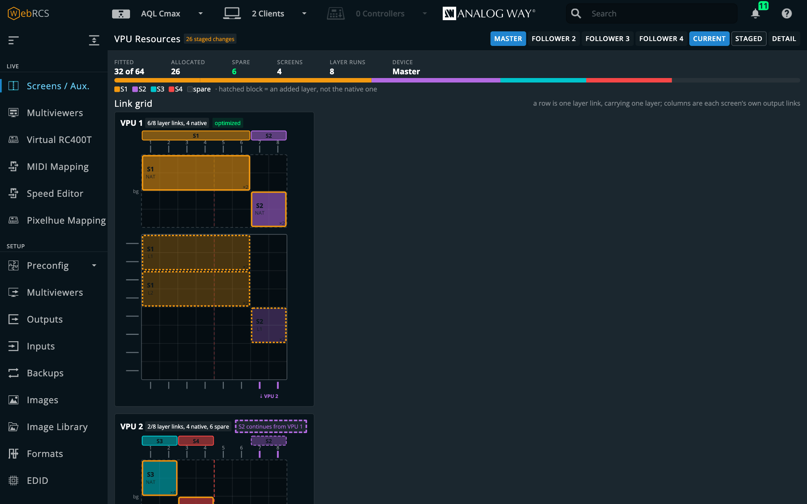

`src/vendor/vpu-model.js` is a **copy** of `public/vpu.js` from
[aquilon-vpu-map](https://github.com/stoatworks-labs/aquilon-vpu-map), the standalone tool that
reads the same allocation over AWJ. It's the same model in both places on purpose: if two tools
worked out their own answers from one device, they'd end up disagreeing about what the box is
doing, and both would look right. `npm run sync:vpu-model` re-copies it and rewrites the recorded
commit, and `test/vendor.test.js` fails if the copy has drifted from an upstream checkout.

`src/core/vpu.js` is the only part that's different between the two projects. That tool builds
mixer records from a few hundred AWJ reads, and this one lifts them straight out of the device
store the page already has. That also gets the per-screen resource status (the device's own
"does this fit" figures) for free, where the standalone reader spends 24 round trips on it.

**There's no AWJ path here, on purpose.** It'd be easy to add (this is a process, it can open TCP
10606), but the store is already mirrored and kept current from the socket, so an AWJ reader
would be a *second source of truth for the same VPU state*. A faster first paint isn't worth two
sources that can disagree about what's on air.

**The simulator the fixtures came from has no VPU at all.** It carries a `vpuLayerList` that's
there and permanently empty, and no `vpuMixerList`; `$vpuLayer` answers `E12` on real hardware.
It isn't only a simulator's quirk, though: an Aquilon RS4 on firmware 6.1.60 reports exactly the
same shape with its screens on air (and so does Analog Way's 6.1.60 simulator, where the panel says
it's a simulator). So the panel asks the device whether it's a simulator
(`isSimulated`) and says so, or says that this firmware doesn't report its VPU allocation, instead
of drawing an empty chassis or blaming a simulator that isn't there. On 6.1.60 it then shows what
the firmware does report: each screen's layers by size and, staged, the room left for more. Not every
simulator does it, mind: another 6.2.73, running under Wine, reports a fully fitted C MAX (64
mixers, two of them carrying S1's NATIVE layer), and the live suite checks the panel's reading of
that one mixer by mixer.

## Platforms

Analog Way ships two Web RCS code families, and this app tells them apart by what's in the
device's store rather than by the model name:

| | LivePremier (Aquilon RS / C / C+) | Midra 4K (QuickVu, Pulse, Eikos, QuickMatrix) · Alta 4K (Zenith 100 / 200) |
|---|---|---|
| Timeline (cue stack) | yes | **yes** — takes, cuts, fades and recalls spelled for the `transition` and `preset` trees |
| Memories | master, screen and layer banks | **master, screen and aux banks** — the aux bank is separate on this platform, and there is no layer bank |
| Console | yes | **yes** — mynah compiles the same grammar for this platform (`Take Screen 1`, `Recall Aux 1 Memory 7`, `Set Aux 1 Source 4`); no layer memories, no stills on a layer, and it says so |
| Audio | `Set Audio Patch … To …` on the channel matrix | **yes** — routed, not patched: `Set Audio Patch Input 3 To Screen 1` writes the preset's audio layer, `Follow Layer 2 On Screen 1` / `Follow Screen 2 On Line Output 1` set what a point follows, mutes land where the device keeps them |
| Layer | yes | **yes** — from a catalogue generated from a Pulse 4K's own bundle: 57 properties, `UP`/`DOWN` buffers |
| Edit page | yes — saves direct or via preview | **yes** — saves via preview only: the banks there have no import, so there's no direct route |
| VPU Map | yes | no — a fixed-architecture switcher has no VPU to map |
| Pitch Compensation | yes | **yes** — the ratios live under `canvas/pitch` there, and the panel knows |
| OSC input | yes — 173 addresses, widened by the device's own catalogue | **yes** — 44 addresses, mynah's vouched-for table; the Midra catalogue is vendored for the Layer tab but not yet merged into the dictionary |
| MIDI Mapping, Speed Editor | yes | no — both pages hang under Virtual RC400T, which a Midra's sidebar doesn't have, and the surface engine still spells LivePremier. The Plugins card says so on their rows |
| Pixelhue Mapping | yes, under Virtual RC400T | **yes, in PLUS** — there's no Virtual RC400T to hang it under, so it sits after Companion; the same page, drawn and edited on the Midra 4K simulator 3.2.29. What a mapped key does there is the Pixelhue panel's row |
| Pixelhue panel | yes | untried — the dialect spells takes, recalls and sources there; fade to black, freeze, swap, time, stills and screens are LivePremier only |
| EDID builder | yes — the 100-slot bank and M1–M16, read off the simulator | not yet seen — it lights up by itself if the store has the same `system/edid/bankList` |
| HyperDecks | yes | **yes** — a deck plays into an `INPUT_<n>` and records an output or `MTVW`; the rules are tested against a Pulse 4K's store |
| Background Slicer | yes — a background per output, from a still or from an input | **yes** — one picture per screen through an Auto Crop set, or a Custom set with an input per output |
| Matrix routing | yes | not yet — the sockets are read, but the Router tab and box are written into LivePremier's own pages |
| Audio Matrix, Mosaic inputs | yes | no — the channel matrix and input groups are LivePremier's; Midra audio is routed at the Console |
| Layer names, Layer Groups, Send to, Layer Lock | yes | offered — spelt through the same dialect as the Layer tab, but not yet driven on a Midra simulator |
| Preview lock | yes | **yes** — proven on the Midra 4K simulator; a shut padlock greys the buffer out there instead of refusing with a warning |
| Multiviewer thumbnails | yes — a capture card or a stream | **yes** — and the switcher's own H.264 streamer can be the feed |
| Pixel Map | yes | not yet — a Midra keeps an image library too, but its Screens page lays the cards out differently |
| Surfaces | yes | not yet — the shaper reads LivePremier's layer paths, and a Midra's Screens page lays the cards out differently |
| UMD Generator | yes | the PNG only — Download works; putting it on the switcher reads LivePremier's library and stills |
| Aux follow | yes | no — the layer paths it reads are LivePremier's, and the dialect has no aux layers there |
| AoI from a custom format | yes | no — a Midra crops its outputs another way, and the section hangs off LivePremier's Canvas page |
| Arithmetic in fields, Variables, Settings | yes | yes — Variables are generated from whatever the box reports, so a Midra gets Midra's |

Destinations are spelt the same everywhere (`S1`, `A2`) and only the last step onto the wire
differs, so a cue stack reads the same on either. Which screens and auxes are offered comes from
the switcher's *applied* preconfig, which is also where the models differ: a QuickVu has one
screen, a Zenith 200 has four screens and four auxes, and the app lists whatever the box says is
in service. Anything a panel holds back is listed with its reason on the Settings page: on the
Plugins card beside the plugin, and under Compatibility beside the part of the switcher it needs.
The three pages under Virtual RC400T are no exception; they're held back as *Control surfaces*.

## Safety

- **The VPU panel never writes.** Every property it reads is `readOnly` in the device's own
  model.
- **The timeline writes only what a cue says.** Preset recalls, transition times, TAKE and CUT,
  and whatever a plugin's cue action says (a router route, a HyperDeck transport, a Companion
  press), nothing else, and only when the cue fires: on GO, on a follow from the cue before, or as
  its timecode goes past with Chase armed.
- **A TAKE waits 150 ms behind a recall in the same cue**, so it can't overtake its own preset
  load and put the previous preview on air.
- **A cue is reported as *sent*, never as *confirmed*.** Recalls and takes return nothing on this
  protocol. The log counts writes that left the browser, and device status is shown separately,
  from the device's own status properties.
- **No second connection to the Web RCS.** The device counts its clients and shows them in the
  header, and an extra socket would turn up there as a phantom operator. The AWJ socket is a
  separate budget of five clients, and it's opened per exchange and closed, never held.
- **The OSC listener is off until you turn it on**, binds to loopback unless you choose
  otherwise, and never answers a packet. It listens and doesn't reply, because replying to a
  spoofable datagram tells an unknown host there's something here worth sending to.
- **An OSC address that can't be resolved is refused, not approximated.** An enum value the
  device doesn't have, a parameter that's read-only, a preset that needs a take state this
  process doesn't hold: each is turned away with the reason, and counted in Settings.
- **A few things write without being asked, and each is fenced in.** That's what they're for,
  so the fences are the point:
  - **A ganged group** only writes a layer's source, and only to members of a group someone made.
    It resolves program and preview per screen rather than copying a preset letter, refuses
    outright while a take is in flight, and only acts on a change made while the page is open,
    never on state it merely found at startup. A layer can only belong to one group, so two
    groups can't pull at the same layer, and turning a group's gang off leaves it a target and
    nothing more.
  - **Layer Lock** writes a locked layer's preview copy back to match program, and nothing else.
  - **Surfaces** (off by default) pulls a bound layer back inside its surface on preview, and
    only flags it on program. Something that keeps putting a layer back outside is let go after
    a few rounds rather than fought for ever.
  - **Preview lock** (off by default) presses the vendor's own PRW padlock during a take, and
    never opens one you shut yourself.
  - **The EDID builder's auto-fill**, if you switch it on, saves an EDID per custom format into
    an empty bank slot, and never overwrites a used one.
  - **Aux follow** (off by default) only writes an aux layer's source, and only from a screen
    layer someone told it to follow. It resolves program and preview on each end rather than
    copying a preset letter, waits out a take in flight rather than guessing, never acts on an
    aux being changed (so taking the aux by hand isn't fought), and only acts on a change made
    while a page is open. Setting a follow that would change the aux's program asks twice,
    because that's a cut on air.
- **AoI from a custom format writes one output's AoI, when asked, and checks it landed.** It
  refuses a format bigger than the output rather than letting the switcher clamp it quietly,
  and reports what the switcher says afterwards. Like the vendor's own fields, it applies at
  once, so an output on air changes on air.
- **Two things sit between the vendor's page and its socket, and both are narrow.** Layer Lock
  holds a TAKE or CUT sent from this page for at most 750 ms while it lines a locked layer up,
  then lets it go whatever happened. Surfaces rewrites the vendor's own geometry writes for a
  bound layer so they arrive inside its surface, and can add a write but never drops one.
- **The UMD Generator and the Background Slicer write to the image library, and say so first.**
  Both start off. Before anything goes they say which library slots, stills and layers or
  background sets they'll take; each write waits for the switcher's echo, and **Undo** puts back
  what was there. **Pixel Map writes nothing at all**: the switcher never learns the map is there.
- **The send-to menu respects a padlock it could ignore.** The PGM lock on a screen card is state
  inside the vendor's own bundle (it stops their UI, not the device), so a write from here
  doesn't have to obey it. The menu asks anyway when a target buffer is locked, and treats a
  screen it can't see as locked.
- **Remote access opens nothing until asked, and only touches the host's networks on an
  appliance.** Serving over Tailscale or ZeroTier is off by default and listens only on those
  networks' addresses, never the LAN. Joining, leaving and renaming are refused unless the app
  was started with `--appliance`. Auth keys and network ids are checked before the CLI sees
  them, and passed as arguments, never through a shell.
- **The Dante panel is off by default, opens locked, and never binds UDP 5353.** It reaches every
  device on the audio network, so a page opens with clicks that only open and close devices. A
  change is only made once it's unlocked, or by a cue, an OSC address, a snapshot recall or a
  preset apply the operator confirmed. Every write sends only what differs, is read back, and is
  reported as what the devices say afterwards. Discovery asks from a port of its own, so the
  system's mDNS responder, Dante Controller and Dante Virtual Soundcard are never disturbed.
- **Re-pointing drops the old relay.** Moving to a backup frame hangs up the sockets aimed at the
  previous one, so a page can't carry on driving a device the operator thinks they've left. Cue
  stacks, layer groups, names and locks, pixel maps, surfaces and UMDs are all kept per device, so
  none of them follows you to another frame.

## Testing

```bash
npm test
```

About 1,100 tests, and no browser. The socket tests bind real ports on loopback.

Thirty-three cover OSC and AWJ. The framing ones run against a stand-in device on a real TCP
socket rather than a mock, on purpose, because everything worth catching there lives in the
plumbing: the `0x04` terminator, a reply that straddles a read boundary, a write thrown away
because the socket was destroyed before it flushed. A mocked `net.connect` would just agree with
whatever the code did. Two of those three were actual bugs the tests found.

One test checks that `docs/OSC.md` is exactly what its generator produces, and another runs
every address the document lists through the resolver, so the published list can't promise an
address that doesn't work.

Twenty-eight cover the expression evaluator, weighted towards what it has to **refuse** (`1/0`,
`2+`, `1920x1080`, `00:01.000`, and anything that looks like code), because the failure that
matters is a plausible wrong value on air, not a parse error somebody notices.

Forty-seven cover the proxy against a stand-in Web RCS on a real socket rather than a mock:
injection ordering against deferred scripts, chunked and gzipped documents, CSP stripping, path
traversal, the byte-level socket relay, runtime device changes, and the shutdown path. That last
one pins a hang rather than a wrong value. An upgraded socket is invisible to the HTTP server's
own connection tracking, so unless the relays are hung up explicitly, the launcher's Stop button
never finishes.

Nine run against `aquilon-c-live-resources.json` (the resource subtree of a real Aquilon C,
read from the device on 2026-08-21) and cover ground no simulator can reach: fitted mixers,
interleaved output links, Optimized mode, and a staged preconfig where every difference is a
link move. Another five run against `aquilon-rs4-6.1.60-resources.json`, read off an RS4 on
2026-10-16, which is how the VPU map knows what a box with no mixer map looks like.

### Against a simulator

```bash
LPP_SIM=<simulator>:3000 npm run test:sim
```

The suite in `test/sim/` boots the real app, points it at a running LivePremier Simulator and
drives it through the doors the outside world uses: the proxied Web RCS socket, the OSC
listener, the Console, the cue engine with timecode pushed at it, the plugin routes, and a
Speed Editor (a fake one on USB; everything after the USB is the shipping code). Every effect is
checked by asking the switcher over AWJ, which is a path none of the app's own code is on, so the
app never gets to mark its own homework.

It writes to the switcher, so it refuses to run against anything that doesn't say it's a
simulator, and it puts back everything it changed, memories included. With `LPP_SIM` unset every
test skips, and CI doesn't run it at all. Files run one at a time, because there's one switcher
and every file wants it. AWJ is asked on the simulator's own address at 10606, or at
`LPP_SIM_AWJ_PORT` if you've moved it.

### Against a Pixelhue console

```bash
LPP_CONSOLE=<console> LPP_SIM=127.0.0.1:3000 npm run test:console
```

The same idea with one more party in the loop: a real Pixelhue console, the real app, and a
simulator at the far end, with the console's own service as a second witness. `LPP_CONSOLE=stand-in`
swaps the console for a fake one, which proves the suite runs and nothing about a console, and the
hands-on file only runs with `LPP_CONSOLE_GUIDED=1` and somebody at the desk. It has only met the
stand-in so far. [docs/PIXELHUE.md](docs/PIXELHUE.md#testing-it-on-a-console) has the rest.

There's also a bench for the panels on their own:

```bash
DEVICE=192.168.2.142 npm run serve
# then open http://127.0.0.1:8765/tools/harness.html
```

It renders a panel against a recorded store and proxies the vendor's own stylesheet, fonts and
icon sprite from the named device. The panels are built from the vendor's utility classes, so a
bench with its own stylesheet would prove nothing about how they look. No vendor asset is copied
into this repo.

## Related

`webrcs-timeline` (not public) is a Rust workspace with the same cue model, both transports and
no UI: the headless route. Its engine and this one are independent implementations and will
drift apart, and I haven't decided yet whether to bring them back together.

[`aquilon-vpu-map`](https://github.com/stoatworks-labs/aquilon-vpu-map) is a standalone
server-side reader of the same VPU mapping over AWJ. It and this app come at the same problem
from opposite ends: that one reaches the device directly and can run headless, and this one gets
the whole device store for free, but only inside a browser tab. The two share one model rather
than translating between two. `src/vendor/vpu-model.js` is that tool's `public/vpu.js`, copied
in by `npm run sync:vpu-model` and held to it by `test/vendor.test.js`. Neither app opens the
other's files: this one reads the live device store, and that one reads the device over AWJ or
a recorded capture, which is still the only way to look at a VPU map with no switcher connected.

<!-- attributions:start -->
This project is built on other people's work — see [ATTRIBUTIONS.md](ATTRIBUTIONS.md).
<!-- attributions:end -->
