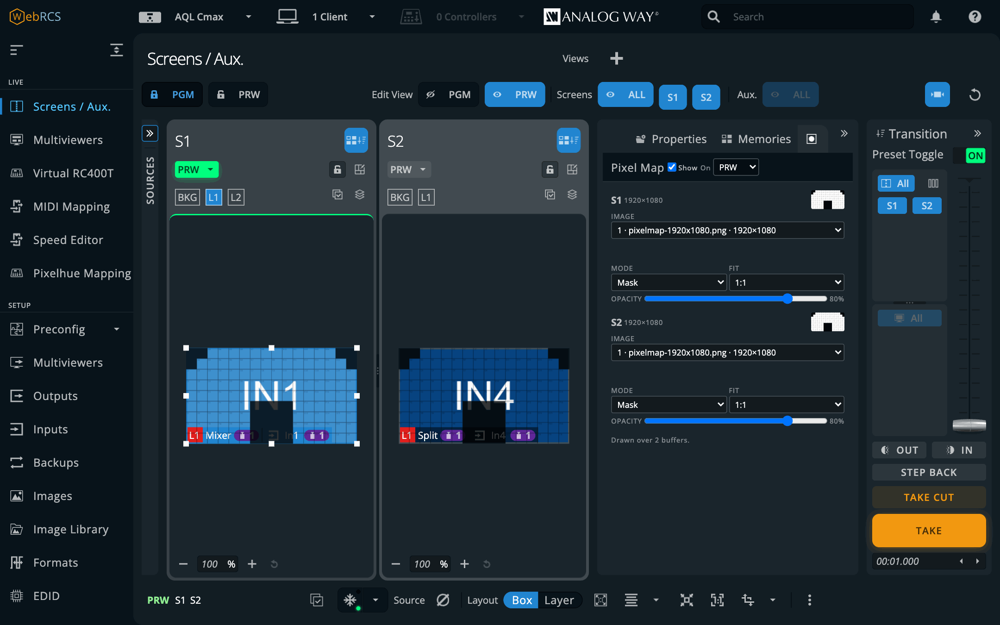
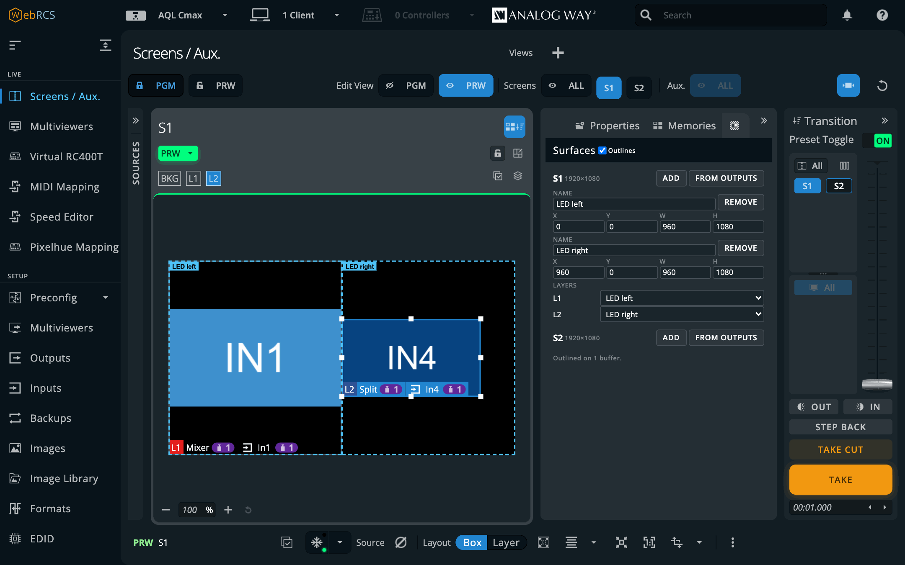
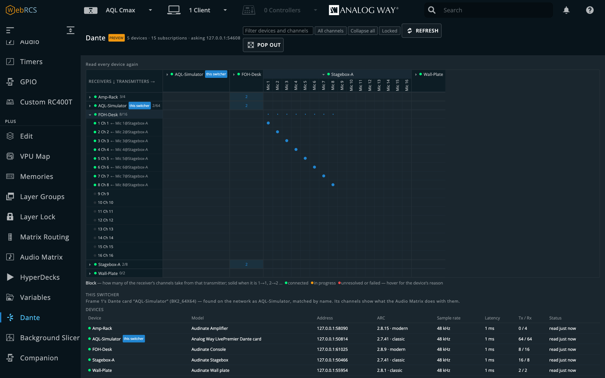
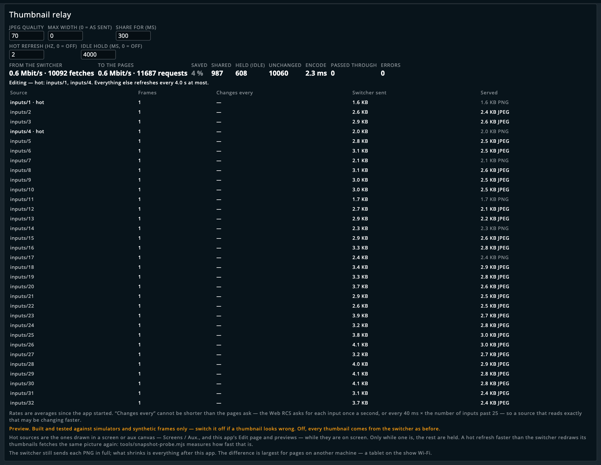
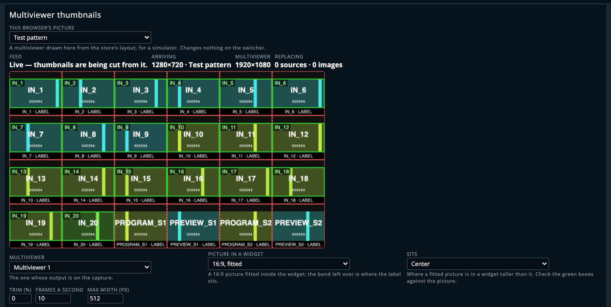
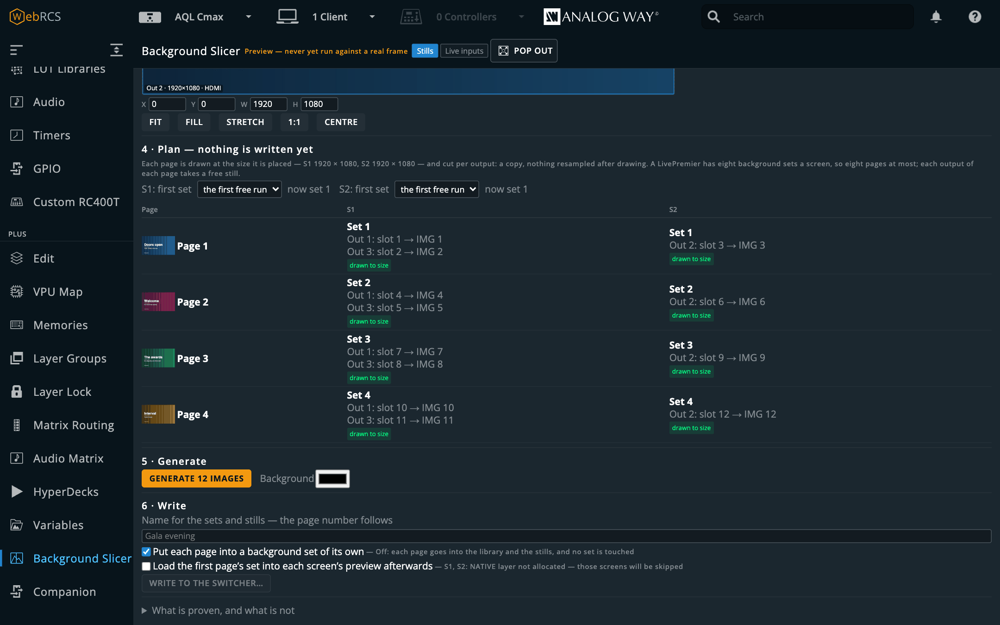
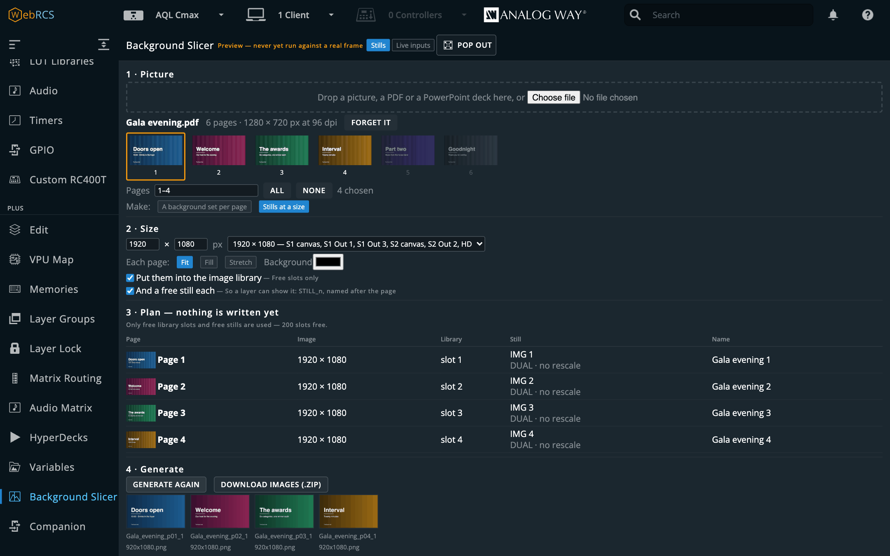

# LivePremier Plus user guide

LivePremier Plus is a local app that adds extra panels to an Analog Way LivePremier Web RCS
session, drawn in Web RCS's own design language so they look like part of the product rather
than something bolted on.


- **Edit:** the Screens / Aux. page with one row instead of two, and that row is a *programmer*,
  a buffer that's on neither preview nor program. Build a look with the same sources, the same
  layer parameters and the same memory bank, and the switcher sees none of it until you save it
  into a memory.
- **VPU Map:** the device's mixing-resource allocation, drawn as a budget: which units are
  fitted, who's holding them, what's spare, and what a staged preconfig would change. On firmware
  with no mixer map (6.1.60), each screen's layer sizes and the room left instead.
- **Console:** a lighting-desk command grammar for a video switcher. It also takes raw AWJ, store
  writes and OSC addresses, and on a Midra 4K or Alta 4K it routes audio.
- **Timeline:** a theatre-style cue stack that steps on with one GO, with per-cue fade, delay and
  follow times, and cues that fire from MIDI Time Code, LTC or a pushed timecode.
- **Memories:** every memory bank in one searchable list, showing which buffer holds each one.
- **Layer:** all 67 of a layer's properties, from the switcher's own catalogue, and names for
  layers, which the switcher has nowhere to keep.
- **Layer Groups:** several layers, on one screen or on many, driven as one. A ganged group
  follows a source change made to any member, wherever it came from.
- **Layer Lock:** a take that leaves chosen layers where they are, or takes one layer (or one
  group) on its own. The switcher can't do either by itself.
- **Preview lock during takes:** the vendor's own PRW padlock shut while a screen transitions,
  so a memory recalled straight after TAKE is refused instead of riding the take onto program.
  Off until you switch it on.
- **Pixel Map:** an image from the switcher's own library laid over a screen's preview as a
  mask, so you see what the LED wall will show of each layer. No layer spent, nothing written,
  and it never takes a click.
- **Surfaces:** the LED elements a screen lands on, as rectangles on its canvas, with layers
  bound to them. A bound layer stays inside its surface however it's moved, and full screen
  fills the surface. Off until you switch it on.
- **UMD Generator** *(preview)*: thin borders and dark name tabs for an aux laid out as a
  multiviewer, drawn as one transparent PNG from where each layer is and what it shows, and put on
  the aux's top layer, with 1, 3, 5 and 7-box layouts to start from. Off until you switch it on.
- **Test Card** *(preview)*: Test Card's patterns (bars, grids, alignment, LED tiles, rulers,
  life-size dinosaurs) in a tab beside the switcher's own Pattern tab, on an output and on a
  canvas, drawn for the switcher's own outputs and put on the top layer as a still. While it's on
  it follows every change. Off until you switch it on.
- **Image Library tools:** Delete all, delete a selection, a zip of pictures uploaded into the
  free slots in name order, and a capacity dropdown on every still's card. Off until you switch
  it on.
- **Aux follow:** an aux's layer that takes whatever source a screen layer has, however it got
  there, in program or role for role. Off until you switch it on.
- **AoI from a custom format:** an LED wall's custom format as an SDI output's AoI, set in one go
  from Preconfig ▸ Canvas. Off until you switch it on.
- **Resolume Mapping:** a Resolume Arena Advanced Output preset made from the switcher's own
  screens and outputs, and, if you like, the inputs it feeds into a background set. Off until you
  switch it on.
- **Send to:** a `…` on every source card that routes it to a screen and layer, or to a whole
  group, in preview or program, without a drag.
- **Matrix Routing:** patch the frame's own SDI and HDMI sockets to ports on a Blackmagic
  Videohub, a Lightware or a Turtle AV router, and route through it from the panel, a cue, the
  Console or OSC.
- **Audio Matrix:** the frame's audio channel matrix as a crosspoint grid: inputs and Dante
  onto outputs, Dante and multiviewers, by blocks of eight or by single channels.
- **HyperDecks:** Blackmagic HyperDecks, and Mitti through its HyperDeck control, played, cued
  and recorded from the panel, a cue or OSC. Link a deck to the input it feeds and rules play it
  when it goes on air, load its next clip when it comes off, and take when its clip ends.
- **Companion:** a Bitfocus Companion linked to this app: its buttons drawn and pressable here,
  a Companion trigger on cues and memory recalls, its own editor on the same address as Web RCS,
  and a panel that knows which switcher you're on and offers to add the connections that belong
  in the show.
- **Dante** *(preview)*: the Dante audio network's routing as a crosspoint grid next to the
  switcher it feeds, with snapshots and Dante Controller presets in and out. Off until you
  switch it on.
- **EDID builder:** EDIDs made beside the EDID bank and saved straight into it: one per custom
  format, automatically if you like, or by hand in the full EDID Editor.
- **Mosaic inputs:** the editor's Mosaic mode carried through to the frame: inputs grouped 2X1
  or 2X2, each plug loaded with its tile EDID.
- **Plug names** *(preview, off by default)*: each input plug's EDID renamed after the input's
  label, so the laptop on In3 says "PPT MAIN" in its display settings instead of AQL_HDMI, and
  numbered with the input, so two plugs are two displays. Not yet tried on a real frame.
- **Pitch Compensation:** the H and V ratios a screen spanning LED walls of different pitches
  needs, worked out from the pitches you give it.
- **OSC input:** QLab, TouchOSC, a lighting desk or Companion driving the switcher over UDP, with
  no browser open.
- **MIDI Mapping:** a control surface driving the switcher, from the page itself.
- **Speed Editor** *(preview)*: a DaVinci Resolve Speed Editor as a switcher panel, plugged into
  the machine this app runs on. CAM 1–9 pick sources, CUT and DIS cut and take, and the wheel
  moves opacity, position and size. Any browser works, as long as DaVinci Resolve is quit.
- **Pixelhue panel** *(preview)*: a Pixelhue U5, U5 Pro or U5 mini driving the switcher, with
  **Pixelhue Mapping** to give any key, fader or encoder a different job.
- **Barco EC panel** *(preview, off by default)*: a Barco EC-30, EC-40 or EC-50, plugged into the
  machine this app runs on, driving the switcher with no browser open. Quit the Event Master
  Toolset first: the panel takes one program at a time. Not yet tried on a real panel.
- **ATEM Micro Panel** *(preview, off by default)*: a Blackmagic ATEM Micro Panel, plugged into or
  paired with the machine this app runs on, driving the switcher like an ATEM, with no browser
  open. Quit ATEM Software Control first, or it switches your ATEM on every press too. Not yet
  tried on a real panel.
- **Lighting desk control** *(preview, off by default)*: a lighting desk driving the switcher over
  Art-Net or sACN, as it drives a media server: memories, takes, each layer's source and opacity.
  Driven from MagicQ PC against the simulator; not yet tried on a real switcher.
- **grandMA3** *(preview, off by default)*: a grandMA3 desk, or onPC with a wing, driving the
  switcher from its executors through the OSC the desk already sends. Tried with grandMA3 onPC,
  not yet with a wing or a desk.
- **Background Slicer** *(preview)*: one picture cut into a pixel-exact background for every
  output of one or more screens, uploaded and put into a background set, or each output fed live
  from an input, with the output map for the media server behind it. A PDF, a PowerPoint deck or a
  Keynote deck becomes a background set per page, or a still per page at any size. Off until you
  switch it on.
- **Thumbnail relay** and **Multiviewer thumbnails** *(preview)*: lighter source thumbnails, or
  live ones cut from a multiviewer. Both are off until you switch them on.
- **Remote access:** the app served over Tailscale (with a real HTTPS certificate) or ZeroTier,
  without binding it to the venue LAN.
- **Your setup in one file:** the cue stack, groups, names and locks, variables, pixel maps,
  surfaces, UMDs, test cards and Companion triggers, the routers and the patch to them, HyperDecks,
  Dante snapshots and settings, saved and restored together.
- **Arithmetic in the vendor's own numeric fields:** type `1080-80` into a layer width and get
  1000.
- **Variables:** `$S1.width` and friends for what the switcher reports, and `@names` of your own,
  wherever a number goes: the Console, a numeric field, an OSC argument.

Every one of these is a plugin, so you can switch any of them off, and you can add your own; see
[Switching features off](#switching-features-off).

The panels ride the vendor app's own WebSocket, so there's no second Web RCS connection to the
device, no replacement UI and nothing to install in the browser. OSC input, the Pixelhue panel,
the Console's `AWJ get` and the Edit page's direct save and memory export each open a brief AWJ
connection of their own when they act, which is worth knowing, because the switcher only allows five AWJ clients at once.

> **Before you rely on this:** the panels render inside a real Web RCS session and the device
> store mirrors live. Both are verified through this proxy against **LivePremier Simulator
> 6.2.73**, along with cue-stack persistence and the whole setup flow. The VPU map has been **read
> from a live Aquilon C** and is tested against that capture, including Optimized mode,
> interleaved output links, and a staged preconfig that differs from the running one. It has
> also been read from a live **Aquilon RS4 on firmware 6.1.60**, which reports no mixer map at
> all, not even over its own protocol; there the panel shows each screen's layers and the room
> left on the box instead. Both were read only, never written to.
>
> **Midra 4K and Alta 4K (QuickVu, Pulse, Eikos, QuickMatrix, Zenith 100/200) have been supported
> since 0.6.0** for the Timeline, Console, Memories, Layer and Pitch Compensation, and since
> 0.17.0 for the Edit page, HyperDecks and the Background Slicer too; Preview lock is proven on
> the Midra 4K simulator, and the UMD Generator gives a Midra its PNG. There's no VPU to map on
> those, and Matrix Routing, Audio Matrix, Mosaic inputs, Pixel Map and Surfaces are LivePremier
> only. MIDI Mapping and the Speed Editor hang under Virtual RC400T, which a Midra's sidebar
> doesn't have, so they don't appear, and the Plugins card says so on their rows; Pixelhue
> Mapping goes at the foot of the PLUS section instead. The port was proven on a **live Pulse 4K**:
> every write over the device protocol by a test harness, and the Console panel's own lines typed
> by the operator, which were the first writes this app's panels have made to real hardware. On
> LivePremier, an **Aquilon RS4** took one preview opacity from the Layer tab, and an **Aquilon C
> mini** has since taken writes from the Layer tab, Memories, the Console and the timeline, whose
> GO has now fired at real hardware.
>
> **The Edit page and Companion (0.10.0, 0.11.0) have been proven on simulators and a running
> Companion 5.0.5, not on a physical switcher.** Two of their limits are worth knowing now. The
> Edit page's *direct* save hands the switcher a file path that the switcher resolves, so it's
> unproven on real hardware (its *via preview* route works anywhere). And Companion can't add the
> LivePremier Plus connection until a Companion module for this app exists. The **Pixelhue panel**
> has met one real console, a U5 mini, which turned it away at the wrong address (0.18.1 is the
> fix) and then showed blank keys (0.18.2 is the answer), both below.
>
> **0.13.0 rebuilt every feature as a plugin.** Each was checked against the simulator and a
> Videohub emulator as it moved, and what each one does didn't change. A plugin of your own runs
> with the same access to the switcher as the app itself, so only switch on what you trust.
>
> **0.14.0 adds the Thumbnail relay and placeholder routers**, both proven on the simulator only.
> The relay is off until you switch it on.
>
> **0.15.0 adds Layer Lock, HyperDecks, the EDID builder, Mosaic inputs, Pixelhue Mapping and the
> Speed Editor**, all proven on the simulator (and emulated decks and panels) only. None had met
> real hardware at 0.15.0; the Speed Editor met a real panel in 0.16.0, below.
>
> **0.18.6 adds Plug names, off until you switch it on.** Each input's label goes into the EDID its
> plug serves, and its number into the serial, so a laptop sees "PPT MAIN" instead of AQL_HDMI.
> Proven on the simulator only. The EDID builder's EDIDs also name SWK, not OTR, as their maker,
> so a slot built before 0.18.6 shows as edited in From Formats until it's built and saved again.
>
> **0.18.5 lets Linux see the HDMI block on EDIDs with no detailed timing.** Every EDID the builder
> made for a CTA VIC (1080p60, 4K30 and so on) told a source, in one byte of its CTA extension, that
> it had no data blocks. Linux believed it, so a Linux machine treated the input as DVI and never
> read the VICs or the TMDS clock. That byte now points past the data blocks, and nothing else in
> the EDID moves. EDIDs already in a bank keep the old byte until you build and save them again.
> From EDID Editor's tests and a reader that parses the way Linux does, not from a screen.
>
> **0.18.4 fixes the TMDS clock the EDID builder states.** A built EDID now says the clock its
> mode needs, rounded up to the next 5 MHz: 150 MHz for 1080p60 12-bit 4:2:2, where it said 225,
> and 300 for 4K30, where it said 295, which is less than the mode itself. Mosaic tiles haven't
> changed. From EDID Editor's tests, not from a screen.
>
> **0.18.3 updates EDID Editor in the EDID builder.** It knows the NovaStar MX2000 Pro and MX6000
> Pro now, card by card, judges an HDMI 2.1 input on FRL when TMDS runs out, and costs YCbCr 4:2:2
> per link (24 bits a pixel on HDMI, twice the bit depth on DisplayPort). Nothing already in its
> table gives a different answer. From NovaStar's spec sheets, not from either processor.
>
> **0.18.2 draws a U5 mini's bus keys.** With 0.18.1 the mini connected, but its LCD keys stayed
> blank and TAKE did nothing: a mini's bus keys belong to its own LCD app. So this app now draws
> them on the console's key grid, a row per bus, and you switch each row to Companion to see them.
> Whether a mini sends this app TAKE and CUT is unknown; the card says so until it does. From the
> mini's firmware, not yet from a mini.
>
> **0.18.1 fixes the Pixelhue panel on a U5 mini.** The first real mini to try it answered
> "upgrade refused with HTTP 200": the panel had asked it for a U5's control socket, and a mini
> hasn't got one. It now asks for the mini's own, read from the mini's firmware, and the panel
> card says so if the socket opens and no key ever arrives. Not yet seen working on a mini.
>
> **0.18.0 adds Test Card, Resolume Mapping, Image Library tools, Aux follow, AoI from a custom
> format, the Barco EC and ATEM Micro panels, and slides in the Background Slicer** (PDF,
> PowerPoint and Keynote), every one of them off until you switch it on. Transitions and Layer
> Lock's timed take-only arrive behind Experimental features. HyperDecks now ask Mitti for its
> slot the way it answers. Proven on simulators and pretend panels only; none of it has run on a
> real frame or a real panel.
>
> **0.17.8 is fixes**, mostly for a Midra 4K or Alta 4K: icons that drew blank, the MVR key,
> SOURCE BACKUP's refusal, Pixelhue Mapping at the foot of PLUS, and Preview lock shutting PRW on
> the vendor's own TAKE button. Proven on simulators only.
>
> **0.17.7 adds the UMD Generator**, a preview: a thin border round each box and a dark tab with
> its source's name, drawn as a transparent PNG from where each layer is and what it shows, put on an aux's top layer or handed to the
> Background Slicer for a screen, with 1, 3, 5 and 7-box layouts for an aux. Off until you switch
> it on. Proven on LivePremier Simulator 6.2.73 only, and not on a real frame yet.
>
> **0.17.6 adds Surfaces**, the LED elements a screen lands on as rectangles on its canvas, with
> the layers bound to them kept inside. Off until you switch it on. Proven on LivePremier
> Simulator 6.2.73 only; on 6.1.60 only by comparing the vendor's bundle, and not on a real frame
> yet.
>
> **0.17.5 adds Pixel Map**, an image from the switcher's library laid over a screen's preview as
> a mask. Proven on LivePremier Simulator 6.2.73 only; on 6.1.60 only by comparing the vendor's
> bundle, and not on a real frame yet.
>
> **0.17.4 says a 6.1.60 box's spare room once.** The VPU map's Screens table gave the same room
> figure on every row; it's the whole box's, so it's now given once under the table.
>
> **0.17.3 is for firmware 6.1.x and a crowded tab strip.** The plugin tabs on Screens / Aux. sit
> behind a ⋯, arithmetic works in 6.1.x number fields, the Layer tab offers only the sources the
> switcher has, the VPU map shows a 6.1.60 box's layer sizes per screen instead of calling it a
> simulator, and two saves of one file at once no longer lose one.
>
> **0.17.2 fixes three things the live test suite found.** Mosaic inputs no longer offers an
> input that already belongs to a mosaic as the start of another, the Thumbnail relay no longer
> counts a revalidated frame as sent, and a plugin that's off because one it needs is off says so.
>
> **0.17.1 fixes the Background Slicer's LivePremier apply**, which took its own write as the
> switcher's answer, so a refused write read as landed. It now waits for the switcher's echo.
>
> **0.17.0 adds Variables and arithmetic wherever a number goes, and Preview lock** (off by
> default). **Dante** and the **Background Slicer** arrive as previews, off by default and proven
> on simulators only. HyperDeck commands end with a bare line feed, so Mitti accepts them.
>
> **0.16.0 adds Audio Matrix, Remote access and Multiviewer thumbnails, and the Speed Editor works
> on a real panel**, through the app's new device host, over USB. Audio Matrix and Multiviewer
> thumbnails are proven on the simulator only.
>
> Built with AI assistance, directed and reviewed by a human author.

---

## Running it

It needs **Node 20 or newer**, and there are no dependencies to install.

```bash
npm start
```

Then open `http://127.0.0.1:8535/` and give it the switcher's address. It remembers it.

```bash
npm start -- --device 192.168.2.142
```

| flag | meaning |
| --- | --- |
| `--device <host[:port]>` | the switcher. Port defaults to 80 (a simulator is usually `:3000`). |
| `--port <n>` | local port to listen on (default 8535) |
| `--host <addr>` | local address to bind (default `127.0.0.1`). Bind a LAN address or `0.0.0.0` to reach it from other machines. On the machine running it, keep using `http://127.0.0.1:<port>/` — that is the address browsers treat as secure, which MIDI Mapping and the timecode sources need; a local browser that arrives by the LAN address is sent there automatically. Other machines get everything except those, unless they come in over Remote access's HTTPS. |
| `--data <dir>` | where it keeps everything: settings, the last switcher, cue stacks, every plugin's per-switcher documents, and your own plugins (default `~/.livepremier-plus`) |
| `--appliance` | this host exists to run the app, so Remote access may join and leave Tailscale and ZeroTier networks for it |
| `--no-devices` | don't start the device host for USB panels (the Speed Editor) |

Each has an environment variable too, for a service manager or Docker: `LPP_DEVICE`, `LPP_PORT`,
`LPP_HOST`, `LPP_DATA`, `LPP_APPLIANCE=1` and `LPP_DEVICES=0`.

There's a desktop app too: a tray launcher with an interface and port picker.

### In Docker

Every change to the main branch publishes an image to `ghcr.io/stoatworks-labs/livepremier-plus`.
`:latest` is the newest of those, which can be ahead of the last release. Each image is also
tagged with its commit, so you can pin a release by the commit its tag points at.

```bash
docker run -d -p 127.0.0.1:8535:8535 -v "$PWD/config:/config" \
  ghcr.io/stoatworks-labs/livepremier-plus:latest
```

The repo's `docker-compose.yml` does the same with `docker compose up -d`, **but it publishes the
port on every interface of the host**. Change `8535:8535` to `127.0.0.1:8535:8535` unless the
whole network is meant to reach it (see *On binding wide* below). `./config` keeps your cue stacks
and the remembered switcher, and setting `LPP_DEVICE` skips the setup page.

> **On binding wide.** The default is loopback for a reason: **this proxy is an unauthenticated
> route to a switcher's entire control surface**, and once a Companion is linked, to that
> Companion's admin UI too. `--host 0.0.0.0` hands that to everyone on the network, so only do it
> when you mean to.

### From another machine: Tailscale or ZeroTier

**Preconfig ▸ LivePremier Plus → Remote access** serves the app to a Tailscale tailnet or a
ZeroTier network while it stays bound to loopback on the venue LAN. Both are off until you switch
them on.

- **Tailscale, HTTPS:** `https://<machine>.<tailnet>.ts.net/`, through `tailscale serve`, with a
  real certificate. Because it's HTTPS, MIDI and LTC input work from the remote browser too.
  Switch HTTPS certificates on for the tailnet once (admin console ▸ DNS); the first load after
  that waits about 15 seconds while the certificate is issued.
- **Tailscale, plain http:** `http://100.x.y.z:<port>/`, a listener on this host's tailnet
  addresses only. No MIDI or audio input from there.
- **ZeroTier:** `http://<zerotier address>:<port>/` on every network this host is authorised on.
  `zerotier-cli` has to be able to read the service's auth token.


The names in that picture are made up, from stand-ins for the two command-line tools.

Switching Tailscale off, or stopping the app, removes the `tailscale serve` entry it made. Joining
and leaving networks from the card is only offered when the app was started with `--appliance`,
because on a laptop the networks belong to whoever owns the laptop.

> ⚠️ **Neither network is a login, and this app doesn't have one.** Everyone who can reach the
> host can drive the switcher, so who can reach it belongs in the tailnet's ACLs or the ZeroTier
> controller's rules. The README has the full table, and what to do in Docker.

### Open it through the proxy, not at the switcher

**If you open the switcher's own address directly, the panels aren't there and MIDI won't
work.** Web MIDI is a secure-context API, and `http://127.0.0.1:<port>` counts as one where a
plain-HTTP LAN address doesn't (Remote access's HTTPS on a tailnet name does). The panel tells you
rather than failing silently.

---

## Edit — programming a look off the buses

**PLUS ▸ Edit.** The Screens / Aux. page, with one row per destination instead of two. Sources on
the left, the destinations in the middle and the layer panel on the right: the vendor's own
layout, so everything is where you'd look for it. The difference is the row. It's marked **EDIT**
in amber rather than PGM in red or PRW in green, because it's on neither bus.

**Nothing you do here reaches the switcher.** There's no TAKE, no T-bar and no padlock, because
there's nothing to transition and nothing to protect.


### Building a look

Each card starts empty. There are three ways to fill it, and none of them asks the device for
anything:

| | |
|---|---|
| **From PGM** | copy what is on air into the programmer |
| **From PRW** | copy what is cued |
| **Empty** | every layer full-frame with no source, which is what an untouched preset looks like |

Then work the way you would on the vendor's page:

- **click a layer** on the card, or a row in the strip beneath it, to select it;
- **drag it** to move, or take one of the eight handles to resize; the numbers land in the Layer
  panel as you go, clamped to the switcher's own limits;
- **click a source** on the left to put it on the selected layer;
- **Layer** on the right is the full parameter set, all sixty-seven of them: the same panel the
  vendor's tab strip carries, pointed at the programmer.

**Discard** forgets a destination's buffer entirely; **Empty** keeps it and clears it.

### Saving it into a memory

The **Memory** tab is the one control on this page that touches the switcher. Name a slot, give it
a label, and choose a route:

- **Direct** writes the memory bank itself. No preset buffer is written and no take is fired, so
  neither preview nor program moves. This needs the switcher to be able to read a file this app
  writes, which it can when both are on the same machine: a simulator, or an installation where
  the **Shared directory** under *Saving memories from the Edit page* (Preconfig ▸ LivePremier
  Plus) points at a share they can both see.
- **Via preview** puts the look into the preview buffer, fires the switcher's own save, then puts
  preview back property for property. **Program never moves.** Preview shows the look for about a
  second, and afterwards the bank calls it *modified* even though the content is identical (the
  switcher is right that the buffer was written to). It's refused while a take is in flight. This
  route works on any switcher, and it's the only one on Midra 4K and Alta 4K.

On a real switcher with no Shared directory set, the tab starts on **Via preview**, because Direct
has nothing it can work with there. Direct is still there to pick once the share is set up.

**Load into the programmer** reads a slot back the other way. A memory's contents aren't in the
device's own data (a slot only publishes its name, its canvas and what categories it holds), so
reading it out is the only way to see inside one, and it's how you pick up yesterday's look and
change it. It needs what Direct needs, the other way round: the switcher writes the memory onto its
own disk, so on real hardware it only works with the Shared directory set, and without it the page
tells you so rather than just passing on the switcher's error.

> On a real frame (Aquilon C mini, 6.2.73, 2026-10-30): a two-layer look saved via preview into an
> empty slot, then a different look saved over it. Each time preview showed the look for under two
> seconds and was put back, program never moved, and recalling the slot afterwards gave the second
> look. Load there said why it couldn't. Direct hasn't been tried on a real frame.

---

## VPU Map

**PLUS ▸ VPU Map.** A LivePremier configuration either fits the mixing resources the chassis has
or it doesn't, and the switcher's own interface only tells you which by refusing it. This draws
the budget instead: which VPUs are fitted, which screen holds which mixers, and what's spare.

Each VPU is drawn the way Analog Way's own manual draws one (an 8 × 8 field of links, with layer
links coming in from the left and output links running down from the top), so the picture matches
the documentation you've already got:


- **Native layers** sit in a band above the field, because a native is the bottom of the stack.
- **A screen that ran out of mixers** and carried on onto another VPU has the two cards stacked,
  with the link drawn straight down out of one and into the next.
- **The header over the columns** names each link's screen, and its region and output plug where
  the switcher's own output figures add up.

**Current** and **Staged** switch between the running configuration and the one waiting in
Preconfig, and a count says how many changes applying it would make, including a layer moving onto
different links with every other value identical, which still counts as a change. On linked frames
a button per frame (MASTER, FOLLOWER 1 and so on) picks which one you're looking at, and **Detail**
adds a table of every fitted mixer: the screen and layer holding it, its slice, capability, cut and
fill, and links.

Under the grid, **Screens** lists what each screen spends: outputs, output capabilities, and its
layers and their sizes (4K, DUAL and so on). On the staged side it also says how many more layers of
each size the box has room for. That figure is the whole box's, so it's given once rather than on
every row, where it would invite adding up; if the screens ever report different figures, each gets
its own. On firmware 6.1.60 that table is all you get. The switcher doesn't say how its VPU is
allocated, not to this page and not over its own protocol either, so there's no grid to draw and
the panel tells you that rather than pretending there's no VPU.

It only reads; nothing on this page writes to the switcher. It's LivePremier only: a Midra 4K or
Alta 4K has fixed processing rather than allocated mixers, so there's no budget to draw and the
entry isn't there.

---

## Console

**Screens / Aux. ▸ ⋯ ▸ Console.** The Console, Timeline, Layer, Groups and Pixel Map (and
Surfaces and UMD, when they're switched on) live in the vendor's own tab strip on Screens / Aux.,
but on LivePremier there's only room in it for one more thing after Properties and Memories. So they sit behind a **⋯** at the end: click it and pick one. While
one is open the ⋯ stays lit and shows that tab's icon; click Properties or Memories to go back. If
the strip has room (on a Midra 4K, say, or with some of these plugins switched off) they show as
ordinary tabs instead.

Verb first, then objects, innermost scope last. Every keyword abbreviates to any unambiguous
prefix, and **nothing is sent until you press Enter.**

```
Recall Screen 1 Memory 5
R Sc 1 Th 4 Me 5 Pre          the same command
Store Master 12
Take Screen 1
```

The line parses as you type and shows what it'll do (`Recall 3 → Screen 1 Preview`) before
anything reaches the device. Tab completes, and ↑ brings back history.

**Variables** go wherever a number does (`Set Screen 1 Layer 2 Size ($S1.width / 2) $S1.height`),
and the feedback names what each one reads before you press Enter. Sums go in brackets. See
[Variables](#variables).


**This panel has no grammar of its own.** Every token, rule and device path comes from
[mynah](https://github.com/stoatworks-labs/mynah)'s own build output, the same file its Companion
module vendors. If a command means the wrong thing, the fix goes in mynah.

There's a reason for that beyond tidiness. Mynah's compiler and this repo's command builder were
written independently, and they produce **byte-identical** store paths for the commands both
know. Two independent derivations agreeing is about the best evidence you'll get that either is
right, and it only stays true while nobody re-types the grammar here.

### Raw AWJ, store JSON and OSC

The same line takes three other languages, for when you've been handed a path rather than a
command: a line out of a packet capture, a frame out of the browser's network panel, an address a
lighting desk already sends. These are all the same write:

```
Take Screen 1
AWJ DeviceObject/$screenAuxGroup/@items/S1/control/@props/xTake = true
{"path":["device","screenAuxGroupList","items","S1","control","pp","xTake"],"value":true}
/lp/screen/1/take
```

Each line is read as whichever language it looks like, and the verdict shows beside the feedback
before you press Enter. Start a line with `MYNAH`, `AWJ`, `JSON` or `OSC` to say which outright,
or turn detection off on the **Console language** card in Preconfig ▸ LivePremier Plus. Everything
rides the vendor's own socket, an AWJ line included, unless **AWJ via** on that card says to send
AWJ exactly as typed on a socket of its own.

`AWJ get <path>` reads a value back, and it's the one line that always opens its own AWJ
connection, because the vendor's socket carries a stream of changes rather than answers. The
reply lands in the console's log.

**Pop out** opens the Console in a window of its own, with three things the tab hasn't room for:
a command dictionary generated from mynah's own grammar, with every word's shortest abbreviation;
live previews of the screens and auxes; and a Variables shelf, where a click puts a name on the
line.

---

## Timeline

**Screens / Aux. ▸ ⋯ ▸ Timeline.** A lighting desk's cue stack, driving a switcher: a numbered list
that steps on with one **GO**, where each cue recalls memories onto screens and takes them.

Each cue can carry:

| | |
|---|---|
| **fade** | its own transition time, written to the screen before the take |
| **pre-wait** | wait this long after GO before firing (the list's DELAY column) — a second GO during the wait fires it at once |
| **follow** | after this cue fires, fire the next one by itself, after a follow time you set |
| **timecode** | fire when incoming timecode passes this point (below) |
| **Companion trigger** | press these Companion buttons as the cue fires — see *Companion* below |

A few things behave the way a desk does rather than the way a switcher does:

- **GO fires the standby cue, then advances.** **BACK** moves the pointer only.
- **BACK isn't the switcher's STEP BACK.** That one is the vendor's own button in the Transition
  column, and it restores the device's previous state rather than replaying a cue. The two differ
  as soon as a cue does more than recall and take, and no cue ever presses it.
- **A cue is sent, never confirmed.** The switcher answers recalls and takes with silence, so the
  log says what left this app and the device status is shown separately.

**Add cue** opens a short form: what to recall (a screen memory or a master memory), the slot,
into preview or program, then a take, a cut or nothing, a fade, a label, and which screens and
auxes it targets (the ones the switcher has in use, all ticked to start with). Each cue in the list
has a tick box beside it; untick one and it sends nothing when its turn comes. **Export** and **Import** write the
stack out as a file and read one back.

The editor pops out into a window of its own, which is handy on a second monitor while the stack
runs. Select a cue there and everything it carries is editable below the list: number, timecode,
name, fade, pre-wait, follow, notes, the Companion buttons it presses, the HyperDeck commands it
sends, and its actions, with **Fire now** to try it on its own. It's keyboard first: ↑ and ↓ move
the selection, Space fires the selected cue, and a double-click makes a cue the standby.


### Firing cues from timecode

Choose a source under **Preconfig ▸ LivePremier Plus → Timecode**:

- **MIDI Time Code** from any MIDI input the browser can see;
- **Audio (LTC)** from an audio input on this machine;
- **Pushed to LivePremier Plus**: anything that can POST a timecode to this app, such as a
  generator on another machine, a lighting desk or a script. **Send it as a stream**, at least
  four a second and ideally every frame: a reading is counted as stopped a quarter of a second
  after it arrives, and a stopped clock fires nothing, so a single POST at a cue's time does
  nothing at all.

Then give the cues a timecode and press **Chase** on the Timeline; it reads **Chasing** while it's
armed. Nothing fires from timecode until you do, and arming it part-way through doesn't fire the
cues whose time has already gone: you armed it to catch what's coming.

A cue fires **once per pass**, not on every reading. **Going backwards re-arms** it, so you can
rehearse the same scene twenty times. **Jumping forward doesn't run everything it skipped.** The
cues in between are silently marked done and the show carries on from the new position, rather
than firing a hundred takes in a second.

Cue timecodes are written at 25 frames a second, so the frames run 00 to 24, whatever the source
runs at; the comparison is made in seconds, so a cue still lands within a frame. LTC doesn't say
what rate it's running at, so the reader assumes 25 as well.

---

## Memories

**PLUS ▸ Memories.** Every memory bank in one list: master, screen and layer on a LivePremier;
master, screen and aux on a Midra 4K or Alta 4K. Search by name, rename in place, and see which
preset buffer is holding each memory right now, and whether it's still unmodified.

- **A recall names its target every time.** The **To** chip says PRW or PGM, starts on PRW and
  never quietly becomes program, and program is coloured like the risk it is.
- **Save and erase** do what the vendor's own buttons do, and the page says which save filters the
  switcher will apply before you press it. Saving over a memory that's already there, or erasing
  one, takes a second click: the button turns into **Overwrite?** or **Erase?** first.
- **It pops out** onto a second monitor, which the vendor's own Memories tab can't do.


Click a name to rename it; **Enter** saves, **Esc** backs out.

---

## Layer

**Screens / Aux. ▸ ⋯ ▸ Layer.** Every one of a layer's 67 properties (source, position, size,
opacity, cropping, border, transitions, effects, masks and keying), generated from the switcher's
own parameter catalogue, so a firmware that adds a property grows a field for it.

You name the destination, the buffer and the layer outright, rather than the panel following what
you clicked. What you clicked is React state inside the vendor's page and can't be read from here,
and on a second monitor a panel that stays where you pointed it turns out to be better anyway.

- **The buffer is shown resolved.** PRW means "whichever letter is preview right now", and the
  panel says which letter that is. A buffer that's on air is banded in red.
- **Mid-take, it refuses to write to PRW or PGM**, because neither reliably names a buffer while a
  transition is running. A literal letter still works.
- **The source list is the switcher's, not the catalogue's.** It offers the inputs and stills that
  are available, enabled and in use in the applied preconfig (and screens set to Freestyle), and
  only the kinds this layer can take: a native layer takes background sets, an aux layer no colour.
  A source the layer already shows stays in the list, marked *(not available)*, so you can see
  what it is. The Edit page's picker follows the same rule; a cue, the Console or a group is not
  narrowed.
- **It pops out** into its own window.


### Naming a layer

Type a name into **Name** and it appears everywhere a layer is listed: this panel, the groups, the
`…` menu, and **the vendor's own layer lists**. The switcher has no field for a layer name, so this
app keeps it, per switcher, and anything that talks to the switcher directly won't see it.


---

## Layer Groups, and the `…` on a source card

**PLUS ▸ Layer Groups.** A group is a name and a list of layers, on one screen or on several:
layer 2 on screen 1 with layer 1 on screens 2 and 3 is *the side screens*. Add a layer with the
destination and layer pickers at the bottom of each group card. The layer list is the device's
own **fitted** list, so you're never offered a slot the hardware hasn't got.

The two source columns beside each member show what it's showing now, in program and in preview,
so you can see at a glance whether the group agrees.


**Gang: follows** is on by default. The rest of the group is written to match whenever any
member's source changes: by the `…` menu, by the vendor's own drag-and-drop, by a memory recall,
by another client. Turn it off and the group stays useful as a target and does nothing on its own.

A layer belongs to **one group at a time**. Adding it somewhere takes it out of where it was, and
the panel says so.

### Sending an input

Every source card in the Sources panel gets a **`…`** beside the vendor's own `⋮`. The `⋮` is the
vendor's and opens that input's settings; the `…` is this app's and routes it.


Preview and program mean the **role**, resolved per screen at the moment you click. Two screens
sitting on opposite preset letters (which is normal) still both get it in the right buffer.

**The PGM padlock is respected.** With program unlocked on the screens involved, a program send
goes through on one click. With it locked, you get a step that names every layer it's about to
change and asks. A screen you haven't got on the page has no padlock to read, so it's treated as
locked and you get asked about that one too.

> Mid-take nothing is sent. While a transition is in flight, "program" and "preview" don't reliably
> name a buffer, and the menu says so rather than guessing.

Groups are kept **per switcher**, beside the cue stack. Point the app at a different frame and you
get that frame's groups.

---

## Layer Lock — a take that leaves a layer alone

**PLUS ▸ Layer Lock.** One card per screen or aux, one row per fitted layer, each with **Lock** and
**Take only**. When Layer Groups is on, each group gets the same two buttons at the top.

The switcher has no per-layer take: TAKE swaps the whole program and preview buffers. What this
uses instead is the fact that **a layer that's the same in program and preview has nothing to
transition.**


- **Lock** keeps the layer's preview copy equal to its program copy. Change it in preview (the
  vendor's properties, a memory recall) and it's put straight back; change it on program and
  preview follows. Every TAKE and CUT sent from this page, the vendor's own buttons included, is
  held for the few milliseconds it takes to line a locked layer up if it has drifted (never more
  than three quarters of a second), then sent.
  Locks are kept per switcher and survive a reload.
- **Take only** takes that layer (or that group, on each of its screens) on its own: every other
  layer on the screen is set equal to program, the take is sent, and once it has landed the other
  layers' preview looks are put back into what is now preview. A locked layer can't be taken this
  way; unlock it first.

**Next take** is the switcher's own word for what each layer will do on the next take: *stays*,
*opens*, *closes*, *crosses*, *flies*. On a real frame, *stays* beside a locked layer is the
switcher agreeing. A simulator cheerfully says *stays* for every layer, whatever the buffers hold.

> ⚠️ **Only takes sent from this page are held.** The front panel, a T-bar, an OSC take, a
> Companion button speaking AWJ straight to the switcher and another operator's browser go straight
> to the switcher. Between takes a locked layer is kept in line, so it usually stays put anyway,
> but a recall and a take from outside in the same instant will move it. The panel says this at the
> top every time.

> ⚠️ **On a real frame without a live source only.** On an Aquilon C mini (6.2.73) a locked layer's
> preview, changed from outside the app, was back to its program copy within a third of a second,
> and the switcher's own verdict beside it read *stays*. Nothing was plugged into it, so no frame
> has yet been asked what it does with a locked layer that has a live source on it. The first time
> you use this on a show, lock a layer in rehearsal, take, and watch it. **Take only** did as it
> says on the same box: with two layers changed in preview, the one taken went to air and the other
> was still waiting in the new preview.

---

## Preview lock during takes

It's **off until you switch it on** in Preconfig ▸ LivePremier Plus → Plugins, and its card is on
the same settings page.

Press TAKE, then recall the next memory into preview before the take has finished, and the memory
doesn't wait. While a transition runs, the buffer the switcher calls *preview* is the one fading
up onto program, so the recall lands in the picture going to air.

Web RCS already has the guard rail for this, the **PRW padlock** on each screen card. This feature
presses it for you:

- When a take starts on a screen (TAKE sent from this page, or a transition the switcher reports
  from anywhere: front panel, T-bar, Companion, OSC), that screen's PRW padlock is shut. A TAKE
  from this page, Web RCS's own TAKE button included, shuts it before the switcher has even
  answered.
- While it's shut, Web RCS refuses a memory recalled into that screen's preview, with its own
  warning (*Screen memory could not be loaded … because PRW is locked*). A screen memory loaded on
  several selected screens still loads on the ones that aren't mid-take; a master memory that
  includes a screen mid-take is refused whole, with Web RCS's master warning (read from its code,
  not yet tried).
- When the take lands, the padlock is opened again. A take that never starts is let go after a
  second and a half.

It's careful with your own padlocks: one you'd shut before the take stays shut, and one you open
mid-take is left open. The card lists the screens it looks after (untick one to leave it alone),
what's mid-take now, and the last few things it did.


**This app's own recalls wait rather than being refused.** The padlock only stops Web RCS's own
buttons, so with this switched on the app holds its own recalls back itself:

- **Timeline cues.** GO on a cue that recalls into a preview that's mid-take, and the cue waits for
  the take to land and then fires whole: recall, fade and take in the usual order. The Timeline
  shows *waiting for take: 12 → S1* meanwhile, and **Stop** cancels it. Cues fire in the order GO
  was pressed: press GO twice quickly and the second waits for the first cue's take to land before
  it recalls, rather than loading over the look the first was about to take.
- **Recall in the Memories panel**, and a **Recall line at the Console**, work the same way:
  *waiting for the take to land*, then sent.
- A recall into **program** is never held. That's you saying *on air, now*.
- If the take hasn't landed by its take time plus three seconds (a T-bar parked half way, say),
  the recall is **not sent**, and the cue, panel or Console line says so. Sending it late, into the
  picture fading up, is the one thing this exists to stop.

> ⚠️ **Not held back:** Companion, OSC, the front panel and other browsers go straight to the
> switcher. And only screens whose card is drawn on the Screens / Aux. page can have their padlock
> shut; a screen whose card isn't on the page when its take lands is unlocked the next time it is.

> ⚠️ **With Web RCS's remote selection switched on**, padlocks are shared between everyone
> connected, so run this in one browser only.

> **On a Midra 4K or Alta 4K** the padlock is the same one on each screen's card, but Web RCS shows
> it differently: a shut PRW greys out that buffer's memory Load, its source pickers and memory
> drops, rather than refusing with a warning. A fresh Midra page also starts with every padlock
> open, PGM included.

> Proven on the LivePremier simulator against Web RCS 6.2.73's own lock: a memory clicked into PRW
> while a screen was mid-take was refused for that screen and loaded on the other, and loaded on
> both once the take had landed. With Web RCS's own TAKE button on S1 and S2 (six-second takes),
> both PRW padlocks were shut within 70 ms of the press and stayed shut until each screen landed,
> and a screen memory clicked into PRW 1.5 s into the take was refused on both, with Web RCS's
> warning in its notifications. Until 2026-10-17 a TAKE from that button never shut the padlock;
> one sent by this app did. Proven on the Midra 4K simulator (3.2.29) with real takes: without
> this feature, a memory recalled 0.6 s after TAKE went to program when the take landed. With it,
> the PRW padlock shut for the whole take (from this page or sent straight to the switcher) and
> opened on landing, a recall from the Memories panel waited and went into the new preview the
> moment the take landed, and with the T-bar parked half way the recall gave up and wasn't sent.
> On a real frame (Aquilon C mini, 6.2.73): the PRW padlock shut for a 5 s take and opened when it
> landed, and a Console recall typed a second into the take was held and sent as it landed, into
> the new preview; with the T-bar parked half way from outside, a recall waited and then said
> *not sent — S1 still mid-take after 3.0 s*, and nothing reached the switcher. Not yet run on a
> real Midra 4K / Alta 4K.

---

## Pixel Map

**Screens / Aux. ▸ ⋯ ▸ Pixel Map.** A pixel map is a picture of what a screen's canvas really
lands on: which bits of the raster are LED, where the gaps between panels are, the hole in the
middle where the set piece goes. Pick one from the switcher's image library for a screen and it's
drawn over that screen's PRW canvas, on its own card, while you build the look.



1. **Put the map in the image library.** Image Library in the vendor's sidebar, any PNG or JPEG.
   Draw it at the screen's canvas size if you can: white where there's LED, black where there
   isn't.
2. **Pick it for the screen.** Each screen and aux in service has a row: **Image** is the list of
   what's in the library, by slot, file name and size.
3. **Choose how it's drawn.**
   - **Mask**: black in the map hides what's under it and white leaves it alone. What's left is
     what the wall will show of each layer. Over an empty preview that's black, correctly.
   - **Over**: the map as it is, at the opacity, for panel numbers and outlines.
   - **Lines**: only the light parts show, for a white grid of panel edges over dark content.

   **Opacity** sets how strongly, and moves the map as you drag it.
4. **1:1 or Stretch.** 1:1 puts each map pixel on one canvas pixel, from the top left, which is
   the only way a pixel map tells the truth. Stretch fits the whole map to the canvas, for a map
   drawn at another size. A map that isn't its screen's size says so under its row.

**On** at the top of the tab draws the maps on PRW (the default), PGM or both, and **Show**
hides every map at once without forgetting them.

**It never gets in the way.** The map sits between the layers and their selection handles, so a
selected layer's handles are drawn on top of it, and it takes no pointer at all: clicking a layer,
dragging it, dropping a source on it and zooming the card all work as if the map weren't there.

**The switcher never knows.** No layer is spent and nothing is written to the switcher. Which
image goes on which screen is kept per switcher by this app, and goes into the setup file under
*Pixel maps*. The picture is the library's original file, the one the Image Library page's
Download button fetches, not its thumbnail, so one-pixel panel edges stay sharp as you zoom.

If a map's library slot is emptied, the map stops being drawn and its row says *Library slot 3 is
empty now*; it's kept, so loading the file back into that slot brings it back. The line at the
bottom of the tab says how many buffers it's drawn on, and says so if it can't find the cards.

> **LivePremier only.** A Midra 4K or Alta 4K has an image library too, but its Screens page lays
> the cards out differently, so the tab isn't offered there.

> Proven on LivePremier Simulator 6.2.73: drawn over S1 and S2 in every mode, on PRW, PGM and both;
> a click through a map selected the layer under it; the map followed the card's zoom, came back
> after leaving the page and went when its slot was deleted. On 6.1.60, the RS4's firmware, the
> library and the image routes answer the same and the card is drawn by the same code, but no card
> was drawn there. On a real frame (Aquilon C mini, 6.2.73) the map loaded from the box's library at
> its own size and was drawn over S1's PRW canvas, taking no clicks.

---

## Surfaces

**Screens / Aux. ▸ ⋯ ▸ Surfaces**, once it's switched on in **Preconfig ▸ LivePremier Plus →
Plugins**. It's off to start with because it rewrites the vendor's own layer moves on their way
to the switcher, and you should get to decide that.

A screen's canvas is one raster, but what it lands on is usually several physical things: a
wall in three pieces, a header strip, a pair of IMAG screens either side. Each of those is a
**surface**, and a layer bound to one stays inside it.



1. **Make the surfaces.** Each screen in service has a section. **Add** makes a surface the size
   of the canvas; type its name and its X, Y, W and H in canvas pixels, the same units a layer's
   own position and size are in. **From outputs** makes one per output feeding the screen, where
   that output sits on the canvas. That's right when one processor drives one element, and only
   a start when one output feeds several.
2. **Bind layers.** Under the surfaces, each layer has a list: pick the surface it lives on. A
   binding is the layer slot, so it holds in program, preview and on the Edit page.
3. **Watch the outlines.** Every surface is drawn as a dashed outline on its screen's PGM and PRW
   cards, over a Pixel Map and under the selection handles. They take no clicks. **Outlines** at
   the top of the tab hides them; the layers are still kept in.

What "kept in" means:

- A **drag or a nudge** stops at the surface's edge. Drag one edge past it and the opposite edge
  stays put. Drag a corner with the ratio kept and it stops with its shape.
- **Full screen** fills the surface, and so does anything that asks for the whole canvas, such as
  a memory that was saved full screen.
- The **align** buttons align to the surface: centre means its centre, left its left edge.
- A layer **too big** for its surface is made to fit, keeping its shape unless you were changing
  its shape.

**On the Edit page** the same rule applies to the programmer, and a dragged layer stops at the
edge while you're still dragging. On the vendor's page the box follows the pointer past the edge
and settles back inside when you let go, because the vendor draws its own drag; the switcher
never sees it outside.

**From anywhere else.** Companion, OSC, the front panel, another browser or a memory recall can
still put a bound layer outside its surface. On **preview** it's pulled back in a moment later.
On **program** it isn't: nothing here moves what's on air by itself. It's flagged instead, red on
the card and in words at the top of the tab, so you can fix it in preview and take. A layer that
something keeps moving back out is let go after three goes rather than fought over, and the tab
names it; change its binding to try again.

**Layer Lock wins.** A locked layer is kept equal to program, so Surfaces leaves it alone, and the
binding says *locked*.

**Changing a surface moves nothing.** Layers it no longer fits are flagged until they're next
moved.

The surfaces and bindings are kept per switcher by this app and go into the setup file under
*Surfaces*.

> **LivePremier only**, for now.

> Proven on LivePremier Simulator 6.2.73 on 2026-10-16: full screen and align-to-middle on a bound
> layer landed on its surface; a drag past the edge stopped there on the switcher and on the
> vendor's card; a change from outside the page was pulled back on preview and left alone on
> program; the Edit page's drag stopped at the edge. 6.1.60's Web RCS has the same buttons and the
> same drag code. On a real frame (Aquilon C mini, 6.2.73): full screen filled the surface, a change
> from outside was pulled back on preview, and program was flagged and left alone.
>
> ⚠️ **Full screen can't pull in a layer that already fills the canvas.** The vendor sends nothing
> when its full screen would change nothing, so a fresh full-canvas layer you've just bound stays
> where it is, flagged. Make it any other size first, or type its size, and it will be kept in.

---

## UMD Generator (preview)

**Screens / Aux. ▸ ⋯ ▸ UMD**, once it's switched on in **Preconfig ▸ LivePremier Plus →
Plugins**. It's off to start with because it uploads into the image library and writes a still
and an aux's layers, and it hasn't met a real frame yet.

It draws a multiviewer's furniture (a thin line round each box and a dark tab with the source's
name) as one transparent PNG the size of the screen or aux, from where its
layers really are and what they're really showing.


1. **Pick the destination** at the top of the tab, and the buffer: **PRW** to build it in
   preview and take it, **PGM** to work on what's on air.
2. **Lay it out (an aux, optionally).** **Template** lists the layouts the aux has layers for.
   An aux's layers come with its capability, in pairs (an advanced aux gets 2 at 4K, 4 at 5K, 6 at
   "6" and 8 at 8K), and the top one carries the UMD, which leaves 1, 3, 5 or 7 boxes. Every box
   keeps the canvas's shape; **Gap** stands them apart. **Lay out** writes the box layers'
   positions and sizes and empties the box layers the template doesn't use. It leaves sources
   alone, so route your cameras before or after, as you like. **Layers as they are** skips this
   and draws whatever you've built yourself.
3. **Name the boxes.** Each box layer has a field. Leave it blank and the box is named after its
   source: the input's or still's label, or `IN5` if it hasn't got one. Type a name and it wins.
   **Name from ▸ Layer name** uses the names from Layer names instead. A layer with nothing on it
   isn't drawn, unless you've named it.
4. **Set the look.** Labels in a dark tab inside the bottom of each box, inside the top, under
   the box, or none; the border, its width (blank is 2 px at 1080, in proportion above) and its
   colour; the text size; CAPITALS; and how dark the tab is. The preview shows the boxes as grey
   stand-ins with the UMD over them, and lists anything wrong: a name too long for its box (it's
   shrunk, then cut short), a label with no room under its box, a label a layer would hide.
5. **Put it on the switcher.**
   - **An aux: Put on L*n***. The PNG goes into a free library slot, a free still is pointed at it
     (no rescale), and the aux's top layer shows the still over the whole canvas. After the first
     time the button is **Update UMD**, which only uploads the PNG again: the still and the layer
     follow by themselves. If the UMD is on program, the button asks first, since the update is on
     air as soon as it lands. The line under the buttons says where the UMD is and whether it
     still matches the layers.
   - **A screen: To Background Slicer.** A screen's background is cut per output, and the
     Background Slicer does that, so the UMD is handed to it as its picture with the screen
     chosen. Open **PLUS ▸ Background Slicer** and carry on there. It has to be switched on.
   - **Anywhere: Download PNG**, to load it yourself.

**Undo** takes back the last thing the tab wrote to the destination you're looking at: a layout,
or a UMD's layer, still and library slot. An update can't be undone back to the previous picture,
which wasn't kept.

**Why an aux uses a layer and not its background.** The vendor's page offers an aux's background
nothing but *None*, and the preconfig never gives it any capacity. The switcher's control software
will in fact accept a still there (it did on the simulator), but whether a frame then shows it is
not known yet, so the UMD uses a layer it knows will.

The box names, label positions and where each UMD went are kept per switcher by this app and go
into the setup file under *UMDs*.

> **LivePremier** for writing. A Midra gets the preview and the download.

> Proven on LivePremier Simulator 6.2.73 on 2026-10-16: a 7-box layout on an 8-layer aux; the UMD
> put on its top layer and checked over AWJ; an update after a rename, on program; a screen's UMD
> handed to the Background Slicer. On a real frame (Aquilon C mini, 6.2.73, 2026-10-30) the screen
> path ran: a named box drawn, handed to the Background Slicer, written and undone (that box has
> no aux, so the aux path and whether a frame keys the still's transparency are still unseen).

---

## Test Card (preview)

A **Test Card** tab beside the switcher's own **Pattern** tab, in two places:

- **Setup ▸ Outputs ▸ an output**, after Format, Signal, Adjustments and Pattern: a card for that
  one output.
- **Preconfig ▸ Canvas**, after Canvas and Pattern, for whichever screen or aux is picked on the
  left: a card for the whole canvas.

Switch it on in **Preconfig ▸ LivePremier Plus → Plugins** first. It's off to start with because
it uploads into the image library and writes a still and a layer, and it has only met one real
frame so far.


The patterns are [Test Card](https://test-card.stoatworks-labs.com)'s, drawn by Test Card's own
code: SMPTE RP 219 and EBU bars, a grid, alignment, LED tiles, a solid field, greyscale, a pixel
check, rulers, a banana for scale, life-size dinosaurs, the hamster dance, ocean waves, the
dinosaur scroll, the volcano and the broken wall. They're drawn for the switcher's own outputs,
from what the switcher says about them (raster, place on the canvas, slices, turn and pitch), so
there's nothing to import and nothing to type.

### Why it isn't simply another pattern

Because the switcher can't be given one. Its own patterns are generators with a fixed list (21
on an output, 15 on a screen, none of them a picture), so a Test Card goes up the only way a
picture can: as a still on the destination's **top layer**, over everything, which is where the
switcher's own patterns appear too. The library slot and the still are free ones, taken when you
switch it on and given back when you switch it off.

What you get instead is the next best thing to drawing it on the switcher: **it follows.** While
a card is on, pick another pattern, change an option, give an output a new format or a new name,
or move it on the canvas, and the card is drawn again and uploaded into the same library slot.
The still picks the new picture up by itself, and nothing else is written. On the simulator that
takes a second or two.

### Putting a card up

1. **Pick a pattern.** The tiles are the patterns, drawn small. The ones marked *still* move in
   Test Card itself, and here they're one frame of the loop (a switcher has no player); **Frame
   at** picks which.
2. **Set its options.** Each pattern has the handful that matter: a grid's cell size, an LED
   tile's size, a solid field's colour and level. Every pattern has **Levels** (full or legal),
   **Name and size** burnt into the corner, and a line of your own. The scale patterns are drawn
   at real size from a pixel pitch, which the switcher doesn't know; they say *pitch assumed* on
   the image until you've set it.
3. **On the Canvas page, pick a layout.** **Per output** gives each output's footprint its own
   pattern and its name, which is the quickest proof there is that the canvas map is what you
   think. **Across the canvas** draws one pattern over the lot and outlines each output on top, so
   seams and overlaps show.
4. **Enable.** The card goes on the top layer in **preview**, so you can look at it and take it.
   Tick **On program** first to put it straight on air instead; Enable then asks once more, and
   the tick is off again the next time the page loads. A card already on program stays there, and
   every change you make goes to air as you make it, which the tab says.

On the outputs page, each output you switch on joins the others on the same screen: one picture,
the size of the box round them, with each card in its own output's footprint and nothing
anywhere else, so the outputs you haven't switched on carry on showing the show. Switching on the
canvas card replaces the output cards, and the other way round.

**Off** puts back exactly what was there before: the layer's source, position and size, anything
it had cropped or keyed, the still, and the library slot. That's kept on disk, per switcher, so
it still works after a reload or from another browser. It only takes back what's still the
card's, though: if someone has put something else on the layer meanwhile, the card stops
following and says so, and Off leaves the layer as they made it (and the same goes for a still or
a library slot somebody has reused).

If something goes wrong half way, the card shows as on, and Off takes back whatever of it landed;
if Off itself can't put everything back, it says so and stays on, so you can press it again. When
a screen has something up that the switch on the page you're on doesn't stand for (another
output's card, say), **Take everything off** is there for it.

**Download PNG** gives you the card as a file, and on the Canvas page **To the Background
Slicer…** hands it over as a picture, if you'd rather have it as a background set under the
layers, cut per output.

### What to check

- **The top layer has to be big enough.** A layer's capacity is judged the way a still's is, by
  area: DUAL up to 1920 × 1200, 4K up to 4096 × 2160, 5K up to 5120 × 2880. A canvas card on a
  wide canvas needs a big layer, and the tab says so before you try. Output cards are smaller,
  one footprint each.
- **A turned output** gets its card drawn upright on the canvas, and the switcher turns it into
  the raster as it turns everything else.
- **A pitched output** (a ratio other than 1.000) has a footprint that isn't its raster, so the
  switcher resamples the card on the way out. The tab names the outputs that aren't pixel for
  pixel.
- **The image library's size counter** never drops a replaced file, on the simulator or on a real
  frame, and Off doesn't give that back. On an Aquilon C mini the vendor's own Image Library header
  went from 91 kB to 354 kB for one card and two changes of pattern, and stayed there. A picture
  uploaded once and deleted gives its space back; it's the replacing that sticks. A card that's
  followed a lot of changes may be using more of the library than the slot count says.

The pattern, its options, which cards are on and what Off puts back are kept per switcher by this
app and go into the setup file under *Test cards*.

> **LivePremier** only. On a Midra 4K or Alta 4K the tab says so, and Test Card itself gives you
> the PNGs.

> Proven on LivePremier Simulator 6.2.73 on 2026-10-20, every write on the switcher's own echo:
> a card on one output and then on two of the same screen, a canvas card per output and across
> the canvas, each on the top layer in preview; one on S2's program; a change of pattern, and a
> rename on the switcher, each a re-upload into the same slot that the still followed with
> nothing else written; and Off putting the layer, the still and the library slot back. The
> simulator draws no pictures, so nothing here has been seen on an output.
>
> On a real frame (Aquilon C mini, 6.2.73, 2026-10-30): a card on Output 1 went onto S1's top
> layer in preview, from the last free still and library slot, with program and the library's
> other pictures untouched. A change of pattern was uploaded again and the still followed with no
> layer write, and Off put the layer, the still and the slot back. Not yet looked at on an output.

---

## Image Library tools (off by default)

Switch on **Image Library tools** in **Preconfig ▸ LivePremier Plus → Plugins**. It's off to
start with because it deletes library images and applies still capacities, and it has only met
one real frame so far.

The vendor's **Image Library** page gives every card a bin and nothing else, which is fine until
there are two hundred of them. This puts three things on the end of the page's header:

- **Delete all** empties the library.
- **Select** lets you click cards (shift-click for a run) and then delete just those.
- **Upload .zip** takes a zip of pictures, unpacks it in the browser and puts them into the free
  slots in name order, so `slide 9` comes before `slide 10`. Dropping a zip on the page does the
  same. The litter macOS and Windows put in zips (`__MACOSX`, `._` files, `.DS_Store`,
  `Thumbs.db`) is passed over quietly; anything else it can't take is named, with the reason.

On the **Images** page every still's card gets a **capacity dropdown** (Dual, 4K, 5K) beside its
tally, so you don't have to trek off to Preconfig ▸ Images.

Everything asks first, and the questions use the switcher's own answers. Two of them matter more
than the rest:

- **Deleting a library image empties every still showing it**, there and then, as the vendor's
  own bin does. The question names those stills. A picture a still is showing on program or
  preview is never deleted, and that's checked again just before each slot, in case a take landed
  while you were reading.
- **An empty slot isn't always unclaimed.** A still keeps pointing at a slot after its picture
  goes, and a picture uploaded into that slot turns up on the still at once. So an upload skips
  those slots unless you tick **Use assigned slots**; then they're used after every clean slot,
  and the question names each still. The tick is off again every time the page loads. The
  Background Slicer, the UMD Generator and Test Card follow the same rule.

A capacity change is staged and put through the switcher's own check before you're asked, and
it's refused if it would take a still that holds a picture out of service. There's no Undo for a
delete; the question says so.

> Proven on LivePremier Simulator 6.2.73 on 2026-10-20: selecting and deleting, Delete all, a zip
> dropped on the page (thirteen pictures in name order round two filled slots, the litter left
> out), assigned slots left alone, and capacities changed and refused. On a real frame (Aquilon
> C mini, 6.2.73, 2026-10-30): a zip of three pictures went into the three free slots in name
> order, with the litter left out quietly and a `.txt` named with its reason; then Select picked
> just those three, the question named them, and they were deleted, with the library's other
> pictures untouched. The capacity dropdowns read what the switcher said. Delete all and a capacity
> change haven't been run on a real frame.

---

## Aux follow (off by default)

Give an aux's layer a screen layer to follow and it takes whatever source that layer has, however
it got there: the vendor's drag, a memory, a take, the front panel, Companion. The switcher has no
such link, so it's kept by the page. With no LivePremier Plus page open, nothing follows.

There are two ways to follow:

- **Program**: the aux's program cuts to match when the screen's take lands, or when somebody
  edits the screen's program directly. The aux's preview stays yours.
- **Program and preview**: role for role, so an aux taken with the screen transitions with it,
  and an aux left out of a take is put back in line when the take lands.

It only ever acts on a change at the screen end. Take or edit the aux by hand and it isn't pulled
back. Setting up a follow that would change the aux's program asks twice, because that's the one
time it acts on what it finds rather than on a change.

> LivePremier only. Proven on LivePremier Simulator 6.2.73 on 2026-10-20, with the changes made
> from outside the page: preview edits left alone, a take followed onto the aux's own program
> letter, a direct program edit followed, both roles mirrored, and an aux taken alone not fought.
> Not yet on a real frame.

---

## AoI from a custom format (off by default)

An LED wall defined as a custom format, say 3000×1000, can't go down SDI as one, because SDI only
carries standard formats. So the output runs a standard format big enough to hold it, and its
**AoI** (area of interest) is the wall.

On **Preconfig ▸ Canvas**, select the output, and under its AoI pick the custom format and where
it sits: top left, top centre or centred. **Set AoI** writes it the way the vendor's own AoI fields
do, then reads back what the switcher made of it. The output's footprint on the canvas becomes the
wall's size, so the canvas is laid out in the wall's own pixels.

A format bigger than the output is refused rather than written, because the switcher would quietly
clamp it. Groups, DP-box slices and clones are refused with the reason; the vendor's own fields
still do those.

> Proven on LivePremier Simulator 6.2.73 on 2026-10-20: the simulator's own 3000×1000 `LEDwall`
> refused on a 1080p output, then centred on a 3840×1080 output, with the switcher reporting
> 3000×1000 at 420, 40 and its own fields and canvas redrawn to match. Not yet over a real SDI
> card, or on a real frame.

---

## Matrix Routing

**PLUS ▸ Matrix Routing.** Patch the switcher's own sockets to ports on an external router (a
**Blackmagic Videohub**, a **Lightware** or a **Turtle AV**) and route through it from here.
LivePremier only for now: the Router tab and box it adds are written into LivePremier's own
pages.

You describe the **cable**, and the rest follows. The direction inverts, which looks wrong at
first glance every single time:


So a switcher input is fed by a router *output*, and a switcher output arrives at a router *input*.
The patch form says which of the two it wants as you fill it in.

**Set it up in three steps.** Add the router (name, protocol, address; the port follows the
protocol's own default). Patch each cable: pick a socket, pick the router, give the port number at
the other end. Then route.


Sockets are named in the device's own words, because which connector "card 2, port 1" is depends on
a legend this app can't see:

```
Input 13 · card IN_2 · connector IN_25 · sdi
Output 5 · card OUT_2 · hdmi
```

**The two route controls are different, on purpose.** An input row gets a source dropdown with one
choice, because a socket is fed by one router output, and that settles what the input sees. An
output row gets a destination field, because the signal arrives at one router input and can go to
any number of outputs at once: type `3`, or `1-4`, or `1,2,5-8`.

> ⚠️ **Sending adds; it never takes away.** Naming outputs 1-4 routes those four and leaves output 5
> alone, even if it was showing this source a moment ago. A router output always shows *something*,
> so "removing" a destination would mean choosing a different source for it, and there's no right
> answer to which one.

**The Now column is what the router says, not what you asked for.** A click doesn't move the grid
until the router agrees, and it keeps up with changes made at the router's own front panel or by
another operator. A Videohub answers a route it won't make with an acknowledgement and the
unchanged crosspoints, so a panel that just showed your request back to you would look right and
be wrong, at the worst possible moment.

### Placeholder routers — building before the rack

A router that hasn't turned up yet can still be patched and routed. Add it with **Protocol ▸
Placeholder (no hardware)** and pick its **Model** (Videohub, Lightware MX2 or MX-FR, Turtle AV,
or a custom size), and it behaves like the real one everywhere: the panel, the Router tabs, cues,
OSC and the Console all route through it. Nothing's on the other end; its crosspoints are kept
here as the router's **plan**.

When the rack arrives, **Go live…** gives it an address. The patch carries over, nothing is sent on
connect, and **Push plan** sends only the crosspoints that differ. A planned port past the real
frame's size is named, not dropped.

### On the input and output pages

You don't have to leave the socket you're working on. **Inputs ▸ an input** and **Outputs ▸ an
output** carry a **Router** tab beside Signal, Aspect and the rest, and **Preconfig ▸ Inputs /
Outputs** shows a **Router** box under the selected card's own boxes.

Each says which router port the cable is on (if it isn't patched yet, patch it right there), then
shows the router's ports twice: as a **grid of tiles** and as a **list** with the router's own port
names.


- **An input** picks one source. Click a tile or a row and it routes at once.
- **An output** picks any number of destinations. Clicking builds a selection (a dashed outline),
  and **Route** sends it. A solid blue tile is one the router already has on this output; the list
  shows what every other destination is showing now, which is what a route there would replace.

> ⚠️ **In Preconfig this is live, not part of Apply.** The route goes to the router straight away;
> Apply only concerns the switcher.

### From a cue, the Console and OSC

A cue can carry a matrix route beside its recalls and takes. It goes out ahead of the take, so the
signal is there before anything switches to it.

> ⚠️ **A cue doesn't wait for the signal to lock.** An SDI reclock is quick, but an HDMI or HDCP
> handshake through a router can take a second or more, and nothing reports when it's done. A cue
> that routes and takes in one breath can take to black, so put the route in an earlier cue when
> the format may change.

The same three addresses work typed at the Console and sent over OSC:

```
/lp/matrix/input/5/source        7        switcher input 5 now sees router input 7
/lp/matrix/output/2/destinations "1-4"    switcher output 2 out of router outputs 1-4
/lp/matrix/hub/route/3           9        router "hub": output 3 takes input 9
```

The routers are kept for the **installation**, not per switcher, because a Videohub doesn't move
when you fail over to a backup frame. The **patch** is per switcher, beside the cue stack, because
it describes that frame's own sockets.

> **What's been proven, and what hasn't.** The Videohub driver was driven end to end against a
> working implementation of the protocol, including the crosspoint numbering, which counts from
> zero on the wire and from one everywhere you can see. **No real Videohub has been in the loop.**
> The Lightware and Turtle AV drivers are written from their vendors' protocol documents and
> **have never spoken to the hardware at all**. `docs/MATRIX.md` gives a short procedure for
> proving each on your own kit before a show.

---

## Audio Matrix

**PLUS ▸ Audio Matrix** (LivePremier only). The frame's audio channel matrix as a crosspoint grid,
with sources down the side (inputs and Dante) and destinations across the top (outputs, Dante and
multiviewers).

The whole matrix is 576 source channels by 272 destinations, which is far more than anyone can
read, so it opens as **blocks of eight**. A block says how many of that destination's channels
come from that source, and is solid when it's exactly 1→1 … 8→8. **Click a block** to lay the
source across the destination channel for channel, or to clear it when that's what is there. Click
a row or column header to **open it into its eight channels**; where an open row meets an open
column, each cell is a single crosspoint.


- **What's lit is what the switcher reports**, not what was clicked. A click marks the cell as
  pending, the switcher's echo lights it, and a write it never echoes is named in the note line.
- **M** mutes a destination channel, or a source; a source mute silences it everywhere. A dot
  beside a name means signal is present.
- **Fitted only** hides the inputs and outputs this frame has no card for (anything patched is
  always shown), and **Collapse all** closes every open row and column.
- **Lock** stops clicks from patching, for a matrix that's live on a show. Groups still open and
  close.
- **It pops out**, because a matrix is wide and the sidebar isn't.

The Console's `Set Audio Patch Input 3 Channel 1 Thru 8 To Output 1` is the same write as a click.
On a Midra 4K or Alta 4K there's no channel matrix and the entry isn't offered; audio there is
routed from the Console.

> On a real frame (Aquilon C mini, 6.2.73, 2026-10-30): a block clicked patched Input 8 across
> Multiviewer 2 channel for channel, M muted and unmuted one of its channels, and a second click
> cleared it, each read back from the switcher. Signal dots weren't tried; nothing was plugged in.

---

## HyperDecks

**PLUS ▸ HyperDecks.** Blackmagic HyperDecks, and anything that answers their protocol (Mitti
included), played, cued and recorded from the switcher's own UI, and made to follow the show.

1. **Add a deck** at the foot of the panel: a name, its address, port 9993, its kind (HyperDeck,
   Mitti, or other) and its role (player, recorder or both). For Mitti, switch HyperDeck control
   on in Mitti's own preferences first.
2. Open **Settings and rules** on its card and pick the input it **plays into**: the plug on the
   back of the frame its output is cabled to. A recorder can name the output that **feeds** it.
3. Its card now shows what the deck is doing (clip, elapsed, remaining, **ON AIR** / **PVW**) and
   drives it: Prev, Top, Play, Stop, Next, a clip to cue, and Record on a recorder. **Record
   all** and **Stop recorders** are in the toolbar.

   
4. Tick **Follow the switcher** and choose what happens when its input is put on program (play),
   put in preview (rewind), taken off (pause, rewind or load the next clip), and when a clip ends
   (take or cut the screens it's on air on, optionally a few seconds early so the mix lands on
   the last frame). Tick screens to narrow it; none means all.

> **The rules run in an open page.** One page at a time runs them (the panel says which), and a
> page that starts running them only acts on what changes after that, so opening one never plays a
> deck that's already on air. With no Web RCS page open, the buttons, cues and OSC still work, but
> nothing follows the switcher.

In a cue, the **HyperDeck** field takes `VT 1 clip 3; VT 1 play; recorders record Act 1`. Over OSC
it's `/hyperdeck/<deck>/play` and the rest, all in docs/OSC.md.

> ⚠️ **Written from Blackmagic's published protocol and proven against an emulation of it, but not
> yet against a real HyperDeck.** `docs/HYPERDECK.md` has a short procedure for proving it on your
> own deck before a show.
>
> **Mitti needs 0.17.0 or later.** A real Mitti 2.8.18 answers `103 unsupported` to any command
> that ends in a carriage return, which is how 0.16.0 ends them. 0.17.0 ends them with a bare line
> feed, which a HyperDeck takes as well. With 0.16.0, Mitti accepts the connection and refuses
> everything after it.

---

## Triggers (preview, off by default)

**PLUS ▸ Triggers.** A cue that does more than switch: unmute the VT channels on the desk, take
the house lights down, fire the lighting desk's VT state, and put all of it back when the video
ends. Switch it on in Preconfig ▸ LivePremier Plus → Plugins; it needs the Timeline.

1. **Add a destination** at the foot of the Destinations list: a name, its kind and address.
   OSC (UDP) for most desks, QLab and lighting desks. MIDI over TCP for an Allen & Heath dLive or
   SQ. Art-Net or sACN for a universe this app sends.
2. **Add a trigger** and give it **go** and **back** lines. A line starts with the destination's
   name: `Desk /ch/17/mix/on 1`, `AH msc go 45 list 1`, `House 1-4 @ 0 fade 3`. Back lines put it
   right again, and a DMX level of `before` means whatever the channel was before the go.
   **Test go** and **Test back** send them now. A line the panel can't read is listed under its
   trigger with the reason.
3. **In a cue**, the Timeline's **Triggers** field names the triggers to fire and when to send
   them back:

   ```text
   VT audio; House down; restore when Mitti ends or after 5:00 then go
   ```

   `when <deck> ends` is a HyperDeck or Mitti clip ending. `after` is a time, `at next cue` is the
   next cue this page fires, and `by hand` is the panel's job. `then go` GOes the stack, and
   `then cue 13` jumps there and GOes it. The back lines go out in reverse order.

Anything waiting to be put back is at the top of the panel, with **Restore now** and **Discard**,
and **Restore all** in the toolbar.

> **The server keeps the holds,** so the lights and the desk come back even if the tab that fired
> the cue has closed. Only `then` needs that page, because it moves that page's cue stack. It's
> done only when the show got there by itself (a clip end or the time) and nobody has moved the
> stack since. A hold left from before a restart is offered, never fired by itself.
>
> **DMX is a stream, and a universe is shared at your peril.** Art-Net from two sources is merged
> by the node, and sACN priority wins the whole universe, not just the channels a line set. Use a
> universe nobody else sends, or fire the lighting desk's own cue instead. On sACN, `release`
> hands the universe straight back to the desk.

> ⚠️ **Never yet run against a real desk, node or lighting desk.** The bytes are checked against
> the published formats and pretend receivers. `docs/TRIGGERS.md` has the rest and a short
> procedure for proving it on the rig; `tools/trigger-sink.mjs` prints what arrives.

---

## Dante (preview)

**PLUS ▸ Dante.** The Dante audio network's routing (who's listening to what), read off the
devices themselves, beside the switcher it feeds. It's off by default: switch it on in
**Preconfig ▸ LivePremier Plus → Plugins**, then reload.

> ⚠️ **Preview: it hasn't been run against a real Dante device yet.** Its protocol code is held to
> packets Dante Controller itself sent, and everything else was proven against a simulated network.
> `docs/DANTE.md` has a short test to run with Dante Virtual Soundcard or the switcher's own card
> before you trust it with a show. Keep Dante Controller open beside it the first time.

### Finding the devices

Devices are found on their own. The app asks the network every 30 seconds by default, from a port
of its own,
so Dante Controller and Dante Virtual Soundcard on the same machine aren't disturbed. On the
**Dante** card in Preconfig ▸ LivePremier Plus you can change how often it asks, choose which network interface to ask on, list devices **by
address** for a network where multicast doesn't reach this machine, and set how often each device
is read again (every 5 seconds by default; this is how a change made in Dante Controller shows up
here).

### The grid

Receiving devices down the side, transmitting devices across the top. A block says how many of the
receiver's channels take from that transmitter, and is solid when it's channel for channel (1→1,
2→2 …). Click a device's name to **open it into its channels**. Where an open receiver meets an
open transmitter, each cell is one subscription, coloured by what the receiver reports: blue for
connected, orange while it's being set up, red for unresolved or failed. Hover over a cell or a
channel for the device's own words.



1. **Unlock** the grid (it opens **Locked**: clicks only open and close devices).
2. Click a cell to subscribe that receive channel to that transmit channel, or to clear it when it
   is already lit. Click a block to lay the transmitter across the receiver channel for channel, or
   to clear exactly that; past eight subscriptions it asks first.
3. The cell waits (dashed) until the device has been read back. The note line and **Last change**
   say what each device reports: *confirmed*, or why not.

**Filter** narrows the grid by name, and **Routed only** hides the empty channels. **Devices**,
under the grid, lists each device's model, address, protocol revision, sample rate, latency and
channel counts, and says why one can't be changed, if it can't.

**This switcher.** The switcher's own Dante card is found by the name in its store and marked
**this switcher**. Its receive channels show the outputs the **Audio Matrix** sends them to
(`→ Output 7 ch 1`), and its transmit channels the input they carry. If it isn't found (its Dante
name was changed, say), choose it on the same card, under **This switcher's Dante card**.

### Dante Controller presets

- **Export preset** saves a Dante Controller preset of every device read. In Dante Controller,
  **File ▸ Load Preset** opens it like one of its own.
- **Import preset…** reads a preset saved by Dante Controller and shows, device by device, which
  subscriptions applying it would change, **including the ones it would clear**: as Dante
  Controller does, a receive channel the preset leaves empty, or doesn't list, is cleared. Each
  role in the preset is matched to a device by its id or name; pick another, or *not applied*, to
  change that. **Apply** sends exactly what was shown, and if the network has changed since, it
  says so and shows the difference again.

Only subscriptions are applied from a preset, never names, sample rates, latency or network
settings. Dante Controller is the tool for those.

### Snapshots

Type a name and **Save current routing** to keep every receiving device's subscriptions. **Recall**
says how many subscriptions it would change, then changes only those, and lists anything it
couldn't do. Snapshots are saved in the setup file with everything else.

### From a cue, the Console and OSC

In a cue, the **Dante** field takes `snapshot Show A`, or `1@Amp-1 <- Mix L@Desk` to subscribe
receive channel 1 of Amp-1 to Mix L on Desk, or `Front L@Amp-1 <- none` to clear one, with `;`
between several. Over OSC or at the Console: `/lp/dante/snapshot/Show-A/recall`,
`/lp/dante/route/Amp-1/2 "Mix R@Desk"`, `/lp/dante/clear/Amp-1/2`. The full list is in
`docs/OSC.md`.

---

## Companion

**PLUS ▸ Companion.** A [Bitfocus Companion](https://bitfocus.io/companion) (5.0 or newer) linked to
this app: its buttons drawn and pressable here, a cue or a memory recall that presses them, and its
own editor served on the same address as Web RCS, so there's no second port to get through a
firewall.


### Connecting

Tick **Connect to a Companion**, give its address, and press **Connect**. The port is Companion's
own admin port: 8000 unless it's been changed in Companion's settings. The link is off until you
turn it on, because an app that reached out to a machine on the show network the moment it started
wouldn't be one you could reason about.

### What is in the show

The panel lists the show's connections (label, module and status) and **follows them live**, so a
connection added or disabled in Companion (including in its editor, opened from here) shows up
without a reload. The two it has an opinion about are highlighted:

- **AWJ:** the switcher itself: sources, presets, takes, layers.
- **LivePremier Plus:** this app: cue stack, timeline, layer groups, matrix routing.

What it does with them is an **offer, never a sync**:

- a connection already in the show is **used as it is**, and its settings are left alone, whatever
  it's labelled;
- two of the same module is **reported, not resolved**: a show with a main and a backup frame is a
  perfectly correct show, and the panel won't pick one for you;
- a missing one is listed under **Not in the show yet**, with the address it would be pointed at,
  and **Add … to the show** creates it and configures it for the switcher you're on. Nothing is
  written until you press it.

> **The LivePremier Plus connection can't be added yet.** It needs a LivePremier Plus module in
> Companion, and there isn't one yet; the panel says so in those words. The AWJ connection works
> today.

**If you opened this app on 127.0.0.1**, that's the address the LivePremier Plus connection would
be given, and a Companion on another machine can't dial it. The panel warns you. Open this app by
its network address first if Companion is somewhere else.

### Buttons

The panel draws Companion's pages as a grid, in this app's own look, with each button exactly as
Companion renders it (text, colours, feedbacks, variables) and updated the moment it changes. Press
one and it's pressed in Companion; hold it and it's held, so a long-press or a *while held* action
behaves as it does under a finger. Pick the page from the list, or step through with ‹ and ›. Dim
buttons have nothing on them.

- **Pop out** puts the grid in a window of its own, for a second monitor or a touch screen.
- **Edit in Companion** opens Companion's own button editor in a new window, through this app, for
  programming a button. Everything you change there shows here at once.

The grid only runs while it's on screen. Move to another panel and it stops asking Companion for
images.

### A cue that presses a button

Each cue has a **Companion trigger** field, in the cue editor (Timeline ▸ Pop out) and in the
Timeline tab's **New cue** form. Type buttons as `page/row/column`, the way Companion numbers them
(`1/0/3`; several separated by commas), or press **Choose…** and click one in the grid (nothing is
pressed while you're choosing). When the cue fires, the buttons are pressed alongside its recalls
and ahead of its take, the same moment a matrix route goes out. An address it can't read is
refused, and the field says why.

The press goes through this app's own link, not the page, so it works whether or not the Companion
panel has been opened, and whether or not Companion's *HTTP API* setting is on.

### A memory recall that presses a button

**Memory triggers**, at the bottom of the panel: choose a bank and a slot, the buttons to press,
and **Set**. From then on, recalling that memory presses them, whether from the Memories panel, a
cue, the Console or the vendor's own Memories tab. **Test** presses them now. One recall sent to
several screens at once presses once.

> **Only recalls made in this page are seen.** A memory recalled from the switcher's front panel,
> from Companion itself, or from a browser that isn't going through this app presses nothing,
> because this app has no way to hear about it. That's also why two open pages don't press the
> button twice.

Triggers are kept per switcher, beside the cue stack, and travel in the setup file.

> **Linking a Companion widens what this app exposes.** Everything below `/__lpp/companion` is
> Companion's admin UI, reachable by anyone who can reach this app. On the default loopback binding
> that's only this machine; see *On binding wide* above before you change that.

---

## EDID builder

**Setup ▸ EDID.** The switcher keeps a hundred custom EDID slots (the **EDID Bank** tab, ED1 to
ED100) and has nowhere to make an EDID to put in them. It wants a file, and getting one is your
problem. This puts the [EDID Editor](https://edid-editor.stoatworks-labs.com) beside the bank,
so an EDID is built and saved without a file changing hands.

### From your custom formats

**From Formats** is a third tab beside Default EDIDS and EDID Bank. It lists every valid custom
format in Setup ▸ Formats (M1–M16) with an EDID already built for it:

- **Every porch is kept.** The EDID is built around the format's exact timing, not re-derived from
  its resolution and rate. Where the raster is exactly a CTA-861 mode (1080p60 is VIC 16), the VIC
  goes in too, because consumer sources act on VICs; anything else is a detailed timing.
- **Its name** is the label you gave the format when it fits the EDID's 13 characters, otherwise
  `M3 1080p50`. It's what the bank card and every input show.
- **Save to ED…** puts it in the next empty slot. **Save N to the bank** does every one that's
  missing. **Edit…** opens it in the editor first. The download button saves the `.bin`.
- **Keep the bank filled** does it for you: whenever a format has no EDID in the bank, one is added
  to the next empty slot. It never overwrites a slot and never deletes one. A format you change
  leaves its old EDID where it was, because an input may be using it.


A format counts as *in the bank* when some slot's EDID has the format as its preferred mode, so an
EDID you opened from here, renamed and saved still counts, and the switch won't add a second copy
beside it.

> **The rate can read 0.01 Hz low.** An EDID states its pixel clock in 10 kHz steps, so a format
> whose clock falls between two steps comes back as the nearest: 3000x1000 at 50 Hz is 162.424 MHz,
> stored as 162.42, which the bank shows as 49.99Hz. Every porch is exact; it's the nearest rate an
> EDID can say.

### Creating or editing one by hand

**Create EDID…**, at the end of the same row of tabs, opens the full editor in a window of its own.
An **edit** tool on every filled bank card opens it on that slot. It's the same editor as the
website: Simple (a resolution and a rate), Advanced (every field), Mosaic (one tiled EDID per plug,
so a Mac bonds its outputs into one display), the signal cost, and which inputs will take it,
across the 23 models in its hardware table: Analog Way, Barco, PixelHue, NovaStar, Brompton,
disguise and Green Hippo.


**Save to the switcher**, at the top right, writes it. Pick the slot (it starts on the first empty
one, or on the slot you opened), and it says what it would replace before you press. A mosaic saves
its tiles into that many slots in a row, as their exact bytes, and **Apply to inputs** groups the
inputs 2 × 1 and loads each plug with the tile for its place.


The save finishes when the switcher reports the new EDID, not when it accepts the request.

> On a real frame (Aquilon C mini, 6.2.73, 2026-10-30): an EDID saved into ED100 came back with its
> name and turned up on the vendor's EDID Bank tab. The switcher's own save route also leaves a
> copy in its EDID editor, as Web RCS's does; that's harmless, and nothing else on the box changed.

The window works through the Web RCS tab it came from, like every popped-out panel here. Close that
tab and it tells you it can't save any more.

### Mosaic inputs

**Apply to inputs** comes from a plugin of its own, **Mosaic inputs**, which is on unless you
switch it off and only appears in the editor's Mosaic mode (so with the EDID builder off it has
nowhere to show). It does the two halves a Mac needs to bond several outputs into one display:
it groups the inputs **2X1** or **2X2** (IN_n and the next inputs in order become its members) and
loads each member plug with its own tile EDID, because grouping on its own leaves the plugs with
the stock EDID and the Mac sees separate displays. It's offered only the inputs that can start a
group.

> ⚠️ **Grouping is a preconfig change.** It copies the running preconfig, sets the group, has the
> switcher check it and applies it, the same steps Preconfig ▸ Inputs sends, and there's no undo in
> the window: put an input back to single in Preconfig ▸ Inputs. LivePremier only, and proven on
> the simulator only; no Aquilon has bonded a Mac's outputs this way yet.

### Plug names

Every input on a LivePremier introduces itself to whatever's plugged into it the same way: Analog
Way, product 8002, serial 0, **AQL_HDMI** (or AQL_DP). So a laptop plugged into In3 and In4 has two
displays with the same name, and somebody gets to guess which is which while the client watches.

**Plug Names** is a tab beside From Formats, there only while the **Plug names** plugin is on
(it's off until you switch it on in Preconfig ▸ LivePremier Plus → Plugins). One card per input
with an EDID, and for each one:

- **The name is the input's label**, put into the EDID's display name, which is what macOS,
  Windows and Linux show in their display settings and what most apps call the screen. An EDID
  holds 13 plain characters and no more, so "powerpoint main" comes out as "powerpoint ma".
  Type a **short name** on the card ("PPT MAIN") and that's used instead, for as long as the label
  stays the same. Accents are dropped (é becomes e) and anything that isn't plain text goes.
- **The serial is the input's number**, so In3 is serial 3. A computer tells two displays apart
  by maker, product and serial, and remembers each one's arrangement by them. With every plug
  saying serial 0, two plugs from one switcher look like the same display twice.
- **Nothing else changes.** It renames the EDID the plug already has, whatever put it there: a
  default, a bank slot or a template. Every mode, block and audio setting stays as it was.

**Name** does one plug and **Name *n* plugs** does every card that's out of date. A card stays out
of date when you rename the input or type a new short name: nothing is written until you press.

> ⚠️ **Every rename is a hot-plug.** The plug drops whatever's connected and takes it back, so
> that source goes black for a second or two and a computer may shuffle its displays about. Do it
> before the show. More than one plug, or one that's on program, asks first. A computer meeting
> the new serial treats it as a new display once, so its resolution and arrangement need setting
> again that one time.

**Undo** puts back the EDID the plug had before it was first named here, byte for byte. The
original is kept by this app, per switcher, because the switcher doesn't keep one, and it
survives a reload. Undo is offered only while the plug still has the EDID written here: if you've
loaded another EDID onto it since, that's your newer choice, and Undo won't put an older one over
it. A plug you load a different EDID onto later takes that EDID's own name again. Name it again if
you want the label back.

Left alone: plugs in a mosaic group (their tile EDIDs have to match each other, and a Mac shows
the group as one display anyway), SDI inputs (no EDID), inputs with no label and no short name,
and an EDID with no room for a name. That last one is an EDID whose four descriptors are all
timings, and it's refused rather than having a timing thrown out to make room.

The write is the one the switcher's own EDID page sends when you drop a bank slot onto an input,
and the switcher reads the new name and serial back itself. LivePremier only: a Midra 4K or Alta 4K
plug takes a requested format, not an EDID written to it. Proven on the simulator only; no Aquilon
has been renamed this way yet.

---

## Pitch Compensation

**Preconfig ▸ Pitch Compensation**, beside the fields it fills in. A screen spanning LED walls of
different pixel pitches needs each output told how much canvas its raster is worth, or a layer
changes physical size the instant it crosses the join. The switcher has the fields for it
(Preconfig ▸ Canvas ▸ Pitch, **H Ratio** and **V Ratio**) and no help working out what to put in
them.

It knows every number but one. The panel reads the rasters, the outputs on the screen and the
ratios already set, and only asks you for the pitches, one per output: `2.6`, or `2.6 x 3.0` if the
pixels really aren't square.

- A **coarser** wall takes a ratio **above** 1.000, because the ratio multiplies a raster to give
  its footprint on the canvas.
- A ratio the switcher wouldn't accept is **refused here** rather than sent: the device discards an
  out-of-range write instead of clamping it.
- **Applying takes two presses.** It's a preconfig change that moves every output on the screen at
  once, so it ought to be hard to hit by accident. If the switcher already holds the computed
  ratios, the button says so and does nothing.


---

## OSC input

It's off until you turn it on in **Preconfig ▸ LivePremier Plus → OSC input**. Then this app
listens on a UDP port, and QLab, TouchOSC, a lighting desk or Companion can drive the switcher
with no browser open.

```
/lp/screen/1/take
/lp/screen/1/memory/5/recall/preview
/lp/master/memory/12/store
/lp/screen/1/preset/a/layer/2/opacity/opacity/norm 0.5
```

Every address, its argument and its range are in
[docs/OSC.md](https://github.com/stoatworks-labs/livepremier-plus/blob/main/docs/OSC.md), which is
generated from the same tables that resolve the messages, so it can't list an address that doesn't
work.

- **The address is the target; the argument is only the value.** A button with a fixed address and
  no argument still means something specific.
- **A trigger fires on a non-zero argument and on none at all.** Surfaces send 1 on press and 0 on
  release, and firing on both would take the screen twice.
- **A recall never defaults to program.** `…/recall` goes to preview.
- **`/norm` takes 0–1 and scales**; without it the value is in the switcher's own units, so opacity
  is 0–256, not 0–100.
- **Live layer parameters must name a buffer:** `/a`, `/b` or `/c`. Over UDP there's no way to know
  which letter is preview at this instant, so `preview` and `program` are refused with that reason
  rather than guessed. The Console can resolve them.

It binds to this machine only unless you choose otherwise, and the other option tells you in as
many words that the network will be able to fire takes.


> On a real frame (Aquilon C mini, 6.2.73, 2026-10-30): a layer's opacity on `/b`, a take and a
> take back, a release (`0`) that took nothing, and a `preview` address refused with its sentence.

---

## MIDI Mapping

It's under **Virtual RC400T**. Pick an input, an output for feedback and a controller profile, then
press Start. Faders, encoders and buttons then drive the selected layer.

The engine is [awj-surface](https://github.com/stoatworks-labs/awj-surface)'s, vendored whole along
with its stock profiles (X-Touch/Mackie, APC40, MIDIcon 2 and Pro, plus a generic learn profile).

**Soft pickup is the bit worth knowing about.** A non-motorised fader won't move a live value until
it's swept *through* that value, so grabbing a fader mid-show can't make a layer's opacity jump.
The panel shows the hold-off rather than looking broken, so if a fader seems dead, that's what
you're seeing.


---

## Speed Editor (preview)

It's under **Virtual RC400T**, next to MIDI Mapping: a DaVinci Resolve Speed Editor as a switcher
panel.

1. **Plug the panel into the machine LivePremier Plus runs on**, by USB, or pair it over Bluetooth.
   That isn't necessarily the machine your browser is on: the app holds the panel, not the page.
2. **Quit DaVinci Resolve.** Both would hear every key and fight over the lamps.
3. Open **Speed Editor**. It says *found* once it sees the panel.
4. Press **Start**. The app opens the panel, answers its handshake, and the JOG lamp lights.


(The panel in that picture is the tests' stand-in, which plays the real handshake.)

Only one page drives the panel at a time. Another page with it started says *Another page is
driving it*, with **Take over** to move it there. Press **Stop**, or close the page, and the app
lets the panel go within a few seconds.

The panel is held by the app's **device host**, a helper program that the app starts, and restarts
if it ever stops. Its state, and whether it has found the panel, is on **Preconfig ▸ LivePremier
Plus**, in the **Device host** card, with a **Restart** button. The desktop app carries it. If
you're running from a checkout, install it once with `npm run setup:devices`. The Docker image has
no USB and no device host, and the Speed Editor page says so.

The keys act on the selected screen, preset and layer:


The wheel has the same **soft pickup** as a MIDI fader, and the panel's activity list shows each
write it made. The panel only talks after a handshake with the app, which is renewed before it
lapses; if a renewal fails the panel goes quiet and the page says so, then tries again. Unplug it
and plug it back in and it's found and answered again by itself.

> ⚠️ **Preview.** Proven on a real panel over USB on macOS against the simulator: CUT, the CAM keys,
> the wheel, the battery level, and unplugging it and plugging it back in. The key lamps, Bluetooth
> and Windows or Linux haven't been tried yet. Treat the first show with one as a rehearsal.

---

## Pixelhue panel (preview)

A Pixelhue **U5**, **U5 Pro** or **U5 mini** event controller, driving the switcher. It's off until
you tick **Drive a Pixelhue console** in **Preconfig ▸ LivePremier Plus → Pixelhue panel**.

The buses aren't mapped. The console is handed a model of this switcher (its screens, inputs and
memories) and labels, lights and pages its own keys from that. What comes back is what the operator
meant: *select screen S2*, *put input 2 on the selected layer*, *take*. So there's nothing to remap
when a firmware moves a key.

A **U5 mini** is the exception. Its bus keys are labelled by its own LCD app, which only knows how
to talk to Pixelhue switchers, so this app draws them itself on the console's key grid (the one
its built-in Companion uses): screens, the active screen's layers, inputs and memories, a row
each, eight keys and that row's two page keys. A row only shows them once you've switched it to
**Companion** with its area-switch key, the last key on the row. While this app is connected the
grid is its, so the console's own Companion can't draw there. Nobody knows yet whether a mini
sends this app TAKE and CUT at all. The card says **TAKE / CUT: not seen yet** until it does, and
until then, take from the Web RCS.

Everything else is mapped on **Pixelhue Mapping**, in the sidebar under Virtual RC400T, next to
MIDI Mapping — or at the foot of the PLUS section on a Midra 4K or Alta 4K, which has no Virtual
RC400T. It draws the console in the Virtual RC400T's look, with the buses showing what the
console shows and every function key, fader and encoder labelled with what it does. Click one to
change it. Any key can take, cut, fade to black, step the layer, run the cue stack, **recall a
memory to preview** or **press a Companion button**, among others; a fader can follow its own layer
or the selected one; an encoder can move, size or fade the selected layer. Press a key on the
console and it lights up on the page and opens, so you can find it. A changed control has a blue
dot, and **Reset** puts everything back.


- A **U5 mini** answers on the network, so it's driven from wherever this app already runs. It has
  less on it than a U5: no faders or encoders, and no TIME, MVR, SIGNAL SOURCE or lower-left
  cluster, so take time, layer stepping and the cue keys have no key on it. Pixelhue Mapping draws
  every model as a U5 for now.
- A **U5** or **U5 Pro** only serves its control port to itself, so this app has to run on the
  console. Luckily that's a Windows mini-PC with a touch screen, and it runs the proxied Web RCS
  perfectly well.

> ⚠️ **This hasn't worked on a real console yet.** It was built from the consoles' firmware and
> proved against the vendor's own control service running with no panel attached. The first real
> one to try it, a U5 mini, refused the connection because it was asked for a U5's address; 0.18.1
> asks for the mini's own. It then connected with its keys blank, which 0.18.2 answers by drawing
> them on the mini's key grid; that hasn't met a mini yet. If the panel card says **connected, no
> key reports**, or **TAKE / CUT: not seen yet** after you've pressed TAKE, that's worth telling me
> about. Treat the first show with one as a rehearsal. Fade-to-black and freeze are sent on LivePremier, not yet on
> a Midra 4K. SOURCE BACKUP is LivePremier's only: a Midra 4K or Alta 4K input has no backup, so
> the key says so instead. docs/PIXELHUE.md lists what each key does, and has a test suite to run the day a
> console turns up ("Testing it on a console").

---

## Barco EC panel (preview, off by default)

A Barco **EC-30**, **EC-40** or **EC-50**, plugged into the machine this app runs on, driving the
switcher with no browser open: screens on the destination keys, layers on the layer keys, inputs,
stills or memories on the labelled rows, ALL TRANS, CUT and the T-bar.

Switch on **Barco EC panel** in **Preconfig ▸ LivePremier Plus → Plugins**, then tick **Drive a
Barco EC panel** on its card. The panel takes one program at a time, so quit Barco's Event Master
Toolset first; if the card says *in use by another program*, that's what's holding it. The EC-200
and EC-210 aren't supported.

Everything else, from what each key does to the platform notes, is in
[BARCO-EC.md](BARCO-EC.md).

> ⚠️ **Never run against a real panel.** The protocol comes from captures of Barco's own software
> driving a real EC-50; here it has only met a pretend panel that keeps that protocol's rules, and
> a simulator at the far end. Try it in rehearsal, not in a show.

---

## ATEM Micro Panel (preview, off by default)

A Blackmagic **ATEM Micro Panel**, plugged in or paired over Bluetooth, driving the switcher the
way it drives an ATEM, with no browser open: the M/E keys pick screens, the preview row puts input
*n* in preview, CUT, AUTO and the T-bar take, and the program row shows tally.

The program row only cuts to air if you tick that on the card, and the tick isn't kept: it's off
again next time. Quit ATEM Software Control first, or every press switches your ATEM as well.

The key map and the rest are in [ATEM-MICRO-PANEL.md](ATEM-MICRO-PANEL.md).

> ⚠️ **Never run against a real panel**, only against a pretend one and a simulator.

---

## Lighting desk control (preview, off by default)

A lighting desk (grandMA3, MagicQ, Titan, anything that sends **Art-Net** or **sACN**) driving the
switcher the way it drives a media server: an **LPP Screen** fixture per screen (Control, Memory,
Take, Cut) and an **LPP Layer** fixture per layer (source folder, source file, opacity), plus an
**LPP Master** for master memories and every screen at once.

Switch on **Lighting desk control** in **Preconfig ▸ LivePremier Plus → Plugins**, then tick
**Listen for a lighting desk** on its card. List the screens and how many layers each gets; the
card shows the patch and has the **.gdtf** files to import into the desk and a **Patch .csv**.

Nothing happens to a screen until its **Control** channel is raised: 25% and up edits preview, 50%
and up edits program. Memory recalls to preview, Take and Cut fire on a rise past 50%, and nothing
fires on the first frame after the app starts or a desk takes over. Opacity is a Dimmer, so it
follows the desk's grand master. **Only these desks** limits who can drive it.

The channel tables, the patch, sACN priority and backup desks, and what has been run are in
[DESK-CONTROL.md](DESK-CONTROL.md).

> ⚠️ **Never run with a real switcher.** It has driven the simulator from MagicQ PC on the same Mac
> and from a pretend desk. A desk on the same Mac has its own settings to get right; DESK-CONTROL.md
> has them.

## grandMA3 (preview, off by default)

A grandMA3 desk, or grandMA3 onPC with a wing, driving the switcher from its own executors. The
desk isn't asked to do anything new: an OSC line with **Send** on already sends a message every
time a playback moves, and this listens. One line per executor says what it does here:

```text
14.14.1.6.1 Go+         -> /lp/screen/1/take
14.14.1.6.3 FaderMaster -> tbar S1
```

A key sends its target when pressed. A fader follows an address ending `/norm`, throws the T-bar
for `tbar`, and on anything else is a button that fires on the way up. You don't have to know
the addresses: move something on the desk and it turns up under **Heard**, with an **Add a line**
button. Leave **Drive the switcher** off while you write them, and each press tells you what it
would have done.

Turn on **OSC input** first: this hears nothing without it. On the desk, set the OSC line's
**Preferred IP**. Its default picks the wrong network card on a Mac running Parallels, and then
nothing arrives at all.

The setup step by step, and what it has and hasn't been tried on, are in
[GRANDMA3.md](GRANDMA3.md).

> ⚠️ **Never run against a wing or a desk**, only grandMA3 onPC on a Mac, driving a simulator.
> And after a grandMA3 update, check the addresses before the show. MA renumbers them between
> versions.

## Desk: the control surface (preview, off by default)

The software for the LivePremier Plus desk: a Mynah keypad, four encoders, three wheels and a
1920 × 550 strip screen. Each keypad key puts one whole word on a Console line of the desk's own,
as if you'd typed it, and **Please** runs it. **TAKE** takes the scope straight away and leaves the
line alone. **Oops** takes back a word. **Clear** clears the line, and on an empty line the scope.
The encoders and wheels move the selected layer on preview, and the wheels have pages (Position,
Size, Opacity, Crop, Source, Border) that an attribute key on an empty line, or a tap on the
screen, chooses.

Switch on **Desk (control surface)** in **Preconfig ▸ LivePremier Plus → Plugins**, open **Desk**
under PLUS, press **Enable MIDI**, then **Open the screen** and put that window on the strip
display. While you type, the line under the command line ends **nothing reaches program**,
**REACHES PROGRAM** or **can't tell**. Only the Program key types Program, and a Recall goes to
preview unless you say otherwise.

The keys, the knobs, the screen and the MIDI the controller has to send are in
[DESK.md](DESK.md).

> ⚠️ **No desk exists yet.** This has only been driven from a pretend controller on a Mac,
> against the simulator. Don't run MIDI Mapping on the same port: every knob would move twice.

---

## Thumbnail relay (preview)

It's off until you switch it on in **Preconfig ▸ LivePremier Plus → Plugins**.

The switcher's source thumbnails are PNGs with next to no compression (about 150 KB each on an
Aquilon C, 590 KB on a Pulse 4K), and the Web RCS asks for every input's once a second or so,
whether anybody's looking at it or not. With the relay on, this app answers those requests itself:
one fetch from the switcher, re-encoded as a JPEG of 10–40 KB, handed to every page that asks. The
vendor's own source cards show it unchanged.

**The sources you're editing are refreshed faster, and the rest are held.** A thumbnail drawn in a
screen or aux card on Screens / Aux. (or on the Edit page), and actually on screen, is *hot*: the
page refreshes it itself, twice a second by default. While any are hot, every other source is
answered from the frame the relay already has until it's four seconds old. With nothing being
edited, every source is treated the same.

Its card in Preconfig ▸ LivePremier Plus has the five settings and what the relay is doing:

| Setting | |
|---|---|
| **JPEG quality** | 30–95; 70 is hard to tell from the original on a card |
| **Max width** | 0 keeps the switcher's size |
| **Share for** | how old a frame may be and still go to a second page |
| **Hot refresh** | how often the edited sources refresh, 0.5–10 a second; 0 leaves them to the vendor |
| **Idle hold** | how old any other source may get while somebody edits; 0 turns holding off |



That's the simulator, whose thumbnails are a few KB of flat colour, so there's hardly anything to
save. A real frame's are tens of times the size.

> ⚠️ **Proven on the simulator only.** A hot refresh faster than the switcher redraws its
> thumbnails just fetches the same picture again. `node tools/snapshot-probe.mjs --device <address>`,
> run from a checkout of the repo, measures how fast that is, so run it against a moving source before raising **Hot refresh**. The
> switcher still sends each thumbnail it's asked for in full; the saving is largest for a page on
> another machine.

## Multiviewer thumbnails (preview)

It's off until you switch it on in **Preconfig ▸ LivePremier Plus → Plugins**.

The switcher already shows every source live on its multiviewer. Bring that multiviewer into the
browser and this plugin cuts each source out of it and puts it into the thumbnails (the Sources
panel, the screen and aux cards, this app's own pages) many times a second, instead of the
once-a-second pictures the switcher sends. It knows where each source sits from the switcher
itself, so there's nothing to line up.

**Choose the picture on each browser**, on the plugin's card in Preconfig ▸ LivePremier Plus:

| This browser's picture | |
|---|---|
| **Off** | the switcher's own thumbnails, as always |
| **Capture device** | a capture card on this computer, plugged into the multiviewer output. Open the app at `localhost` on that computer. |
| **Stream (WHEP)** | the multiviewer as a stream from MediaMTX — from an encoder, or from a Midra 4K / Alta 4K's own streamer. Works on any computer or tablet. |
| **Test pattern** | a made-up multiviewer, for trying it on a simulator |

Then check the picture on the card: every green box should sit exactly on a source's picture,
clear of its label. If they don't, change **Picture in a widget**, **Sits** or **Trim** until they
do.



**Replacing** counts the thumbnails on the page you're looking at, so it reads nought on the
settings page, which has none.

| Setting | |
|---|---|
| **Multiviewer** | which of a LivePremier's multiviewers is on the capture |
| **Picture in a widget** | 16:9 or 4:3 fitted inside each widget, or the whole widget |
| **Sits** | where a fitted picture is — centre, top or bottom |
| **Trim** | taken off every edge, for a tally border drawn over the picture |
| **Frames a second** | how often the thumbnails are redrawn, 1–25 |
| **Max width** | how large a thumbnail is drawn |

**Midra 4K and Alta 4K: using the switcher's streamer.** Run MediaMTX on a computer on the show
network, put its address in **RTMP address** (`rtmp://<computer>:1935/lpp-mv`), and press **Stream
the multiviewer here**. It asks first, writes one of the streamer's ten destinations (10 unless you
change it), sets the multiviewer as the picture and starts it. It won't touch a streamer that's
already streaming something else, since it's the unit's only one. Set the browsers to **Stream
(WHEP)**. The pictures run about a second behind the switcher.

If the capture stops, or a source leaves the multiviewer, its thumbnails go back to the switcher's
own within three seconds. Set a browser to **Off** at any time to have them all back.

> ⚠️ **Proven on the simulator only**, with the test pattern. It hasn't seen a real multiviewer
> output yet, and the simulators never start a stream, so starting the streamer is untested.

---

## Background Slicer (preview)

It's off until you switch it on in **Preconfig ▸ LivePremier Plus → Plugins**. Then open **PLUS ▸
Background Slicer**; **Pop out** gives it a window of its own.

A background set gives each output of a screen its own still or input, and shows it **1:1 in the
output**, with no scaling. So a picture that spans a wall has to be cut into exactly the piece each
output shows, at exactly that output's resolution. This does the cutting and fills the set, which
is a lot less fiddly than doing it by hand.

**Stills: a picture as the background**

1. **Picture:** choose a file, or drop one on the box. Its size is shown. A screen's UMD from the
   UMD Generator arrives here the same way, with its screens already picked and a note saying so.
2. **Screens:** click the screens it goes on. With two or more, choose **On each screen** (the
   picture placed on each separately) or **Span selected screens** (the screens side by side, in
   order, under one picture; type where each sits in the strip if they aren't edge to edge).
3. **Placement:** the screen's canvas with its outputs drawn on it, and the picture over them. Drag
   the picture, or type **X / Y / W / H** in canvas pixels (sums work, and so do variables such as
   `$S1.width/2` or `@gap`), or press **Fit**, **Fill**, **Stretch**, **1:1** or **Centre**. An
   output outlined in orange dashes is one whose cut depends on something not yet seen on a real
   frame (rotated, grouped, sliced or pitched); hover over it to see which.
4. **Plan:** nothing has been written yet. For each screen, the **background set** it goes into
   (the first empty one; pick another if you like, and one with content says so). For each output:
   its resolution, the **library slot** and **still** it'll use (free ones only; nothing is ever
   overwritten unless you pick a set that has content), the still's **capacity** and whether it has
   to change, the **content**, what it **replaces**, and whether the cut is a **pixel copy** or
   **resampled** (anything scaled: Fit, Stretch, an LED pitch ratio). A red line is something that
   stops it; fix that first.
5. **Generate:** cuts one PNG per output. The thumbnails show them, and **Download images** saves
   them as a zip. **Background** is the colour where the picture doesn't reach.
6. **Write:** give the sets and stills a **name** (16 characters). **Put them into a background
   set** is on; switch it off to leave the images in the library and the stills and touch no set.
   Tick **Load each set into its screen's preview** if you want it ready to take. **Write to the
   switcher…** says what it'll do and asks. Each step then shows as it lands. If one fails it stops
   there, and **Undo what was written** takes everything it wrote back off.


Good to know:

- A set that's **on program** is refused unless you tick that it may be written live, because a
  set's content changes on air the moment it's written.
- Raising a still's **capacity** (for a 4K output, say) is a preconfig change. It's only applied
  when the switcher's own check says no still in use would be lost, and not at all while someone
  has other changes waiting in Preconfig ▸ Images.
- A screen shows a background set through its **NATIVE layer**. If the screen has none allocated
  (Preconfig ▸ Resources), the set is built but can't be loaded, and the panel says so.

**Slides: a PDF, a PowerPoint deck or a Keynote deck**

Drop a PDF, or a PowerPoint (`.pptx`, `.ppt`, `.ppsx`, `.pps`, `.potx`), Keynote (`.key`) or
OpenDocument (`.odp`) deck, on the **Picture** box instead of a picture.

1. **The pages** appear as a strip. Every page is taken to start with; click one to leave it out
   (or back in), or type them in the box (`1-3, 5, 8-`, or `all`). The orange outline is the page
   shown under the placement.
2. **Make:** **A background set per page** or **Stills at a size**.

*A background set per page* goes on exactly as a picture does: screens, placement, plan, Generate,
Write. The plan has a row per page and a column per screen. Each page gets the next background set
(**first set** chooses where they start), and on a LivePremier each output of each page takes a
free still, so a deck uses stills quickly. A LivePremier has eight sets a screen, so eight pages at
most go at once; a Midra 4K or Alta 4K has four Background Images a screen, so four. **Load the
first page's set into each screen's preview** does that for page 1 only.



*Stills at a size* skips the screens:

1. **Size:** type the width and height in pixels, or pick one from the list (each screen's canvas,
   each output's resolution, HD and UHD). **Fit** shows the whole page with the **Background**
   colour round it, **Fill** fills the image and loses what overhangs, **Stretch** doesn't care
   about shapes. **Put them into the image library** (on) and, on a LivePremier, **And a free still
   each**. Untick the library to just download them.
2. **Plan:** the slot, still and name for each page. A still too small for your size is set to
   downscale to its capacity, and the plan says so.
3. **Generate** draws the pages; **Download images** zips them. **Write** puts them on the
   switcher, and **Undo** takes them off again.



Good to know:

- **Each page is drawn at the size it's going to be**, not drawn once and stretched, so text stays
  sharp. The plan marks the cut **drawn to size**.
- **A PowerPoint deck is turned into a PDF by PowerPoint** on the machine LivePremier Plus runs
  on, or by Keynote if PowerPoint isn't there, or by LibreOffice if neither is. The first time, macOS asks twice: whether
  LivePremier Plus may **access data from other apps** (the copy goes in PowerPoint's own folder,
  the one place PowerPoint opens a file without asking you), and whether it may **control
  PowerPoint**. Say yes to both. If you said no, allow it in System Settings ▸ Privacy &
  Security ▸ Automation (and App Data). PowerPoint opens a copy, exports it and closes it, and
  leaves any deck you have open alone. Each page is the slide as PowerPoint exports it to PDF, fonts and all.
  Animations aren't played, so a build you step through on the night is one still here.
- **A Keynote deck is turned into a PDF by Keynote**: Keynote Creator Studio if you have it, the
  older Keynote only if you don't. The first time, macOS asks whether LivePremier Plus may
  **control Keynote**; say yes (or allow it later in Privacy & Security ▸ Automation). Keynote
  opens the deck, exports it and closes it, leaves any deck you have open alone, and is quit
  afterwards only if it wasn't running before. It won't be touched while a slideshow is playing in
  it: try again when the show's over. A Keynote slide's pixels are its own, so a 1920 × 1080 deck
  is 1920 × 1080 here.
- **Hidden slides** aren't in PowerPoint's or Keynote's PDF, so pages go by **slide number**: hide
  slide 3 and the strip reads 1, 2, 4, 5, and the stills are named to match.
- **Not opened:** a password-protected deck (the app would sit there asking for the password),
  a `.key` saved as a package rather than a single file, and a macro-enabled `.pptm`. Remove the
  password, save it as a single file or a `.pptx`, or export a PDF and drop that.

> Slides have run on simulators only (2026-10-20): both kinds written, read back and undone on the
> LivePremier Simulator 6.2.73 and the Midra 4K simulator 3.2.29, and drawn in the pop-out window.
> An unsigned test build of the desktop app converted a PowerPoint deck, after macOS had asked
> both questions above. A Keynote deck went through Keynote Creator Studio into the slicer the
> same day, from a terminal that could already control Keynote. Not yet tried: a signed release,
> LibreOffice, Windows, the older Keynote on its own, a real frame.

**Live inputs: a media server as the background**

Switch to **Live inputs**. The steps are the same, without Generate: each output gets an **input**
instead of a still (free ones are suggested, an input already receiving the output's format first,
marked ✓; one input per output), and the set takes that input.
**Load each input plug with the switcher's EDID** (on by default) makes each input ask its source
for exactly the output's resolution and rate, because a live background has to match its output's
format. No picture is needed: type the **content** size your media server works in.

Then the media server has to play, into each input, exactly the piece of its content that the
output shows. **Media server** downloads that map:

| | |
|---|---|
| **Resolume Arena** | an Advanced Output preset. Copy it into `Documents/Resolume Arena/Presets/Advanced Output/`, choose it in Output ▸ Advanced Output, then bind each screen to its real output. |
| **disguise** | a Feed Mapping table: put it in `<project>/objects/Table/`, then Feed Mapping ▸ Import from table. |
| **Pixera**, **Hippotizer**, **Millumin**, **TouchDesigner** | files they load, with the step each leaves by hand — the list under *What each media server can import* says which. |
| **QLab**, **Mitti**, **MadMapper**, **Watchout** | no file they can import; the pack's templates and the recipe beside each. |

**Everything (.zip)** has all of it, plus `pixel-map.csv` / `.json` (every region, in pixels) and
templates (the whole content and each output, every region outlined and labelled with its size) to
load into any server as a guide.

**On a Midra 4K or Alta 4K**

The same steps, with the platform's own model:

- A screen takes **one** picture: its **canvas**, cut at the canvas's own pixels. Generate makes one
  PNG per screen, not per output.
- It goes into the image library (the **switcher picks the slot**, always its first empty one) and
  into one of the screen's four **Background Images** (BKG1–BKG4; the first free one, or pick
  another), shown **1:1**. The write waits for the switcher to report the image at exactly the
  canvas size.
- The set is **Auto Crop** with that Background Image: the switcher crops the picture for each
  output. Under the plan, *How the switcher crops it* shows each output's rectangle of the canvas
  and whether it's **1:1** or **scaled by the switcher** (a pitch other than 1.000).
- If a Background or Foreground Image anywhere already points at the slot an upload would take, the
  plan stops with a red line saying which, because the picture would appear there too. Clear that
  image in **Images**, then plan again.
- The screen's **background layer** in Preconfig decides what it may show: *stills* or *live inputs
  or stills* for a picture, *live inputs* or *live inputs or stills* for the live mode.
- **Live inputs** fills a **Custom** set: each output its own input, aligned top left. The EDID
  option is only offered where the input plug lists preferred formats.

> ⚠️ **Written to a real frame once, and not yet looked at.** On an Aquilon C mini (6.2.73,
> 2026-10-30) a UMD from the UMD Generator went into library slot 4, still 3 and S1's background
> set 1 for its one HDMI output, a pixel copy, and **Undo what was written** took it all back off.
> That screen had no NATIVE layer allocated, so the set couldn't be shown and nobody saw it on an
> output. A simulator's outputs are a still picture too. Check the first one on a real output,
> especially a rotated one, and if the picture comes out turned twice, let me know.

---

## Resolume Mapping (off by default)

**Preconfig ▸ Resolume Mapping**, just under Canvas. Tick the screens, side by side or one above
another, and it writes a **Resolume Arena Advanced Output preset**:

- The screens' canvases are the composition, each at its own pixels.
- Every switcher output gets an Arena output the size of its raster, with a slice per connector
  reading exactly its rectangle of the composition.
- Rotated, pitched and grouped outputs are worked out as the Background Slicer works them out,
  and marked where that's the switcher's arithmetic rather than something seen on a device.

Say which switcher input each Arena output is cabled into and the output is named after the cable
(`IN 5 → S1 Out 1`). Then, if you like, **Write** puts those inputs into a background set per
screen, and loads each plug with the switcher's own EDID for its output's format, so Arena's
graphics card is offered exactly the mode a live background has to match. The set's writes can be
undone; the EDIDs can't, and it says so.

The preset is written by the same code that writes the Background Slicer's Arena export, and
that code was checked against files real Arena 7.27 wrote. I've since opened these presets in
Arena 7.28.1 and played a picture through them: every output, slice and rectangle arrived as
written, the turned output included. Two things Arena leaves to you: it **doesn't take the
composition size from the preset**, so set it to the size the panel gives (Composition ▸
Settings), and the screens arrive Virtual, so bind each to its real output. Nobody has run one
into a switcher yet, so check the first one before a show depends on it.

> LivePremier only. Proven on LivePremier Simulator 6.2.73 on 2026-10-20: two screens made a
> 3840 × 1080 composition (1920 × 2160 stacked), the preset parsed, and the background set was
> written and undone, all read back from outside the page. Opened in Resolume Arena 7.28.1 on a
> Mac the same day: both arrangements loaded as written and a picture played through landed where
> the plan says. Not on a frame; not with a screen bound to a real output.

---

## Arithmetic in numeric fields

Type an expression into one of Web RCS's own numeric fields and it's worked out when you commit, on
Enter or when you leave the field:

| typed | becomes |
| --- | --- |
| `1080-80` | `1000` |
| `(1920-40)/2` | `940` |
| `1920*2` | `3840` |

`+ - * / ( )` and decimals, with the usual precedence. The result is clamped to the field's own
declared range and rounded to its step, so a width of `9000+1000` lands on 8192 rather than being
refused.

Nothing else about the field changes: the vendor still validates it, still decides what to send,
and still drags the other axis along if the aspect lock is on.

**Where it applies is narrow on purpose.** Only fields the vendor itself marks as numeric, by
putting `min`, `max` and `step` on them. That leaves out everything that mustn't be touched: labels
have no `step`, and neither does the transition-time field, whose `00:01.000` would be mangled by
anything treating `:` as arithmetic.

On a real **6.2.73** frame (an Aquilon C mini) the geometry fields are text fields carrying `min`,
`max` and `step`, which is what this looks for: `1920/2` typed into a layer's width committed 960,
and `$S1.width` put it back to 1920, the aspect lock dragging the height along both times.

**On firmware 6.1.x it works too.** There the geometry fields are number inputs, which throw away
anything they can't parse, so while you type in one that has a range it becomes a text field, and
it goes back when you leave. Arrow keys and the wheel still step it. If what you typed doesn't work
out, Enter does nothing and the field flashes amber with the reason; leaving the field puts the
switcher's value back. The canvas zoom box has no range and is left alone. It's been tried on
Analog Way's 6.1.60 simulator, which serves exactly the web page an Aquilon on 6.1.60 does, but not
yet on a 6.1.x box itself: if the arrow keys stop stepping a field there, switch **Field
arithmetic** off.

There's **no `eval`** anywhere in this path, and anything the parser doesn't fully understand is
refused rather than guessed at.

With **Variables** on (next section), a field takes them too: `$S1.width/2`, `@gap*3`. One that
can't be read right now isn't applied: the field flashes amber and its tooltip says why.

---

## Variables

**PLUS ▸ Variables.** Names for numbers, usable wherever a number goes: in the Console, in the
vendor's numeric fields, in an OSC argument. There are two kinds:

- **`$`, the switcher's.** `$S1.width`, `$S1.PGM.L2.x`, `$IN3.rate`, `$OUT1.cw`, `$device.model`
  and a few hundred more, read live. They're generated from what the switcher has (the screens in
  service, each one's allocated layers, the fitted inputs and outputs), so a bigger rig lists more.
  Search the table, and click a name to copy it.
- **`@`, yours.** Press **Add**, name it, and give it a definition: `@gap` = `40`,
  `@half` = `$S1.width / 2`. The Value column shows what it comes to now, and says why when it
  comes to nothing. It's kept for this switcher, and in the setup file.


```
Set Screen 1 Layer 2 Size ($S1.width / 2) $S1.height       at the Console
Set Screen 1 Layer 2 Position (@gap * 3) 540
$S1.width/2                                                 in a width field
```

**Arithmetic goes in brackets at the Console.** `Take Screen 4 - 1` is still screens 4 without 1;
`Take Screen (4 - 1)` is screen 3. In a field there's no list, so `$S1.width/2` doesn't need any.

Four things it refuses rather than guesses, each with a sentence saying so:

- **a layer by role while its screen is mid-take**: `$S1.PGM.L2.x` names whichever buffer is
  program, and during a transition that's changing hands;
- **a layer that isn't allocated**: the preset holds geometry for every slot, but only allocated
  layers are real;
- **anything the switcher hasn't reported** (a canvas, a memory), rather than a default;
- **a cycle**: `@a` naming `@b` naming `@a`, spelled out above your table.

**Over OSC, only `@` variables that don't depend on a `$` one** work, because the OSC listener
holds no copy of the switcher's state. It's the same reason it refuses `preview` and `program`.

The plugin **only reads**. It never writes to the switcher, and a field or a Console line still
goes out when you commit it. The full namespace is in [VARIABLES.md](VARIABLES.md).

---

## The demo environment

```bash
npm run demo
```

brings the whole thing up against a **LivePremier Simulator**, with a real Aquilon C's resource map
folded in and an example cue stack loaded, so every panel has something to show without a switcher
in the room. Start the simulator first: the demo looks for it on `127.0.0.1:3000`,
`127.0.0.1:3001` and `localhost:3000`, and stops if there's no Web RCS there. Point it somewhere
else with `LPP_DEMO_DEVICE=127.0.0.1:3002`. It serves on 8535, the app's own port, so quit the app
first or move the demo with `LPP_DEMO_PORT=8545`.

A simulator may have **no VPU at all** (the one this app's tests were cut from hasn't), and
against one like that the panel correctly reports there's nothing to draw. The demo replaces
whatever it has with the recorded capture: 32 of 64 mixers fitted, 26
allocated, one screen in Optimized mode, and a staged preconfig that differs in 26 mixers.
Everything outside that stays the simulator's own live state, so cues fired from the timeline
really do go out on the wire.

> **It refuses to run against anything that isn't loopback.** The demo splices a store subtree and
> seeds a cue stack, and "I thought it was the simulator" is not a sentence anyone wants to say at
> a production meeting.

The demo's cue stack lives in a temporary directory and is deleted on exit; your own is never
touched.

---

## Experimental features

Some things the switcher accepts, and reports back as done, haven't been seen to *happen* on a
real frame. Those are behind **Experimental features** in **Preconfig ▸ LivePremier Plus →
Plugins**, which is off, and their own switches don't appear on the Plugins card until it's on.
Use them on a simulator or a spare box, not in a show.

- **Transitions** *(a tab on Screens / Aux.)*: every layer's opening and closing effect and its
  timing in seconds of the take, the same effect on several layers at once, kept styles, and moves
  the switcher doesn't have: a wipe across the whole screen, a cascade, a dip through the
  background. Seconds are worked out from the next take's time every time it's drawn, because a
  memory recall changes that time. Everything is written to preview unless you choose program,
  which warns you first.
- **Layer Lock's "Take only with"** a time and an effect: the layers moving in a take-only get
  their own effect and take time, and the screen's own time is put back afterwards, landed or not.
- **Aux backgrounds** *(Preconfig ▸ Backgrounds, under the screens)*: a still or a live input on an
  aux's background, in preview or program.
- **The UMD Generator on an aux's background**, so every layer is a box.

> Proven on LivePremier Simulator 6.2.73 (and the aux background on an Aquilon RS4's control
> software too), every write read back. What a frame actually shows for any of them is the open
> question, and [NOTES.md](NOTES.md) has the tests that would answer it.

---

## Switching features off

**Preconfig ▸ LivePremier Plus → Plugins** lists every feature this app adds, each with a switch.
Everything is on until you switch it off, except the ones that haven't met a real frame yet,
which start off: **Preview lock**, **Image Library tools**, **Surfaces**, **Aux follow**, **AoI
from a custom format**, **Resolume Mapping**, **Aux backgrounds**, **Transitions**, **Experimental
features**, and the
**UMD Generator**, **Test Card**, **Dante**, **Barco EC panel**, **ATEM Micro Panel**, **Lighting
desk control**, **grandMA3**, **Thumbnail relay**, **Multiviewer thumbnails** and **Background Slicer**
previews.


- A switched-off feature is **gone, not hidden**: no sidebar entry or tab, nothing added to the
  vendor's page, and no background service (an OSC listener closes, router and Companion
  connections hang up).
- **Reload the page** after a change. The server side applies straight away; the page picks it up
  on the next load, and the card reminds you.
- Some features need others. **Send to** needs **Layer Groups**, and **Timecode** needs the
  **Timeline**: switch Groups off and Send to goes with it, marked *needs Layer Groups*, and comes
  back when Groups does.
- A feature's own switch is separate. Switching **OSC input** on as a plugin brings its settings
  back; the listener itself still starts off until you tick *Listen for OSC*.

### Adding a plugin of your own

A plugin somebody else wrote, or one you wrote yourself, is a folder you put in the **`plugins`
folder of the app's data directory**: `~/.livepremier-plus/plugins/` for the desktop app and
`npm start`, `/config/plugins/` in Docker, or `plugins/` in whatever `--data` names.

1. Copy the plugin's folder in, and **restart the app**.
2. In **Preconfig ▸ LivePremier Plus → Plugins** it's listed under **Added by you**, switched off.
3. Tick it. You're asked to confirm, because a plugin runs inside this app with full control of it
   and of the switcher. **Only switch on plugins you trust.** Then reload the page.

Nothing in a plugin's folder runs until you switch it on. A folder that isn't a working plugin is
listed with the reason instead. The app's source has an example to start from in
`examples/plugins/hello-switcher`, and `docs/PLUGINS.md` is the guide to writing one.

---

## Saving and restoring your setup

A `.awc` from the switcher restores the *processor*: inputs, outputs, screens, memories. It holds
nothing about this app: your cue stack, your layer groups, the names you gave layers, the pixel
maps, surfaces and UMDs, the patch to the external routers. Restore a `.awc` on its own onto a fresh frame and the show comes back with
no cue list, which is not the surprise anyone wants at load-in.

So this app can write all of that into one file:

```
curl -o livepremier-plus.json 'http://127.0.0.1:8535/__lpp/config?download=1'
```

It's plain JSON, so it's readable, diffable and fine in a git repo. It carries which switcher it
was written against, and three separate groups:

- **installation:** the app settings (which plugins are on, and each one's own settings: the
  console language, the OSC port and bind, Remote access, the Companion link, the Pixelhue console,
  the Dante interface and the rest), your external routers, your HyperDecks, your Dante
  snapshots, and the Triggers plugin's destinations and triggers. Not tied to a switcher.
- **show:** the cue stack, layer groups, layer names, layer locks, your variables, Companion memory
  triggers, pixel maps, surfaces and UMDs. Tied to the switcher they were built on, because they
  name screens and layer slots like `S1/2`.
- **rig:** the patch between the frame and the routers.

To restore, POST it back:

```
curl -X POST -H 'content-type: application/json' \
     --data-binary @livepremier-plus.json \
     http://127.0.0.1:8535/__lpp/config
```

By default that restores everything in the file **except the app settings**, because a restore
shouldn't change the OSC port a lighting desk is sending to without telling you. Ask for them
explicitly if you want them. A `sections` list *replaces* the default rather than adding to it, so
name everything you want back:

```
{ "doc": { … }, "sections": ["stack", "groups", "names", "locks", "variables",
  "companion-triggers", "pixel-maps", "surfaces", "umd", "patch", "matrices",
  "hyperdecks", "triggers", "danteSnapshots", "settings"] }
```

**Reload any open page afterwards.** The restore reaches the running app at once (the routers are
dialled, and the patch and any settings you asked for are the ones in force), but a Web RCS page
that was already open still holds the cue stack, groups, names, locks, pixel maps, surfaces and
UMDs it loaded, and its next save would put those back. The answer to the restore says `"reloadPages": true` when that applies.

**A feature that's switched off is left out** of both: its section isn't written, and a file that
has one reports it as skipped rather than restoring it. A plugin of your own can add a section of
its own; see [PLUGINS.md](PLUGINS.md#contribution-points).

**Onto a different frame.** The device-keyed parts land under whichever switcher this app is
currently pointed at, so failing over to a backup frame at another address is just this: point the
app at the backup, then POST the file. Add `"device": "192.168.2.141"` to send it somewhere else
again. To see what a file would do before doing it, POST it to `/__lpp/config/inspect`.

**Both halves in one file.** [Showbook](https://stoatworks-labs.com/software/showbook/) keeps this
file beside the `.awc` for the same show and exports the pair as one `.showbook` bundle. Or, if you
want a single file you can restore straight from the switcher's own Web RCS, it can put this
configuration *inside* the `.awc`. The switcher accepts it and ignores it, and this app reads it
back out. The switcher doesn't keep it, though: a `.awc` you export from Web RCS afterwards won't
contain it.

## If something is wrong

| Symptom | Cause |
| --- | --- |
| **No panels in Web RCS** | You opened the switcher's address directly. Go through the proxy. |
| **MIDI does nothing** | Same cause — Web MIDI needs a secure context, which loopback is and a LAN address is not. |
| **A fader does not move anything** | Soft pickup. Sweep it through the current value. |
| **The Speed Editor does nothing** | DaVinci Resolve is still running, or the panel is plugged into a different machine from the one the app runs on, or another page is driving it (**Take over**), or the device host is not running (see the **Device host** card in Preconfig ▸ LivePremier Plus), or this is the Docker image, which has no USB. |
| **A console command means the wrong thing** | The grammar is mynah's; the fix is there. |
| **Arithmetic does not work in a field** | It is not one the vendor marks numeric with a range — the canvas zoom box, for one, has none. |
| **The VPU panel says there is nothing to draw** | This simulator has no VPU (not every one does), or it's LivePremier firmware 6.1.60, which does not report its VPU allocation. The panel says which, and on 6.1.60 shows each screen's layers and the room left instead. Either way it is correct, not a failure. |
| **The demo refuses to start** | It only runs against loopback, on purpose. Or it found no simulator (start one, or set `LPP_DEMO_DEVICE`), or port 8535 is the app's and the app is running (quit it, or set `LPP_DEMO_PORT`). |
| **The Console, Timeline or Layer tab has gone** | On LivePremier they sit behind the **⋯** at the end of the Screens / Aux. tab strip, because the strip has room for one more tab and no more. |
| **I switched a plugin on and it isn't there** | Reload the page; the page picks up a change on its next load. If its row says *not on this switcher* or *needs* another plugin, that's the reason, and a *not on this switcher* row says why underneath. MIDI Mapping and the Speed Editor never appear on a Midra 4K or Alta 4K, which has no Virtual RC400T to hang them under, and their rows say so. Pixelhue Mapping is there, at the foot of the PLUS section rather than under Virtual RC400T. |
| **I restored a setup and the old cue stack came back** | A page that was open during the restore saved what it had loaded. Reload every open page after a restore, then restore again. |
